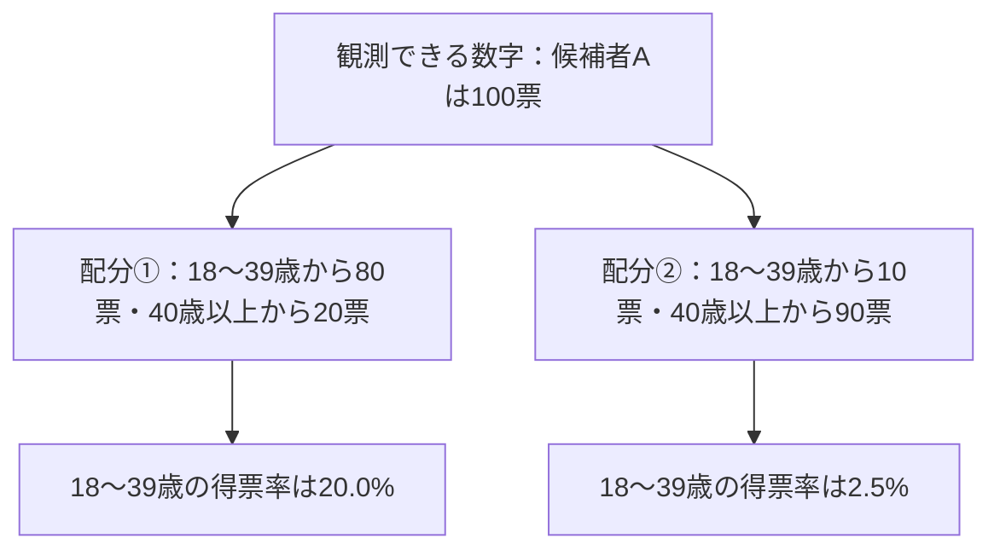

選挙が終わると、候補者の得票数や得票率が公表されます。そこで、こんな疑問が浮かびます。

**「この候補者は若者にどのくらい支持されていたのだろう？」**

得票数は数万票単位で分かるのに、年代別の数字はそのまま読み取れません。なぜでしょうか。

この記事では、2026年10月18日執行の横浜市長選挙の**公式集計**を入口に、後半は**明示的に架空とした小さな投票データ**で考えます。目的は候補者を評価することではなく、**集計データから何を計算でき、何を計算できないか**を見極めることです。

想定読者は、割合・平均・基本的な確率を一度学んだ方です。計量経済学の回帰分析は前提としません。

## 先に結論

- 公表された総得票数から、**有効投票に占める候補者の得票率**は計算できます。
- しかし、総得票数だけでは**年代別に誰が何票投じたか**は決まりません。年代別の投票数まで追加で分かっても、各年代が候補者に何票入れたかが不明なら、一般には答えは一意になりません。
- 出口調査のように、**投票先と年代を同じ回答者について尋ねるデータ**があれば年代別得票率を推定できます。ただし標本誤差や調査上の偏りが残ります。
- さらに「若年層の有効票に占める得票率」と「若者全体の支持率」は、分母も測定方法も異なるものです。

以下で、2通りの投票行動がまったく同じ総得票数を生む例を作ります。

## 1. 実際の選挙結果では何が分かる？

横浜市選挙管理委員会の「令和8年10月18日執行 横浜市長選挙結果表」によると、次の数字が公表されています。

| 指標 | 公表値 |
| --- | ---: |
| 山本理顕氏の得票数 | 49,377票 |
| 全候補者の得票総数（有効投票） | 1,398,358票 |
| 山本氏の得票率（有効投票ベース） | 約3.53% |

出典：[横浜市選挙管理委員会「横浜市長選挙結果表」](https://www.city.yokohama.lg.jp/city-info/senkyo/data/mayor/20261018_shicho.files/R08_shicho_kekka.pdf)（候補者別得票数のページ）。数値は2026年10月21日時点の掲載資料を確認しました。

得票率は、次のように計算できます。

$$
\frac{49,377}{1,398,358}\times100\approx3.53\%
$$

この3.53%は**有効投票のうち山本氏に投じられた票の割合**です。全有権者のうち3.53%が支持したという意味ではありませんし、20代の得票率でもありません。

同じ資料には区別の候補者得票数も載っています。しかし、**「候補者×年代」の票数の表ではありません**。区別データを見ても、誰がどの年代で、誰に投票したかという対応は直接観測できません。

ここから先は実際の横浜市長選の年齢別の内訳を推測するのではなく、**架空の候補者A**と架空の投票者1,000人による例で仕組みを確認します。

## 2. 同じ100票でも、若者の投票行動は真逆になりうる

ある架空の選挙で、有効投票が1,000票あり、候補者Aが100票を獲得したとします。さらに、投票者の年代別の**有効票数まで既知**だと仮定します。

| 年代 | 全候補者への有効票数 |
| --- | ---: |
| 18〜39歳 | 400票 |
| 40歳以上 | 600票 |
| 合計 | 1,000票 |

ここまで情報があっても、候補者Aの100票がどう分かれたかはまだ分かりません。

例えば、次の2つの配分を考えられます。

| | 配分① | 配分② |
| --- | ---: | ---: |
| Aに投じられた18〜39歳の票 | 80票 | 10票 |
| Aに投じられた40歳以上の票 | 20票 | 90票 |
| **Aの総得票数** | **100票** | **100票** |
| 18〜39歳のA得票率（80/400、10/400） | **20.0%** | **2.5%** |
| 40歳以上のA得票率（20/600、90/600） | **3.3%** | **15.0%** |

**どちらも候補者Aの得票数は100票、得票率は10%で一致しています。** しかし配分①では若い年代の得票率のほうが高く、配分②では逆になります。



*図1：2つの配分はすべて架空の例。矢印は「観測値と整合する内訳の候補」を示し、推定された投票行動や因果関係を示すものではありません。*

これがこの記事の核心です。**観測された総数が同じでも、知りたい内訳は1つに定まらない**のです。

## 3. 式で見る：1本の条件だけでは内訳が決まらない

架空の例について、候補者Aへ投じられた18〜39歳の票数を $x$、40歳以上の票数を $y$ とします。

分かっているのは、総得票数100票という条件です。

$$
x+y=100
$$

これだけでは、未知数が2つあるのに独立な等式が1つしかありません。

$$
y=100-x
$$

なので、$x=80$ なら $y=20$、$x=10$ なら $y=90$ です。どちらも同じ観測条件を満たします。

ただし、票数には**0票以上で、各年代の有効票数を超えない**という制約があります。今回は

$$
0\leq x\leq400,\qquad0\leq y\leq600
$$

です。$y=100-x$ を代入すれば、

$$
0\leq x\leq100
$$

となります。つまりこの情報だけでは、18〜39歳からAに入った票数は0〜100票のどれも可能です。

18〜39歳のA得票率を $p_{\mathrm{young}}$ とすると、

$$
p_{\mathrm{young}}=\frac{x}{400}
$$

ですから、その取りうる範囲は

$$
0\%\leq100p_{\mathrm{young}}\leq25\%
$$

となります。

**年代別の有効票数まで知っているのに、若い年代の候補者A得票率を1つの値に確定できません。**

:::details 少し一般化：どこまで絞り込める？

年代を2グループに分け、若い年代の有効票数を $N_Y$、その他の年代の有効票数を $N_O$、候補者Aの総得票数を $V$ とします。$x$ をAへ投じられた若い年代の票数とすると、

$$
0\leq x\leq N_Y,\qquad 0\leq V-x\leq N_O
$$

が必要です。したがって、

$$
\max(0,V-N_O)\leq x\leq\min(V,N_Y)
$$

となります（$0\leq V\leq N_Y+N_O$ とします）。

これは、**集計情報だけから確実に言える上下限**です。今回の数値を代入すると、

$$
\max(0,100-600)=0,\quad\min(100,400)=100
$$

で、若い年代からの得票数は0〜100票です。条件によっては区間が狭くなることもありますが、一般に1点へ定まるとは限りません。

:::

統計学では、このように観測された情報から求めたい値が一意に決まらない問題を、**識別できない（非識別）**と説明します。

## 4. 「区ごとの得票率が分かれば推定できるのでは？」

市全体のデータだけでなく、各区の得票率を見比べたくなるかもしれません。

例えば、仮に「若者の多い区で候補者Aの得票率も高い」という関係が見えたとします。しかし、それだけで**若者自身がAへ多く投票した**とは言えません。

区ごとの傾向は、**地域という集団の特徴**です。年代別の投票行動は、**個々の投票者の特徴**です。若者の多い区で、実際には高い年齢層がAへ投票していた可能性も、集計値だけからは排除できません。

**集計された集団の関係を、そのまま個人の関係だと考えてしまうこと**は、*生態学的誤謬（ecological fallacy）* と呼ばれます。集計データから個人行動を推論する研究分野は *生態学的推論（ecological inference）* と呼ばれます。

注意したいのは、**集計データからの推定がすべて不可能という意味ではない**ことです。地域をまたぐデータに統計モデルや追加の仮定を組み合わせれば、年代別の傾向について推定を試みる研究もあります。ただし、その結果は**仮定の妥当性に依存し**、単純な割り算による確定値とは違います。

## 5. 何を追加で調べればよいのか

必要なのは、**年代と投票先の対応**について新しい情報を得ることです。

その方法の1つが出口調査です。投票を終えた人に年代と投票先を同時に尋ねれば、**回答した投票者の中での年代別得票率**を集計できます。調査対象を適切に選び、回答の偏りを考慮することで、投票者全体の年代別得票率を推定する材料になります。

ただし、出口調査にも限界があります。

- 対象になった投票所・時間帯が一部に限られることがある。
- 回答を断る人と回答する人で傾向が異なる可能性がある。
- 期日前投票者などをどう把握するかが問題になる。
- 年代ごとの回答人数が少なければ推定は不安定になる。

また、出口調査が調べるのは、原則として**投票した人の申告による投票先**です。投票しなかった人を含む全年代の政治的な「支持率」を、出口調査だけでそのまま知ることはできません。

たとえば「18〜39歳の候補者A得票率」と言うとき、**18〜39歳の有効票のうちAに投じられた割合**と定義するなら分母は年代別の有効票数です。一方、「18〜39歳の有権者全体でAを支持する割合」と言うなら、対象者も「支持」の測定方法も異なります。

**「若者の支持率は何％？」と尋ねる前に、何を『支持』と呼び、誰を分母にするのかを決める必要があります。**

## 6. PythonとRで、2つの内訳を再現する

第2節の数値をPythonとRで計算してみます。ここからの計算は**完全に架空の1,000票の例**です。冒頭の横浜市長選挙の公式数値とは混ぜません。

### Python

```python
young_total = 400
older_total = 600
candidate_total = 100

for name, young_votes in [("配分①", 80), ("配分②", 10)]:
    older_votes = candidate_total - young_votes
    print(
        name,
        f"若い年代 {young_votes / young_total * 100:.1f}%",
        f"その他 {older_votes / older_total * 100:.1f}%"
    )
```

計算結果は、

```text
配分① 若い年代 20.0% その他 3.3%
配分② 若い年代 2.5% その他 15.0%
```

となります。

### R

```r
young_total <- 400
older_total <- 600
candidate_total <- 100

for (young_votes in c(80, 10)) {
  older_votes <- candidate_total - young_votes
  cat(sprintf("若い年代 %.1f%% / その他 %.1f%%\n",
              100 * young_votes / young_total,
              100 * older_votes / older_total))
}
```

Rでも同じ割合が出ます。

さらに、実際の横浜市長選挙の**市全体の得票率のみ**を検算する処理と、上限・下限を確かめる処理を含めた完全版コードをGitHubの下書きブランチに置いています。

- [Python完全版](https://github.com/Osino-Niso/econ-data-lab/blob/draft/election-age-aggregate-20261021/code/election-age-aggregate/python.py)
- [R完全版](https://github.com/Osino-Niso/econ-data-lab/blob/draft/election-age-aggregate-20261021/code/election-age-aggregate/r.R)

図1・表・コードで確認したいのは、**計算を精密にするほど年代別得票率が分かるわけではない**という点です。最初から欠けている情報は、同じ数値を計算し直すだけでは補えません。

## 7. 理解確認：同じ結果から何通りの内訳が考えられる？

### 問題1［基本・計算］

架空の選挙で、有効投票が500票あり、候補者Aに投じられた有効票は50票だった。18〜39歳の有効票は200票、40歳以上の有効票は300票だったが、候補者別・年代別の内訳は不明である。

**候補者Aの全体得票率を求め、18〜39歳のA得票率がこの情報だけから1つに決まるか答えよ。**

:::details 解答と考え方

全体得票率は $50/500=10\%$ です。

18〜39歳からAに投じられた票数を $x$ とすると、40歳以上からの票数は $50-x$。$0\leq x\leq50$ が可能なので、若い年代の得票率は $x/200$、つまり **0〜25%** の範囲で変わります。

全体10%という数字だけから18〜39歳のA得票率は1つには決まりません。

:::

### 問題2［誤解を見抜く］

架空の自治体で、「18〜39歳の住民比率が高い地区ほど、候補者Aの得票率も高い」という**地区別の相関**が観察された。ただし、個々の投票者の年代と投票先を結びつけたデータはない。

**「18〜39歳の人はAに投票する傾向が強い」と断定してよいか。理由も説明せよ。**

:::details 解答と考え方

**断定できません。** 住民比率と地区得票率の関係は地区という集団を単位にした相関であり、個々の18〜39歳がどう投票したかを直接示していないからです。若い住民が多い地区に住む40歳以上の投票者がAへ多く投票していた可能性などもあります。

これは生態学的誤謬につながる典型的な推論です。一定の仮定を置いて個人行動を**推定する試み**は可能ですが、集計された相関だけで断定することはできません。

:::

### 問題3［応用・分母］

ある架空の選挙の出口調査で、18〜39歳の回答者が100人、そのうち候補者Aに投票したと答えた人が25人だった。調査方法や回収率、期日前投票者の扱いなどは不明である。

**「18〜39歳の有権者全体の25%がAを支持していた」と結論づけてよいか。**

:::details 解答と考え方

**そのまま結論づけることはできません。** 直接計算できるのは、調査に回答した18〜39歳の**投票者**100人のうちAへ投票したと**答えた**割合 $25/100=25\%$ です。

有権者全体には投票しなかった人も含まれます。また、回答者が18〜39歳の投票者全体を適切に代表しているかどうかも、この情報だけでは分かりません。「Aに投票した」と「Aを支持する」も必ずしも同じ測定ではありません。

:::

## まとめ

今回の問いは、**「選挙の総得票数から、若者の支持率は分かるのか？」** でした。

総得票数から全体の得票率は分かります。しかし、年代別の得票内訳は、一般には**その数字だけでは決まりません**。

小さな架空の例では、候補者Aの得票数が100票と同じでも、18〜39歳のA得票率は20.0%にも2.5%にもなりました。年代別の有効票数まで与えても、内訳を一意に定める情報が足りなかったからです。

集計データは無価値ではありません。**何を直接観測した値か、何を追加の仮定で推定した値か**を区別すれば、活用できる情報は多くあります。

選挙以外にも、自治体別の平均所得から「その地域の若者の所得」を決めつけたり、学校別の成績から「個々の生徒の学習効果」を断定したりすると、似た問題が生じます。

**数字が正しくても、その数字から引き出した結論まで正しいとは限らない。** 今回は、そこを確かめました。

## 関連記事

- [標本数を増やせば内生性は解決する？](https://zenn.dev/econ_data_lab/articles/endogeneity-sample-size) — データを増やしても解消しない別種の問題を扱います。
- [標本分布の期待値・分散・標準偏差は何のため？](https://zenn.dev/econ_data_lab/articles/sampling-distribution-moments) — 標本による推定のばらつきを考える記事です。

## 参考資料

1. [横浜市選挙管理委員会「横浜市長選挙（令和8年10月18日執行）」](https://www.city.yokohama.lg.jp/city-info/senkyo/data/mayor/20261018_shicho.html) — 得票数・投票結果の一次資料。リンク先の「横浜市長選挙結果表」を参照。
2. [A. A. Schuessler (1999), "Ecological inference," PNAS](https://pmc.ncbi.nlm.nih.gov/articles/PMC33746/) — 集計値と個人の投票行動を結びつける際の非識別・推論上の問題を説明。
3. [岡山理科大学「なぜこんなにも早く当確が出るの？ ～選挙の出口予想の仕組み」](https://www.mgt.ous.ac.jp/about/management/lecture/lecture_d-02/) — 出口調査と標本誤差の考え方を紹介。
