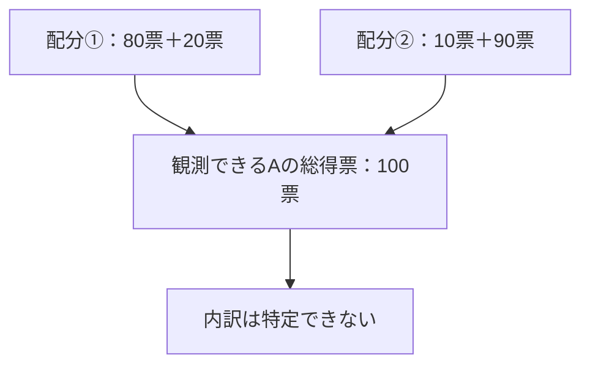

開票結果を見ると、候補者ごとの得票数や得票率は分かります。では、こんな問いには答えられるでしょうか。

**「その候補者には、若い世代からどれくらい票が入ったのだろう？」**

全体では何票を獲得したか分かっていても、その票をどの年代の人が投じたかまでは見えていません。なおタイトルの「支持率」は日常的な疑問の言い方です。本文でまず考えるのは、**その年代が投じた有効票に占める候補者の得票率**であり、世論調査で聞く**支持意向の割合**とは区別します。だから「総得票率が分かるなら、年代別の得票率も分かるはず」と考えると、途中で情報が足りなくなります。

この記事では、まず**架空の1,000票**を使ってその不足を確かめ、次に**2026年10月18日の横浜市長選挙の公式結果**へ戻ります。分析するのは候補者の優劣ではなく、**集計表から何が分かり、何が分からないか**です。

読み終えたら、開票結果に年代別の情報がないときに、**どこまでが計算可能で、どこからが推測なのか**を説明できるはずです。想定読者は割合と百分率を学んだ方で、回帰分析の知識は必要ありません。

## 先に結論

結論は、**全体の得票数だけでは、年代別の得票率は決まらない**ということです。

全体の得票率は計算できても、その票がどの年代から来たのかは別の情報です。年代別の有効票数を追加しても、候補者への票の配分が不明なら一意に決まらないことがあります。

出口調査は足りない情報を補う手段ですが、調査には不確実性があります。また、「投票した若者のうち何％がその候補を選んだか」と「若者全体の何％が支持したか」も別の問いです。

以下で、2通りの投票行動がまったく同じ総得票数を生む例を作ります。

## 1. まず、架空の1,000票で考える

架空の選挙を考えます。有効投票は1,000票で、候補者Aは100票を獲得したとします。さらに実際の開票結果では通常そのまま得られない、**年代ごとの有効票数まで分かっている**という、あえて情報の多い設定にします。

ここでの「18〜39歳」「40歳以上」は説明のために置いた区分で、どちらも**実際に有効票を投じた人の票数**です。人口や有権者数ではありません。

| 年代 | 全候補者への有効票数 |
| --- | ---: |
| 18〜39歳 | 400票 |
| 40歳以上 | 600票 |
| 合計 | 1,000票 |

ここまで情報があっても、候補者Aの100票がどう分かれたかはまだ分かりません。

例えば、次の2つの配分を考えられます。A以外の候補者への有効票も合わせて考えると、配分①は次のようになります。

| 配分① | Aへの票 | A以外への票 | 有効票計 |
| --- | ---: | ---: | ---: |
| 18〜39歳 | 80 | 320 | 400 |
| 40歳以上 | 20 | 580 | 600 |
| **合計** | **100** | **900** | **1,000** |

配分②では、18〜39歳のAへの票が10票、40歳以上のAへの票が90票になります。その場合、A以外への票はそれぞれ390票と510票です。**年代別の有効票数とAの総得票数は、どちらの配分でも同じ**です。

| | 配分① | 配分② |
| --- | ---: | ---: |
| Aに投じられた18〜39歳の票 | 80票 | 10票 |
| Aに投じられた40歳以上の票 | 20票 | 90票 |
| **Aの総得票数** | **100票** | **100票** |
| 18〜39歳のA得票率（80/400、10/400） | **20.0%** | **2.5%** |
| 40歳以上のA得票率（20/600、90/600） | **3.3%** | **15.0%** |

**どちらも候補者Aの得票数は100票、得票率は10%で一致しています。** しかし配分①では若い年代の得票率のほうが高く、配分②では逆になります。

全体の10%は、年代別の得票率を単純平均したものではありません。各年代の**有効票の構成比を重みとする加重平均**です。例えば配分①では、

$
\frac{400}{1000}\times 20\%+\frac{600}{1000}\times\frac{20}{600}\times100\%=10\%
$

となります。配分②でも同じ10%になります。「全体の割合は知っているが、その中身は知らない」という状況がここに表れています。



*図1：異なる年代別の配分が同じ総得票数になる。架空の数値の集計を表す図であり、投票行動の因果図ではありません。*

これがこの記事の核心です。**観測された総数が同じでも、知りたい内訳は1つに定まらない**のです。

## 2. 式で見る：総数が同じでも内訳は決まらない

架空の例について、候補者Aへ投じられた18〜39歳の票数を $x$、40歳以上の票数を $y$ とします。

分かっているのは、総得票数100票という条件です。

$$
x+y=100
$$

これだけでは、未知数が2つあるのに独立な等式が1つしかありません。

$$
y=100-x
$$

なので、$x=80$ なら $y=20$、$x=10$ なら $y=90$ です。どちらも同じ観測条件を満たします。

ただし、票数には**0票以上で、各年代の有効票数を超えない**という制約があります。今回は

$$
0\leq x\leq400,\qquad0\leq y\leq600
$$

です。$y=100-x$ を代入すれば、

$$
0\leq x\leq100
$$

となります。$x$ は票数なので整数です。0票ならAの100票はすべて40歳以上から、100票ならすべて18〜39歳から来たことになり、どちらも400票・600票という年代別の有効票数を超えません。**0から100までの整数は、すべて実現可能**です。

18〜39歳のA得票率を $p_{\mathrm{young}}$ とすると、

$$
p_{\mathrm{young}}=\frac{x}{400}
$$

ですから、その取りうる範囲は

$$
0\leq p_{\mathrm{young}}\leq0.25
$$

となります。百分率では **0〜25%** です。

**年代別の有効票数まで知っているのに、若い年代の候補者A得票率を1つの値に確定できません。**

:::details 少し一般化：どこまで絞り込める？

年代を2グループに分け、若い年代の有効票数を $N_Y$、その他の年代の有効票数を $N_O$、候補者Aの総得票数を $V$ とします。$x$ をAへ投じられた若い年代の票数とすると、

$$
0\leq x\leq N_Y,\qquad 0\leq V-x\leq N_O
$$

が必要です。したがって、

$$
\max(0,V-N_O)\leq x\leq\min(V,N_Y)
$$

となります（$0\leq V\leq N_Y+N_O$ とします）。

これは、**集計情報だけから確実に言える上下限**です。今回の数値を代入すると、

$$
\max(0,100-600)=0,\quad\min(100,400)=100
$$

で、若い年代からの得票数は0〜100票です。条件によっては区間が狭くなることもありますが、一般に1点へ定まるとは限りません。

:::

統計学では、このように観測された情報から求めたい値が一意に決まらない問題を、**識別できない（非識別）**と説明します。

## 3. 実際の横浜市長選挙の結果に戻る

では、架空例で見た問題を、実際の開票結果に当てはめてみます。横浜市選挙管理委員会の「令和8年10月18日執行 横浜市長選挙結果表」には、候補者別の得票数が掲載されています。

ここでは**計算対象として候補者のうち1人を選び**、山本理顕氏の票数を使います。特定の候補者について政治的な評価をするためではなく、公開された集計表から何が計算できるかを確かめるためです。

| 指標 | 公表値 |
| --- | ---: |
| 山本理顕氏の得票数 | 49,377票 |
| 全候補者の得票総数（有効投票） | 1,398,358票 |
| 投票者数（無効票などを含む） | 1,416,233人 |
| 山本氏の得票率（有効投票ベース） | 約3.53% |

出典：[横浜市選挙管理委員会「横浜市長選挙結果表」](https://www.city.yokohama.lg.jp/city-info/senkyo/data/mayor/20261018_shicho.files/R08_shicho_kekka.pdf)（得票数は資料の2ページ、投票者数は1ページ）。2026年10月21日に確認した確定値です。

「投票者数」は投票した人の人数ですが、「候補者の得票総数」は有効票の合計です。**得票率の分母は後者**です。無効票などを含む投票者数を分母にすると、違う割合になります。

得票率は、次のように計算できます。

$$
\frac{49,377}{1,398,358}\times100\approx3.53\%
$$

この3.53%は**有効投票のうち山本氏に投じられた票の割合**です。全有権者のうち3.53%が支持したという意味ではありませんし、20代の得票率でもありません。

同じ資料には区別の候補者得票数も載っています。しかし、**「候補者×年代」の票数の表ではありません**。区別データを見ても、誰がどの年代で、誰に投票したかという対応は直接観測できません。

この結果表は候補者別・区別の集計であり、先ほどの架空例で未知だった**「どの年代がどの候補者を選んだか」**という内訳までは示していません。

## 4. 区別の数字だけで年代別の投票先は分かる？

市全体のデータだけでなく、各区の得票率を見比べたくなるかもしれません。

例えば、仮に「若者の多い区で候補者Aの得票率も高い」という関係が見えたとします。しかし、それだけで**若者自身がAへ多く投票した**とは言えません。

区ごとの傾向は、**地域という集団の特徴**です。年代別の投票行動は、**個々の投票者の特徴**です。そもそも住民の年代構成と、実際に投票した人の年代構成も一致するとは限りません。若者の多い区で、実際には高い年齢層がAへ投票していた可能性も、集計値だけからは排除できません。

**集計された集団の関係を、そのまま個人の関係だと決めつけること**は、*生態学的誤謬（ecological fallacy）* と呼ばれます。一方、集計データを使って個人レベルの行動を推論する研究は *生態学的推論（ecological inference）* と呼ばれます。

前節までの**非識別**は「同じ集計結果に合う内訳が複数ある」というデータ上の問題です。ここでの**生態学的誤謬**は、その情報不足や集計単位の違いを無視して「若者自身が投票した」と**断定してしまう推論上の問題**です。混同しないようにしましょう。

注意したいのは、**集計データからの推定がすべて不可能という意味ではない**ことです。地域をまたぐデータに統計モデルや追加の仮定を組み合わせれば、年代別の傾向について推定を試みる研究もあります。ただし、その結果は**仮定の妥当性に依存し**、単純な割り算による確定値とは違います。

## 5. 出口調査で何が増えるのか

必要なのは、**年代と投票先の対応**について新しい情報を得ることです。

その方法の1つが出口調査です。投票を終えた人に年代と投票先を同時に尋ねれば、**回答した投票者の中での年代別得票率**を集計できます。適切な調査設計と補正を行えば、投票者全体の年代別得票率を**推定する手掛かり**になります。ただし、回答者の割合がそのまま全投票者の割合と一致する保証はありません。標本抽出による偶然の誤差に加え、非回答、投票先の自己申告、調査の対象範囲に由来する系統的な偏りも考えられます。

ただし、出口調査にも限界があります。

- 対象になった投票所・時間帯が一部に限られることがある。
- 回答を断る人と回答する人で傾向が異なる可能性がある。
- 期日前投票者などをどう把握するかが問題になる。
- 年代ごとの回答人数が少なければ推定は不安定になる。

また、出口調査が調べるのは、原則として**投票した人の申告による投票先**です。投票しなかった人を含む全年代の政治的な「支持率」を、出口調査だけでそのまま知ることはできません。

たとえば「18〜39歳の候補者A得票率」と言うとき、**18〜39歳の有効票のうちAに投じられた割合**と定義するなら分母は年代別の有効票数です。一方、「18〜39歳の有権者全体でAを支持する割合」と言うなら、対象者も「支持」の測定方法も異なります。

**「若者の支持率は何％？」と尋ねる前に、何を『支持』と呼び、誰を分母にするのかを決める必要があります。**

## 6. PythonとRで2つの内訳を再現する

第1節の数値をPythonとRで計算してみます。ここからの計算は**完全に架空の1,000票の例**です。第3節の横浜市長選挙の公式数値とは混ぜません。

### Python

```python
young_total = 400
older_total = 600
candidate_total = 100

for name, young_votes in [("配分①", 80), ("配分②", 10)]:
    older_votes = candidate_total - young_votes
    print(
        name,
        f"若い年代 {young_votes / young_total * 100:.1f}%",
        f"その他 {older_votes / older_total * 100:.1f}%"
    )
```

計算結果は、

```text
配分① 若い年代 20.0% その他 3.3%
配分② 若い年代 2.5% その他 15.0%
```

となります。

### R

```r
young_total <- 400
older_total <- 600
candidate_total <- 100

for (young_votes in c(80, 10)) {
  older_votes <- candidate_total - young_votes
  cat(sprintf("若い年代 %.1f%% / その他 %.1f%%\n",
              100 * young_votes / young_total,
              100 * older_votes / older_total))
}
```

Rでも同じ割合が出ます。

完全版コードには、横浜市長選挙の**市全体の得票率**の検算と、架空例の上下限・配分の整合性を調べる処理も入れています。いずれもGitHubの `main` にあり、記事の下書きと一緒に更新されます。

- [Python完全版](https://github.com/Osino-Niso/econ-data-lab/blob/main/code/election-age-aggregate/python.py)
- [R完全版](https://github.com/Osino-Niso/econ-data-lab/blob/main/code/election-age-aggregate/r.R)

図1・表・コードで確認したいのは、**計算を精密にするほど年代別得票率が分かるわけではない**という点です。最初から欠けている情報は、同じ数値を計算し直すだけでは補えません。

## 7. 理解確認：同じ結果から何通りの内訳が考えられる？

### 問題1［基本・計算］

架空の選挙で、有効投票が500票あり、候補者Aに投じられた有効票は50票だった。18〜39歳の有効票は200票、40歳以上の有効票は300票だったが、候補者別・年代別の内訳は不明である。

**候補者Aの全体得票率を求めよ。また、18〜39歳からAへ投じられた票数の下限と上限を求め、若い年代のA得票率が一意に決まるか説明せよ。**

:::details 解答と考え方

全体得票率は $50/500=10\%$ です。

18〜39歳からAに投じられた票数を $x$ とすると、40歳以上からの票数は $50-x$。$0\leq x\leq50$ が可能なので、若い年代の得票率は $x/200$、つまり **0〜25%** の範囲で変わります。

全体10%という数字だけから18〜39歳のA得票率は1つには決まりません。

:::

### 問題2［誤解を見抜く］

架空の自治体で、「18〜39歳の住民比率が高い地区ほど、候補者Aの得票率も高い」という**地区別の相関**が観察された。ただし、個々の投票者の年代と投票先を結びつけたデータはない。

**「18〜39歳の人はAに投票する傾向が強い」と断定してよいか。理由も説明せよ。**

:::details 解答と考え方

**断定できません。** 住民比率と地区得票率の関係は地区という集団を単位にした相関であり、個々の18〜39歳がどう投票したかを直接示していないからです。若い住民が多い地区に住む40歳以上の投票者がAへ多く投票していた可能性などもあります。

これは生態学的誤謬につながる典型的な推論です。一定の仮定を置いて個人行動を**推定する試み**は可能ですが、集計された相関だけで断定することはできません。

:::

### 問題3［応用・分母］

ある架空の選挙の出口調査で、18〜39歳の回答者が100人、そのうち候補者Aに投票したと答えた人が25人だった。調査方法や回収率、期日前投票者の扱いなどは不明である。

**「18〜39歳の有権者全体の25%がAを支持していた」と結論づけてよいか。**

:::details 解答と考え方

**そのまま結論づけることはできません。** 直接計算できるのは、調査に回答した18〜39歳の**投票者**100人のうちAへ投票したと**答えた**割合 $25/100=25\%$ です。

有権者全体には投票しなかった人も含まれます。また、回答者が18〜39歳の投票者全体を適切に代表しているかどうかも、この情報だけでは分かりません。「Aに投票した」と「Aを支持する」も必ずしも同じ測定ではありません。

:::

## まとめ

今回の問いは、**「選挙の総得票数から、若者の支持率は分かるのか？」** でした。

全体の得票数から全体の得票率は計算できます。しかし、**その票をどの年代の人が投じたか**は、総数だけでは一意に決まりません。架空の例でも、同じ100票から若い年代の得票率20.0%と2.5%の両方が生じました。

選挙データに限らず、集計表を読む際には、少なくとも次の3点を確認したいところです。

1. **分母は誰か。** 有効票、投票者、有権者、住民は異なる。
2. **観測している単位は何か。** 市全体・区別の集計と、個人の年代・投票先の対応は異なる。
3. **計算値か推定値か。** 推定なら、追加の仮定・標本誤差・偏りを確認する。

集計情報にも価値はあります。ただし、**正しい数字から、観測していない内訳まで断定できるわけではない**という点を忘れないようにしたいと思います。

## 関連記事

- [標本数を増やせば内生性は解決する？](https://zenn.dev/econ_data_lab/articles/endogeneity-sample-size) — データを増やしても解消しない別種の問題を扱います。
- [標本分布の期待値・分散・標準偏差は何のため？](https://zenn.dev/econ_data_lab/articles/sampling-distribution-moments) — 標本による推定のばらつきを考える記事です。

## 参考資料

1. [横浜市選挙管理委員会「横浜市長選挙（令和8年10月18日執行）」](https://www.city.yokohama.lg.jp/city-info/senkyo/data/mayor/20261018_shicho.html) — 得票数・投票結果の一次資料。リンク先の「横浜市長選挙結果表」を参照。
2. [David A. Freedman (1999), "Ecological Inference and the Ecological Fallacy"（UC Berkeley公開PDF）](https://statistics.berkeley.edu/sites/default/files/tech-reports/549.pdf) — 集団で見える関係から個人の行動を断定できない理由。
3. [Simone Zhang (2017), "Ecological Inference"（Princeton公開講義資料PDF）](https://bstewart.scholar.princeton.edu/document/83) — 生態学的推論、生態学的誤謬、観測不能な内訳という課題の導入。
4. [岡山理科大学「なぜこんなにも早く当確が出るの？ ～選挙の出口予想の仕組み」](https://www.mgt.ous.ac.jp/about/management/lecture/lecture_d-02/) — 出口調査と標本誤差の考え方を紹介。
