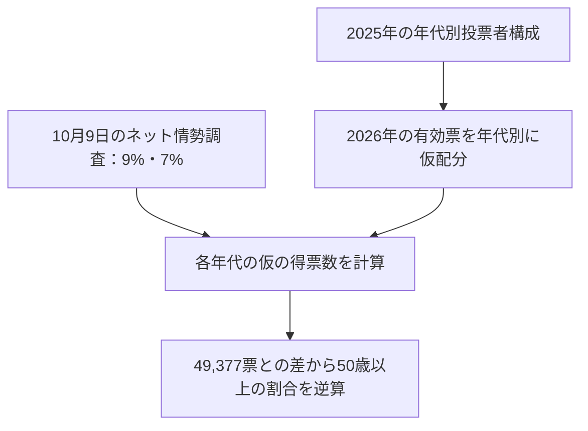

2026年10月18日の横浜市長選挙で、山本理顕氏の得票数は**49,377票**、有効投票に占める得票率は**約3.53%**でした。

その9日前、選挙ドットコム・JX通信社の**10月9日のネット情勢調査**では、投票先を決めていた回答者のうち、山本氏を選んだ割合は**18〜39歳で9%、40代で7%**と表示されています。

一見すると、若い年代では比較的高い割合で山本氏を選んでいるように見えます。それなのに、開票後の市全体の得票率は3.53%でした。

**この2つの数字は、そもそも両立するのでしょうか。**

この問いを、横浜市の選挙管理委員会が公表した年代別投票者数と、実際の開票結果を使って計算してみます。単に「調査と結果は違う」と説明するのではなく、**どんな年代別の票数なら49,377票になるのか**を逆算するのが目的です。

なお、最初に一つだけ区別します。**10月9日の資料は、投票前のネット情勢調査であって、投票後の出口調査ではありません。** この記事の「9%」「7%」は、実際の年代別得票率ではなく、仮定を置いた試算の入力値として扱います。

## 先に結論

**「若い年代で9%、40代で7%」という割合は、実際の49,377票と数字の上では両立します。**

2025年の横浜市長選挙で観測された年代別の**投票者構成**を、2026年の有効投票にも仮に当てはめると、山本氏の票数は次のように再構成できます。

| 年代 | 仮の得票数 | 仮定した年代別得票率 |
| --- | ---: | ---: |
| 18〜39歳 | 約26,600票 | 9% |
| 40〜49歳 | 約15,200票 | 7% |
| 50歳以上 | 約7,600票 | **約0.86%（逆算値）** |
| **合計** | **49,377票** | 市全体では約3.53% |

これは**実際の年代別の得票数を推定したものではなく、両立するシナリオを1つ作った計算**です。

しかも、前提を少し変えるだけで、この組み合わせは成り立たなくなる場合もあります。そこまで確かめます。

## 1. 使う数字は3種類ある

### ① 10月9日の事前ネット調査

読者が公開情報として確認できる資料には、選挙ドットコム・JX通信社のネット情勢調査を再掲した[年代別の投票先の図](https://okatakashi.net/archives/15485)があります。

この図を読むと、山本氏を選んだ割合は次のとおりです。

| 調査時の年代 | 山本氏を選んだ割合 |
| --- | ---: |
| 18〜39歳 | 9% |
| 40代 | 7% |

出典は**2026年10月9日のネット情勢調査**で、図には**「未定を除く」**と明記されています。図中の「n=1,095」は調査全体の標本数として示されており、**各年代で何人が回答し、そのうち何人が投票先を決めていたかは、この図からは分かりません**。

したがって、9%と7%の差が統計的に明確か、誤差範囲がどれくらいかは、この図だけでは判断できません。公表されているのは、あくまでも**調査時点の回答割合の丸め値**です。

### ② 2026年10月18日の公式開票結果

[横浜市選挙管理委員会の確定結果](https://www.city.yokohama.lg.jp/city-info/senkyo/data/mayor/20261018_shicho.html)では、次の数字が分かります。

| 指標 | 2026年10月18日 |
| --- | ---: |
| 当日有権者数 | 3,108,312人 |
| 投票者数 | 1,416,233人 |
| 有効投票の総数 | 1,398,358票 |
| 山本氏の得票数 | **49,377票** |

実際の得票率は、

$$
\frac{49,377}{1,398,358}\times100
\approx3.53\%
$$

です。**有権者、投票者、有効票の数は同じではありません。** この3.53%の分母は、全有権者でも全人口でもなく、有効投票の総数です。

### ③ 年代別の投票者数：使えるのは2025年の実績

横浜市は[2026年3月末の年齢別住民基本台帳人口](https://www.city.yokohama.lg.jp/city-info/yokohamashi/tokei-chosa/portal/jinko/nenrei/juki/r8nen.html)を公開しています。ただし、人口には**選挙権のない人**も含まれ、人口だけでは投票者数を求められません。

そこで今回は、比較対象として、横浜市選管の[2025年8月3日執行の市長選挙に関する調査資料（「横浜市長選挙の年代別投票率」、資料Ⅱ-1-1）](https://www.city.yokohama.lg.jp/city-info/senkyo/data/survey/survey-r07.files/04_shiryou.pdf)を利用します。

この**2025年の選挙**では、次のように集計されています。

| 年代 | 当日有権者数 | 投票者数 |
| --- | ---: | ---: |
| 18〜19歳 | 65,101 | 22,146 |
| 20〜24歳 | 186,216 | 49,101 |
| 25〜29歳 | 200,456 | 56,388 |
| 30〜34歳 | 192,334 | 68,476 |
| 35〜39歳 | 197,405 | 77,019 |
| **18〜39歳 合計** | **841,512** | **273,130** |
| 40〜44歳 | 224,980 | 90,537 |
| 45〜49歳 | 258,817 | 109,988 |
| **40〜49歳 合計** | **483,797** | **200,525** |
| 全年代合計 | 3,103,689 | 1,292,363 |

**表は2025年の数字です。2026年の年代別投票者数として読み替えてはいけません。** 後で行う計算には、「投票者の年代構成は両年で変わらなかった」という強い仮定を置きます。

## 2. 若い有権者の9%を掛けると、すでに実得票を超える

最初は、わざと間違えやすい計算をしてみます。

2025年の18〜39歳の**有権者**841,512人に、ネット情勢調査の9%をそのまま掛けると、

$$
841,512\times0.09\approx75,736\text{票}
$$

です。

山本氏が2026年に実際に獲得した49,377票を**約26,400票も上回ります**。

もし9%が「18〜39歳の有権者全員のうち、選挙当日に山本氏へ有効票を投じた割合」を意味し、しかも2025年の有権者数を2026年にも使えると仮定するなら、この計算は整合しません。

しかし、調査の9%はそのような割合ではありません。**未定者を除いた事前ネット調査の回答割合**です。

何より、**有権者全員が投票するわけではありません**。2025年には、18〜39歳の有権者841,512人のうち、投票したのは273,130人でした。この年代の投票率は、

$$
\frac{273,130}{841,512}\times100\approx32.5\%
$$

です。

同じ9%を、仮にこの**投票者**へ掛ければ、

$$
273,130\times0.09\approx24,582\text{票}
$$

となります。

もちろん、これは2025年の投票者数と2026年の調査割合を混ぜた**説明用の掛け算**で、2026年の得票数を推定したものではありません。

それでも、ここには重要な違いがあります。**「9%」だけで票数は決まらず、分母を有権者とするか投票者とするかで計算結果が3倍以上変わる**のです。

## 3. 2026年の有効投票に、2025年の年代構成を当てはめてみる

では、2026年の実際の有効投票1,398,358票を使ってみます。ただし、2026年の年代別の有効票数は、この段階では確認できていません。

代わりに、2025年の投票者に占める年代別割合を計算します。

$$
w_{\mathrm{young}}
=\frac{273,130}{1,292,363}\approx0.2113
$$

$$
w_{\mathrm{40s}}
=\frac{200,525}{1,292,363}\approx0.1552
$$

**2026年の有効票でもこの構成比が同じ**と仮定します。厳密には、投票者の年代構成だけでなく、年代別の無効票の割合にも違いがないとみなす簡略化です。

その結果、2026年の有効票の配分は次のようになります。

| 年代 | 2026年の有効票の仮配分 |
| --- | ---: |
| 18〜39歳 | 約295,531票 |
| 40〜49歳 | 約216,971票 |
| 50歳以上 | 約885,856票 |
| **合計** | **1,398,358票** |

ここで、ネット情勢調査にあった9%、7%が**投票日にもそのまま成り立った**と、さらに仮定します。

18〜39歳からは、

$$
295,531\times0.09\approx26,598\text{票}
$$

40代からは、

$$
216,971\times0.07\approx15,188\text{票}
$$

です。

すると、この2つの年代からの票は**合計約41,786票**になります。

実際の49,377票との差を取ると、

$$
49,377-26,598-15,188\approx7,591\text{票}
$$

です。

残りの50歳以上の有効票を約885,856票と置いていますから、必要な得票率は、

$$
\frac{7,591}{885,856}\times100
\approx0.86\%
$$

となります。

**50歳以上で約0.86%だった、という仮定を追加すれば、9%・7%という事前調査の数値と49,377票は、計算上ぴったり両立します。**

ただし、**実際に50歳以上の得票率が0.86%だったことを示す証拠ではありません。** これは、ほかの仮定から逆算した*残差*です。

## 4. なぜ「若い年代で高め」と「全体3.53%」が両立するのか

全体の得票率は、年代別得票率の**有効票数で重み付けした平均**です。

$$
p=w_Yp_Y+w_{40}p_{40}+(1-w_Y-w_{40})p_{50+}
$$

ここで、$p$ は市全体の得票率、$p_Y$・$p_{40}$・$p_{50+}$ はそれぞれ18〜39歳・40代・50歳以上の年代内得票率、$w_Y$ と $w_{40}$ は有効票に占める各年代の割合です。

今回の仮定では、

$$
p\approx
0.2113\times0.09
+0.1552\times0.07
+0.6335\times0.00857
\approx0.03531
$$

となります。

右辺の各項は、**市全体の有効票に対して、その年代から来る票が占める割合**です。

ここで興味深いのは、このシナリオだと山本氏の全得票のうち、

$$
\frac{26,598}{49,377}\times100\approx53.9\%
$$

が18〜39歳から来た計算になることです。

これは**山本氏の実際の支持者の過半数が若者だったという発見ではありません**。その割合が過半数になる**一つの整合的な票の内訳を構成できた**という発見です。

「若い年代で比較的高い投票割合」と「支持者のうち若い年代が何割か」は、逆向きの条件付き確率です。両者を結びつけるのが、年代別の投票者構成という重みです。



*図：観測時点・母集団の異なる情報を、仮定を置いて結びつける計算の流れ。因果関係や実際の投票先を示す図ではありません。*

## 5. 仮定が少し変わると、整合しなくなることもある

ここまでの試算は、2025年の年代構成が2026年にも当てはまるという前提に依存しています。

そこで、2026年の有効票に占める**18〜39歳と40代の割合を、一緒に20%小さく／大きくした**ケースを試します。各年代の「山本氏を選ぶ割合」は9%と7%に固定します。

| 18〜49歳の有効票構成比 | 18〜39歳からの仮票数 | 40代からの仮票数 | 49,377票に必要な50歳以上の率 |
| --- | ---: | ---: | ---: |
| 基準の80% | 約21,278 | 約12,150 | 約1.61% |
| 基準どおり | 約26,598 | 約15,188 | 約0.86% |
| 基準の120% | 約31,917 | 約18,226 | **負の値（不可能）** |

最後の行では、18〜39歳と40代の仮票数だけで**49,377票を超えてしまいます**。50歳以上の票数をマイナスにすることはできないので、その組み合わせは実際の総得票と両立しません。

つまり、**「若い年代で9%、40代で7%」という2つの割合が正しいと仮定しても、投票者の年代構成次第で結果との整合性が変わる**のです。

ここで初めて、単なる「データ不足」という話を超えて、実得票数が**仮説に制約を与える**ことが分かります。

## 6. これは山本氏の実際の年代別得票率を確かめたのか

答えは、**まだ確かめていません**。

この検算が成り立つには、少なくとも次の条件が必要です。

1. 2025年と2026年で、有効票に占める各年代の割合がほとんど変わらない。
2. 10月9日のネット情勢調査で「未定を除く」9%・7%という値が、選挙当日の年代内得票率に近い。
3. ネット調査の標本構成・回答傾向に、年代内得票率を大きくゆがめる偏りがない。
4. 表示された百分率の丸めや標本誤差を無視できる程度の概算でよい。

いずれも、今回の開票結果から保証されません。

特に、**調査対象の一部である「投票先を決めていたネット回答者」と、選挙当日の全有効投票者は同じ集団ではありません。** 「9%」を真の得票率として採用したわけではなく、もしそうなら実際の総得票と整合するかを試しただけです。

また、2025年の選挙と2026年の選挙は別の選挙です。2026年の有効票に占める年代別割合を直接調べられれば、今回の仮定を一つ減らせます。

### 生態学的推論とのつながり

市全体ではなく、横浜市の各区の開票結果と年代別投票者構成が得られたとします。

区 $i$ について、若い年代がその区の有効票に占める割合を $w_i$、その年代の候補者得票率を $a_i$、それ以外の得票率を $b_i$、区全体の得票率を $p_i$ とすれば、

$$
p_i=w_ia_i+(1-w_i)b_i
$$

が成立します。

観測される $p_i$ と $w_i$ から、未知の $a_i$ と $b_i$ を推定しようとする考え方が**生態学的推論**です。ただし、各区について未知数が複数あるため、そのままでは一意に解けません。モデルや追加の仮定が必要です。

**今回行ったのは生態学的推論による実測値の推定ではなく、全市のデータに年代構成と事前調査の割合を仮定として入れ、実得票数と両立する条件を調べる感度分析**です。この違いは重要です。

## 7. Python・Rで計算を再現する

Pythonでは、必要な部分は次の式で書けます。

```python
valid_2026 = 1398358
actual = 49377
voters_2025 = 1292363
young_2025 = 273130
forties_2025 = 200525

young_valid = valid_2026 * young_2025 / voters_2025
forties_valid = valid_2026 * forties_2025 / voters_2025
older_valid = valid_2026 - young_valid - forties_valid

young_votes = young_valid * 0.09
forties_votes = forties_valid * 0.07
required_older_rate = (actual - young_votes - forties_votes) / older_valid

print(round(young_votes), round(forties_votes))
print(f"{required_older_rate * 100:.2f}%")
# 26598 15188
# 0.86%
```

Rでも同じ計算ができます。

```r
valid_2026 <- 1398358
actual <- 49377
voters_2025 <- 1292363
young_2025 <- 273130
forties_2025 <- 200525

young_valid <- valid_2026 * young_2025 / voters_2025
forties_valid <- valid_2026 * forties_2025 / voters_2025
older_valid <- valid_2026 - young_valid - forties_valid

young_votes <- young_valid * 0.09
forties_votes <- forties_valid * 0.07
required_older_rate <- (actual - young_votes - forties_votes) / older_valid

cat(round(young_votes), round(forties_votes), "\n")
cat(sprintf("%.2f%%\n", required_older_rate * 100))
```

感度分析と数値チェックまで実行できる完全版も用意しました。

- [Python完全版](https://github.com/Osino-Niso/econ-data-lab/blob/main/code/election-age-aggregate/python.py)
- [R完全版](https://github.com/Osino-Niso/econ-data-lab/blob/main/code/election-age-aggregate/r.R)

いずれも、**2025年の観測値／2026年の確定値／事前調査の表示値／分析者が置いた仮定**を別の変数として扱っています。

## 8. 確認問題

### 問題1：分母を間違えると何が起きる？

ある自治体で、18〜39歳の有権者が10万人、同年代の投票者が4万人いた。事前調査では、投票先を決めていた同年代の回答者の12%が候補者Aを選んだ。

**10万人×12%=1万2,000票を、実際にAへ投じられた票数だと考えてよいか。** 考えられない理由を説明し、仮に投票者全体の12%がAへ投票したなら何票になるか計算せよ。

:::details 解答と考え方

実際の票数と考えてはいけません。10万人は有権者数で、実際に投票したのは4万人です。さらに事前調査の12%は、投票日当日の割合と同じとは限りません。

仮に**投票者4万人の12%**がAに投票したなら、

$$
40,000\times0.12=4,800\text{票}
$$

です。これはあくまで仮定に基づく票数です。

:::

### 問題2：票数の整合性を検算する

ある選挙の有効票が10万票、候補者Aの実際の得票が3,000票だった。若い年代の有効票が2万票、40代が2万票、50歳以上が6万票であると仮定する。さらに若い年代のA得票率を8%、40代を5%と仮定する。

**50歳以上のA得票率は何%であれば実得票と一致するか。**

:::details 解答と考え方

若い年代からは $20,000\times0.08=1,600$ 票、40代からは $20,000\times0.05=1,000$ 票です。残りは

$$
3,000-1,600-1,000=400\text{票}
$$

ですから、50歳以上の得票率は、

$$
\frac{400}{60,000}\times100\approx0.67\%
$$

です。ここで計算したのは**両立に必要な率**で、実際にそのような投票行動があった証拠ではありません。

:::

### 問題3：モデルの仮定が破れた場合

ある選挙の有効票が1万票で、候補者Aの実得票は300票だったとする。18〜39歳が有効票の30%、40代が20%、50歳以上が50%を占めると仮定する。さらに、18〜39歳のA得票率を8%、40代を5%と固定する。

**この条件をすべて満たす年代別得票の配分は存在するか。理由を票数で説明せよ。**

:::details 解答と考え方

若い年代のA票は $10,000\times0.30\times0.08=240$ 票、40代のA票は $10,000\times0.20\times0.05=100$ 票です。

この2つだけで340票になり、候補者Aの**実得票300票を超えます**。

50歳以上からの票数を負の40票にすることはできないため、**すべての条件を同時に満たす配分は存在しません**。どれかの仮定を見直す必要があります。

:::

## まとめ

投票前のネット情勢調査では、山本氏を選んだ回答者の割合が18〜39歳で9%、40代で7%と示されていました。一方、実際の市長選での得票率は約3.53%でした。

**この2つの数字は、必ずしも矛盾しません。**

2025年の年代別投票者構成が2026年の有効票にも当てはまると仮定すれば、若い年代と40代の割合に9%・7%を当てはめ、50歳以上を約0.86%と置くことで、実際の49,377票と整合する内訳を作れます。

しかし、年代構成の仮定を変えると、同じ9%・7%では総得票数を超える場合もあります。

今回、選挙データから得られたのは「山本氏の実際の若年層得票率」ではなく、**その率について考えた仮説が、実際の得票数と両立する条件**です。

次に必要なのは2026年の年代別投票者構成や、投票後の年代別投票先を示す調査です。新しいデータが得られれば、仮定を減らしながら検証を進められます。

## 関連記事

- [標本分布の期待値・分散・標準偏差は何のため？](https://zenn.dev/econ_data_lab/articles/sampling-distribution-moments)
- [E[u｜X]=0って結局どういう意味？](https://zenn.dev/econ_data_lab/articles/zero-conditional-mean)

## 参考資料

1. [横浜市選挙管理委員会「横浜市長選挙（令和8年10月18日執行）結果表」](https://www.city.yokohama.lg.jp/city-info/senkyo/data/mayor/20261018_shicho.html) — 2026年の有権者数・投票者数・有効票数・山本氏の得票数。
2. [横浜市選挙管理委員会「選挙に関する意識調査（令和7年8月3日執行 横浜市長選挙）資料Ⅱ-1-1」](https://www.city.yokohama.lg.jp/city-info/senkyo/data/survey/survey-r07.files/04_shiryou.pdf) — **2025年**の年代別有権者数・投票者数（記事のモデルで使う構成比）。
3. [横浜市「令和8年 年齢別人口（住民基本台帳による）」](https://www.city.yokohama.lg.jp/city-info/yokohamashi/tokei-chosa/portal/jinko/nenrei/juki/r8nen.html) — 人口統計と投票者数の違いを確認する際の資料。
4. [岡高志氏「横浜市長選2026を振り返る」](https://okatakashi.net/archives/15485) — 記事内に選挙ドットコム・JX通信社の2026年10月9日ネット情勢調査の年代別図を再掲。**二次掲載先**であり、年齢別の標本数など調査詳細は確認できない。
5. [David A. Freedman (1999), "Ecological Inference and the Ecological Fallacy"（UC Berkeley）](https://statistics.berkeley.edu/sites/default/files/tech-reports/549.pdf) — 集計データから個人の行動を推定する際の注意点。

※本記事の年代別票数と50歳以上の率は、特記した実測値を除き、**仮定に基づく試算**です。政治的な支持・評価や実際の年代別投票結果を断定するものではありません。
