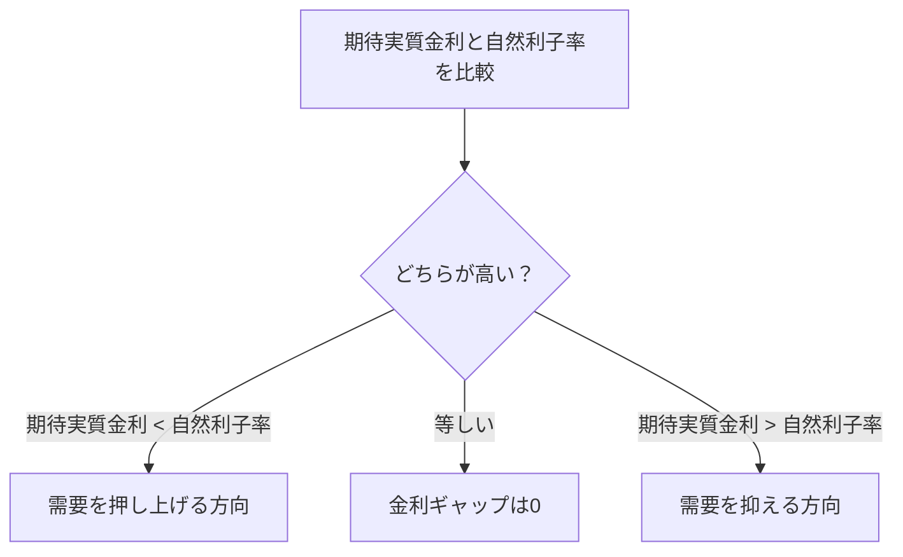

2026年の「ノーベル経済学賞」（正式には *Sveriges Riksbank Prize in Economic Sciences in Memory of Alfred Nobel*）は、Robert E. HallとMichael Woodfordに授与されました。

ノーベル委員会が示した正式な受賞理由は、

> **“for microeconomic foundations of macroeconomic stabilisation”**

です。

発表を見たとき、私は最初、「ニュー・ケインジアン・モデルや金融政策への貢献が評価されたのだろう」くらいに受け取っていました。

ただ、そこから内容を理解しようとして数式を追うと、もっと手前にある疑問に戻ることになりました。

> **中央銀行が金利を動かすと、なぜ家計の消費が変わり、最終的にGDPまで動くのか？**

この記事では、2026年の受賞内容そのものを網羅するのではなく、私がその疑問を理解するためにたどった


という一本の流れを整理します。

ここは最初に区別しておきたいところです。

**この流れ全体が、そのままノーベル賞の正式な受賞理由だったわけではありません。**

ノーベル委員会が評価したのは、HallとWoodfordによる**マクロ経済安定化のミクロ的基礎づけ**です。この記事の流れは、その内容を私自身が理解するためにたどった理論上の道筋です。

## 先に結論

ニュー・ケインジアン・モデルの需要側は、代表的には次のような式で表されます。

$$
x_t
=
E_t x_{t+1}
-
\frac{1}{\sigma}
\left[
(i_t-E_t\pi_{t+1})-r_t^n
\right].
$$

ここで、

- $x_t$：今期のGDPギャップ（ここでは自然産出量からの対数乖離）
- $E_t x_{t+1}$：今期の情報で予想する来期のGDPギャップ
- $i_t$：名目金利
- $E_t\pi_{t+1}$：期待インフレ率
- $i_t-E_t\pi_{t+1}$：期待実質金利
- $r_t^n$：自然利子率
- $\sigma$：消費の異時点間代替のしにくさに関係するパラメータ

です。

この式で特に重要なのは、

$$
(i_t-E_t\pi_{t+1})-r_t^n
$$

という部分です。

これは単なる記号の塊ではなく、

> **実際の期待実質金利 − 経済にとって中立的な自然利子率**

という比較です。

実際の期待実質金利が自然利子率より高ければ、現在の需要を抑える方向に働きます。逆に低ければ、現在の需要を押し上げる方向に働きます。

私は最初、この式を完成形だけ見ても「なぜ家計の効用最大化がGDPの式になるのか」がよく分かりませんでした。

そこで、家計の2期間の選択まで戻ってみます。

## 1. 家計は「今日」と「将来」の消費を同時に考える

家計が今期と来期の消費から効用を得るとします。

目的関数を単純化して、

$$
\max_{C_t,C_{t+1}}
\left\{u(C_t)+\beta E_t[u(C_{t+1})]\right\}
$$

と書きます。

$C_t$ は今期の消費、$C_{t+1}$ は来期の消費、$\beta$ は将来の効用をどれだけ重視するかを表す割引因子です。

今期の所得を $Y_t$、貯蓄を $S_t$ とすると、簡単な2期間モデルでは

$$
C_t+S_t=Y_t
$$

$$
C_{t+1}=Y_{t+1}+(1+r_t)S_t
$$

と書けます。

今期に1円多く貯蓄すれば、今期の消費は1円減ります。その代わり、来期には元本と利子を合わせて $1+r_t$ 円分だけ消費を増やせます。

したがって家計は、

- 今期に1円多く消費する価値
- その1円を貯蓄して、来期に $1+r_t$ 円分多く消費する価値

を比べています。

予算制約を目的関数へ代入して $S_t$ で微分しても、ラグランジュ法で解いても、一階条件は

$$
-u'(C_t)
+\beta(1+r_t)E_t[u'(C_{t+1})]
=0
$$

となります。

したがって、消費のEuler方程式は

$$
u'(C_t)
=
\beta(1+r_t)E_t[u'(C_{t+1})]
$$

です。

## 2. Euler方程式は「限界的に動かしても得しない」条件

私はここを、単に「今期消費と来期消費を結ぶ式」と覚えるだけでは理解しにくいと感じました。

左辺

$$
u'(C_t)
$$

は、**今期の消費をほんの少し増やしたときに得られる追加的な効用**です。

一方、右辺

$$
\beta(1+r_t)E_t[u'(C_{t+1})]
$$

は、今期の消費を1単位我慢して貯蓄し、その資金を来期に回したときに得られる追加的な効用を、今期から見た価値に直したものです。

最適な消費計画では、この2つが一致します。

もし左辺の方が大きければ、来期から今期へ消費を少し移すと効用を増やせます。

逆に右辺の方が大きければ、今期の消費を少し減らして来期へ回した方が得です。

したがって最適点では、

> **今期と来期の間で消費を限界的に動かしても、もう効用を増やせない**

という条件が成立します。

これがEuler方程式を読むときの中心だと理解しました。

## 3. consumption smoothingは「毎期同じ額を使う」ことではない

通常、消費の限界効用は逓減すると考えます。

$$
u''(C)<0.
$$

消費が少ないときの1万円は価値が大きく、すでに十分消費しているときの追加の1万円は相対的に価値が小さい、という考え方です。

そのため、所得がある時期だけ極端に多く、別の時期には極端に少ないなら、貯蓄や借入を使って消費時点をならすことで効用を高められる場合があります。

これが **consumption smoothing（消費の平準化）** です。

ただし、これは

> 毎期まったく同じ金額を消費する

という意味ではありません。

金利、時間選好、不確実性、借入制約などを考えながら、**各時点の限界効用のバランスを取る**というのがより正確です。

ここで金利が上昇すると、1円を今使わずに貯蓄したときに来期へ持っていける量が増えます。

Euler方程式の右辺にある $(1+r_t)$ が大きくなるため、他の条件が同じなら、現在消費を抑えて将来消費へ回す誘因が強くなります。

この「金利によって消費の時点配分が変わる」という仕組みが、後で金融政策につながります。

## 4. Hall：消費を動かすのは「所得を受け取った時点」とは限らない

Hallの1978年の研究は、消費が将来についての情報をすでに織り込んで決まるなら、**消費の変化を過去の既知情報で簡単に予測できるはずがない**と考えました。

その直感を、教科書的に単純化して確認します。

効用関数を二次効用

$$
u(C)=aC-\frac{b}{2}C^2
$$

とし、さらに

$$
\beta(1+r)=1
$$

と置きます。

このときEuler方程式から、

$$
C_t=E_t[C_{t+1}]
$$

という形を得られます。

来期の消費は、

$$
C_{t+1}=C_t+\varepsilon_{t+1},
\qquad
E_t[\varepsilon_{t+1}]=0
$$

と書けます。

$\varepsilon_{t+1}$ は、$t$ 時点では予想できなかった新しい情報による変化です。

つまり、今日までに分かっている情報は、今日の消費計画にすでに反映されています。

Hallの原論文では、より一般的に最適化から**限界効用がトレンド付きランダムウォークに従う**ことを導き、特定の効用関数のもとでは消費そのものについても同様の含意が得られます。上の式は、その考え方を理解するための単純化です。

## 5. 「来月10万円もらえる」と今日初めて分かったら、いつ消費は動くのか

ここが、私にはHallの考え方を最も理解しやすかった例です。

たとえば、

> **来月、給与とは別に10万円を確実にもらえることが、今日初めて分かった**

とします。


素朴な消費関数

$$
C_t=a+bY_t
$$

だけを頭に置くと、「来月の所得が10万円増えるのだから、来月になってから消費が増える」と考えたくなります。

しかし、Hall型の前向きな家計を考えると重要なのは、**所得が実際に振り込まれる時点ではなく、その所得についての新情報を知った時点**です。

今日の時点で「来月10万円増える」と分かれば、生涯にわたって使える資源についての見通しが今日変わります。

借入や貯蓄によって時点間で資源を移せるなら、その情報を受けた**今日から消費計画を調整する**ことになります。

これは「今日10万円を全部使う」という意味ではありません。

むしろconsumption smoothingを行うなら、増えた資源を複数の時点に配分します。

そして来月になり、予定どおり10万円を受け取っただけなら、それはもう新情報ではありません。

したがって、その受取自体は

$$
\varepsilon_{t+1}
$$

を生みません。

一方、10万円の予定だったのに実際には12万円入ったなら、予想との差である2万円分は新情報になり得ます。

もちろん現実には、借入できない家計や、手元資金に強く制約される家計もあります。Hallの結果は「すべての家計が完全にこの通り動く」という意味ではなく、**前向きな消費決定を考えるための基準**として重要です。

## 6. 名目金利ではなく「期待実質金利」を見る

ここまでで、家計は金利を見ながら今期と将来の消費を配分することが分かりました。

ただし、中央銀行が直接動かす政策金利は名目金利です。

家計が気にするのは、将来買える財・サービスの量なので、物価上昇も考える必要があります。

Fisher関係を近似的に使うと、期待実質金利は

$$
r_t^e
\simeq
i_t-E_t\pi_{t+1}
$$

です。

たとえば名目金利が2%でも、

- 期待インフレ率が2%なら、期待実質金利はおよそ0%
- 期待インフレ率が0%なら、期待実質金利はおよそ2%

です。

同じ名目金利でも、家計にとっての「現在消費を我慢して将来へ回す見返り」は違います。

したがって、金融政策から需要へのつながりを見るときには、単に

$$
i_t
$$

だけではなく、

$$
i_t-E_t\pi_{t+1}
$$

を見る必要があります。

ここから、現在の政策金利だけでなく**期待インフレ率や将来の金融政策に対する期待**も重要になる理由が見えてきます。

## 7. CRRA効用から、金利と消費成長率を結ぶ

ニュー・ケインジアン・モデルでは、代表的な効用関数としてCRRA効用を使うことがあります。

$$
u(C)=\frac{C^{1-\sigma}}{1-\sigma},
\qquad \sigma>0.
$$

このとき限界効用は

$$
u'(C)=C^{-\sigma}
$$

です。

名目債券とインフレ率を考慮したEuler方程式は、概念的には

$$
1
=
\beta E_t\left[
\left(\frac{C_{t+1}}{C_t}\right)^{-\sigma}
\frac{1+i_t}{1+\pi_{t+1}}
\right]
$$

と書けます。

この式を定常状態の周りで対数線形化すると、単純化された形として

$$
c_t
=
E_t c_{t+1}
-
\frac{1}{\sigma}
\left(
i_t-E_t\pi_{t+1}-\rho
\right)
$$

が得られます。

$c_t$ は消費の対数、$\rho$ は定常状態の実質金利に関係する項です。

この式が言っていることは、かなり直感的です。

- 期待実質金利が高いほど、今使うより将来へ回す魅力が増える
- そのため現在消費は相対的に抑えられる
- 期待実質金利が低ければ、その逆になる

CRRA効用では $1/\sigma$ が異時点間代替の弾力性に対応します。$\sigma$ が大きいほど、金利が変わっても消費時点を動かしにくい、という読み方ができます。

## 8. 消費の式が、どうGDPギャップの式になるのか

ここが、私が一番つながりを見失いやすかったところです。

非常に単純なモデルでは、投資や政府支出などをいったん脇に置き、産出と消費が一致するとします。

$$
Y_t=C_t.
$$

もちろん現実のGDPには投資や政府支出なども含まれるので、これは仕組みを見るための単純化です。

次に、実際の産出の対数を $y_t$、価格が柔軟だった場合などに達成されるモデル上の自然産出量を $y_t^n$ として、

$$
x_t=y_t-y_t^n
$$

を定義します。

$x_t$ が正なら、実際の産出が自然産出量を上回っています。

$x_t$ が負なら、その逆です。

ここでさらに、経済を自然産出量に保つ実質金利を**自然利子率** $r_t^n$ とします。

実際の需要側のEuler方程式と、自然産出量に対応するEuler方程式の差を取ると、基本的なニュー・ケインジアンIS曲線

$$
\boxed{
 x_t
 =
 E_t x_{t+1}
 -
 \frac{1}{\sigma}
 \left[
 (i_t-E_t\pi_{t+1})-r_t^n
 \right]
}
$$

が得られます。

最初に出した式へ戻ってきました。

重要なのは、中央銀行の金利がGDPを直接機械的に動かしているわけではないことです。

その間には、

```text
名目金利
  ↓
期待インフレ率を考慮した期待実質金利
  ↓
自然利子率との比較
  ↓
家計の現在消費と将来消費の配分
  ↓
総需要
  ↓
GDPギャップ
```

という経路があります。

## 9. 符号を間違えないために：「実質金利 − 自然利子率」だけを見る

私はこの式を追っているとき、GDPギャップの符号を何度か逆に考えました。

そこで、括弧の中だけを見ることにしました。

$$
\underbrace{i_t-E_t\pi_{t+1}}_{\text{期待実質金利}}
-
\underbrace{r_t^n}_{\text{自然利子率}}
$$

です。



たとえば、

$$
E_t x_{t+1}=0,
\qquad
\sigma=1
$$

と単純化します。

期待実質金利と自然利子率の差が -1%ポイントなら、

$$
x_t
=0-(-0.01)
=0.01
$$

です。

現在のGDPギャップは正の方向へ動きます。

逆に金利差が +1%ポイントなら、

$$
x_t
=0-0.01
=-0.01
$$

です。

つまり、覚えるなら

> **実際の期待実質金利が自然利子率より高い → 引き締め方向**
>
> **実際の期待実質金利が自然利子率より低い → 緩和方向**

と考えるのが私には分かりやすかったです。

なお、ここでの $x_t$ は対数で表したモデル上の産出ギャップです。小さな値なら、0.01をおおむね1%程度の乖離として読めます。

また、自然利子率は固定された数値でも、直接観測できる数値でもありません。実際の金融政策では、その推計にはかなりの不確実性があります。

## 10. Python / Rで符号だけ確認する

今回の理論はコードを書かないと分からないものではありません。

ただ、私自身が符号を取り違えやすかったので、

$$
x_t
=E_t x_{t+1}
-\frac{1}{\sigma}(\text{実質金利}-\text{自然利子率})
$$

の向きだけ小さく確認してみます。

### Python

```python
import numpy as np

sigma = 1.0
expected_next_gap = 0.0

# 期待実質金利 - 自然利子率
interest_gap = np.array([-0.02, -0.01, 0.00, 0.01, 0.02])

current_output_gap = expected_next_gap - interest_gap / sigma

print("real_interest_gap_pct  current_output_gap_pct")
for gap, output_gap in zip(interest_gap, current_output_gap):
    print(f"{gap * 100:>21.1f}  {output_gap * 100:>22.1f}")
```

出力は、

```text
real_interest_gap_pct  current_output_gap_pct
                 -2.0                     2.0
                 -1.0                     1.0
                  0.0                     0.0
                  1.0                    -1.0
                  2.0                    -2.0
```

となります。

### R

```r
sigma <- 1.0
expected_next_gap <- 0.0

# 期待実質金利 - 自然利子率
interest_gap <- c(-0.02, -0.01, 0.00, 0.01, 0.02)

current_output_gap <- expected_next_gap - interest_gap / sigma

data.frame(
  real_interest_gap_pct = interest_gap * 100,
  current_output_gap_pct = current_output_gap * 100
)
```

この小さな計算で確認したいのは一つだけです。

**金利ギャップにマイナスが付いているので、期待実質金利が自然利子率より高いほど、現在のGDPギャップは下がる方向へ動く**ということです。

## 11. では、HallとWoodfordはどこでつながるのか

2026年のノーベル委員会の解説は、このつながりをかなり明確に説明しています。

Hallの重要な貢献の一つは、家計の消費を「現在の所得だけに反応するもの」とせず、**将来についての期待と新情報に反応する前向きな意思決定**として捉え、実証可能な形にしたことです。

Woodfordは2003年の *Interest and Prices* などで、それまでのWoodford自身や他の研究者による成果をまとめながら、家計・企業のミクロ的な意思決定を土台とするニュー・ケインジアン・モデルを体系化しました。

そこでは、需要側について、

- 家計は将来を見ながら消費を決める
- 消費は金利にも反応する
- 実際の実質金利が自然利子率より高いか低いかが需要を左右する

という構造が入ります。

ノーベル委員会の一般向け解説も、Woodfordのモデルで消費を記述する重要な要素としてHallの結果が組み込まれたことを明示しています。

ただし、ここで

> Hallの1978年のランダムウォーク式を変形すると、そのままWoodfordのIS曲線になる

と理解するのは正確ではありません。

両者をつないでいる中心は、**家計が将来を見ながら異時点間で最適化するというミクロ的な考え方**です。

Hallは、その前向きな消費決定が「新情報と消費変化」という形でどんな実証的含意を持つかを大きく前進させました。

Woodfordのニュー・ケインジアン・モデルでは、その異時点間最適化を金利・期待・自然利子率と結び付け、マクロの需要変動と金融政策を分析できる形にしています。

この区別をすると、私には「HallからWoodfordへ」という言い方の意味がかなり整理されました。

## 12. まだ「インフレ率そのもの」を決める式がない

ここまで追ったのは、ほぼ需要側です。

$$
x_t
=E_t x_{t+1}
-\frac{1}{\sigma}
\left[
(i_t-E_t\pi_{t+1})-r_t^n
\right]
$$

には期待インフレ率 $E_t\pi_{t+1}$ が入っています。

しかし、この記事だけでは

> **そもそもインフレ率 $\pi_t$ は何によって決まるのか？**

をまだ説明していません。

ニュー・ケインジアン・モデルでは、価格を毎期自由に変更できないという**価格の粘着性**と、企業の前向きな価格設定から、代表的には

$$
\pi_t
=
\beta E_t\pi_{t+1}
+\kappa x_t
+u_t
$$

というニュー・ケインジアン・フィリップス曲線が出てきます。

ここまで入ると、

```text
金利
 ↓
需要・GDPギャップ
 ↓
インフレ率
```

という金融政策のもう一方の重要な経路が見えてきます。

今回はEuler方程式からGDPギャップまででかなり長くなったので、価格の粘着性とインフレ率の決まり方は次の課題に残します。

## まとめ

今回、2026年のノーベル経済学賞を理解しようとして数式を追った結果、私の中では次の流れでつながりました。

1. 家計は今期だけでなく将来も含めて効用を最大化する。
2. Euler方程式は、今期と将来の間で消費を限界的に移しても得しない条件を表す。
3. Hall型の消費理論では、消費は現在所得だけでなく将来の見通しを反映し、新情報が入った時点で変化する。
4. 「来月10万円もらえる」と今日初めて分かれば、受取月ではなく今日から消費計画が変わり得る。
5. 金融政策を見るときは、名目金利ではなく期待インフレ率を差し引いた期待実質金利が重要になる。
6. さらに重要なのは、その期待実質金利が自然利子率より高いか低いかである。
7. 家計のEuler方程式をマクロの需要側へつなぐと、ニュー・ケインジアンIS曲線としてGDPギャップと金利の関係を表せる。

ノーベル賞の正式な評価対象と、この記事で私が理解のためにたどった道筋は同じものではありません。

それでも、ニュースで「マクロ経済安定化のミクロ的基礎」と読むだけだった言葉が、

$$
\text{家計の選択}
\rightarrow
\text{期待}
\rightarrow
\text{金利}
\rightarrow
\text{需要}
\rightarrow
\text{GDPギャップ}
$$

までつながったことで、少なくとも私にはかなり具体的に見えるようになりました。

次に理解したいのは、**価格が粘着的だと、なぜGDPギャップがインフレ率につながるのか**です。

## 参考資料

- The Royal Swedish Academy of Sciences, “The Prize in Economic Sciences 2026”  
  https://www.kva.se/en/news/the-prize-in-economic-sciences-2026/
- The Royal Swedish Academy of Sciences, “Microfoundations deliver macro insights”  
  https://www.kva.se/en/prizes/prize-in-economic-sciences/microfoundations-deliver-macro-insights/
- Robert E. Hall (1978), “Stochastic Implications of the Life Cycle-Permanent Income Hypothesis: Theory and Evidence”  
  https://web.stanford.edu/~rehall/Stochastic-JPE-Dec-1978.pdf
- Robert E. Hall and Frederic S. Mishkin, “The Sensitivity of Consumption to Transitory Income: Estimates from Panel Data on Households”  
  https://www.nber.org/papers/w0505
- Michael Woodford, *Interest and Prices: Foundations of a Theory of Monetary Policy*  
  https://blogs.cuit.columbia.edu/mw2230/interest-and-prices/
- Board of Governors of the Federal Reserve System, “The New Keynesian Model”  
  https://www.federalreserve.gov/newsevents/speech/fischer20160519a1.htm
- 日本銀行「わが国の自然利子率の決定要因」  
  https://www.boj.or.jp/research/wps_rev/lab/lab18j02.htm
- 日本銀行「自然利子率の動向と金融緩和度合いの評価」  
  https://www.boj.or.jp/research/wps_rev/rev_2026/rev26j05.htm

