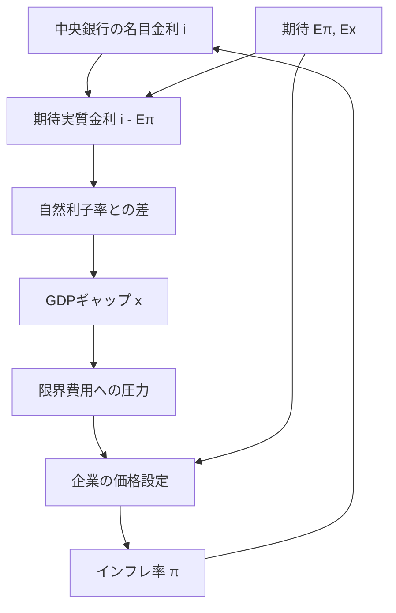

2026年の「ノーベル経済学賞」（正式には *Sveriges Riksbank Prize in Economic Sciences in Memory of Alfred Nobel*）は、Robert E. HallとMichael Woodfordに授与されました。

正式な受賞理由は、

> **“for microeconomic foundations of macroeconomic stabilisation”**

です。

前回の記事では、この受賞内容を理解するために、家計の異時点間最適化からEuler方程式、Hallの消費理論、期待実質金利、自然利子率、ニュー・ケインジアンIS曲線までを追いました。

https://zenn.dev/econ_data_lab/articles/nobel-2026-hall-woodford

そこで分かったのは、中央銀行の金利が需要へ効く経路です。

$$
\text{名目金利}
\rightarrow
\text{期待実質金利}
\rightarrow
\text{GDPギャップ}
$$

ただ、前回の記事にはまだ大きな穴がありました。

> **GDPギャップが動いたあと、なぜインフレ率が動くのか？**

さらに金融政策まで戻って考えるなら、疑問はこうなります。

> **中央銀行が利上げすると、なぜ企業の価格設定を通じてインフレを抑える方向に働くのか？**

今回は、私がこの疑問を理解するためにたどった


という流れを整理します。

前回と同じく、この順序そのものがノーベル委員会の受賞理由をそのまま並べたものではありません。Royal Swedish Academy of Sciencesの2026年解説は、Woodfordのニュー・ケインジアン・モデルを、家計・企業のミクロ的意思決定に基づく3つの式からなる政策分析の枠組みとして説明しています。この記事は、そのうち前回ほとんど触れなかった**企業の価格設定と金融政策ルール**を、私自身の理解順に追うものです。

## 先に結論

基本的なニュー・ケインジアン・モデルでは、需要・供給・金融政策を代表的に次の3本の式でまとめられます。

### 需要側：ニュー・ケインジアンIS曲線

$$
 x_t
 =
 E_t x_{t+1}
 -
 \frac{1}{\sigma}
 \left[
 (i_t-E_t\pi_{t+1})-r_t^n
 \right].
$$

### 供給側：ニュー・ケインジアン・フィリップス曲線

$$
\pi_t
=
\beta E_t\pi_{t+1}
+\kappa x_t.
$$

### 金融政策：単純化したTaylor rule

$$
 i_t
 =
 r_t^n+\pi^*
 +\phi_\pi(\pi_t-\pi^*)
 +\phi_x x_t.
$$

ここで新しく重要になるのは、2本目と3本目です。

GDPギャップ $x_t$ が正なら、企業の限界費用を押し上げ、価格を引き上げる圧力になります。逆に $x_t$ が負なら、インフレ率を下げる方向に働きます。

ただし、

$$
x_t<0
$$

だからといって、

$$
\pi_t<0
$$

になるとは限りません。

現在のインフレ率には

$$
\beta E_t\pi_{t+1}
$$

も入るからです。

そして中央銀行がインフレを抑えるときに重要なのは、単に名目金利 $i_t$ を上げたかではありません。

$$
i_t-E_t\pi_{t+1}
$$

という**期待実質金利**がどう動き、自然利子率との差がどう変わったかを見る必要があります。

この3点が、今回私が特に引っかかったところでした。

## 1. まず、企業が毎期自由に価格を決められる世界を考える

いきなり価格の硬直性を入れる前に、価格を自由に変更できる企業の最適価格を考えます。

企業 $i$ が、他社とは少し違う商品を売っているとします。

価格を $P_i$、その企業の商品への需要を $Y_i$ とすると、簡単な差別化財モデルでは需要を

$$
Y_i
=
\left(\frac{P_i}{P}\right)^{-\varepsilon}Y,
\qquad \varepsilon>1
$$

のように書けます。

$P$ は経済全体の物価水準、$Y$ は総需要、$\varepsilon$ は価格を上げたとき需要がどれくらい減るかに関係するパラメータです。

企業の利潤を、限界費用 $MC$ が一定だと単純化して

$$
\Pi_i
=
(P_i-MC)Y_i
$$

とします。

企業は「値段を高くすれば1個あたりの利益は増えるが、売れる量は減る」という関係の中で $P_i$ を選びます。

この利潤を $P_i$ で最大化すると、最適価格は

$$
\boxed{
P_i^*
=
\frac{\varepsilon}{\varepsilon-1}MC
}
$$

となります。

前の学習では、たとえば

$$
MC=100,\qquad \varepsilon=5
$$

なら、

$$
P_i^*
=
\frac{5}{4}\times100
=125
$$

と計算しました。

ここで

$$
\mu
=
\frac{\varepsilon}{\varepsilon-1}
$$

と置けば、

$$
P_i^*=\mu MC
$$

です。

つまり、柔軟価格の世界では、企業の最適価格をまず

> **限界費用 × マークアップ**

として考えられます。

これは「企業が好き勝手に価格を決める」という意味ではありません。価格を上げすぎると需要を失うので、需要の価格弾力性がマークアップを制約しています。

## 2. でも、これだけでは「インフレの遅さ」を説明できない

ここで私は一度、「限界費用が上がれば価格も上がるなら、もうインフレの説明になっているのでは」と思いました。

ただ、この式だけなら、限界費用が変わった瞬間に企業は最適価格へ変更できます。

$$
MC\uparrow
\quad\Rightarrow\quad
P_i^*\uparrow
$$

です。

現実には、すべての価格があらゆる情報に対して同時に瞬時に変更されるわけではありません。

Royal Swedish Academy of Sciencesの2026年解説も、Woodfordのモデルでは企業が需要や生産費の変化のたびに価格を変えるのは高くつくため、価格が粘着的になると説明しています。

ニュー・ケインジアン・モデルでは、この**価格の硬直性**を入れることで、需要の変化が価格だけでなく生産量にも影響する余地が生まれます。

## 3. Calvo pricing：今価格を変えられる企業と、変えられない企業を分ける

価格硬直性を扱う代表的な方法が **Calvo pricing** です。

Calvo (1983) の価格設定では、各期に企業が価格を最適化し直せる確率を

$$
1-\theta
$$

とし、残りの

$$
\theta
$$

の企業はその期には価格を最適化し直せない、と考えます。

これは「現実の企業が本当に毎期くじを引いている」という主張ではありません。

さまざまな価格変更の摩擦を、分析しやすい形で表現するモデル化です。

重要なのは、価格を変更できる企業にとっても、今日だけを見て価格を決めればよいわけではないことです。

今日設定した価格を、次の期にも、その次の期にも使わなければならない可能性があります。

すると企業は、

- 将来の限界費用は上がりそうか
- 他社の価格は上がりそうか
- 自分の価格を次にいつ変更できるか分からない

といった将来まで考えて、今日の価格を決めます。

ここで、企業側にも**期待**が入ってきます。

前回の記事では家計が将来を見て消費を決めました。

今回は企業が将来を見て価格を決めます。

2026年のRoyal Swedish Academy of Sciencesの解説が、家計だけでなく企業の意思決定もforward lookingだと強調しているのは、この部分です。

## 4. 限界費用からインフレ率へ：まずはNKPCの「限界費用版」

Calvo型の価格設定を集計すると、単純化されたニュー・ケインジアン・フィリップス曲線は、まず実質限界費用を使って

$$
\pi_t
=
\beta E_t\pi_{t+1}
+\lambda\widehat{mc}_t
$$

のように書けます。

$\widehat{mc}_t$ は、実質限界費用の定常状態からの乖離です。

この式は、いきなり暗記するより2つに分けると分かりやすかったです。

### 将来のインフレ期待

$$
\beta E_t\pi_{t+1}
$$

企業は、今日決めた価格をしばらく使う可能性があります。

将来、他社の価格や自社の費用が高くなると考えているなら、価格を変更できる今日の時点で、より高い価格を設定する誘因があります。

そのため、**将来のインフレについての期待が現在のインフレ率にも入る**ことになります。

### 現在の限界費用

$$
\lambda\widehat{mc}_t
$$

生産を1単位増やす費用が高くなれば、企業が設定したい価格も高くなります。

San Francisco Fedも、基本NKPCを「期待将来インフレと実質限界費用が現在のインフレに関係する式」と説明しています。

## 5. なぜGDPギャップが限界費用につながるのか

次に、限界費用をGDPギャップへつなぎます。

ここは、私が最初に

> GDPギャップが増えたら、なぜ企業の限界費用が上がるのか

と引っかかったところです。

基本的なモデルでは、実際の産出が自然産出量を上回ると、企業は通常より多く生産しようとします。

そのため、

```text
GDPギャップが正
  ↓
生産を増やす
  ↓
労働需要などが強まる
  ↓
実質限界費用が上がる方向
  ↓
企業が設定したい価格が上がる
```

という経路を考えます。

もちろん、現実の限界費用は賃金、原材料価格、生産性、エネルギー価格などにも左右されます。

ここで言っているのは、基本的なニュー・ケインジアン・モデルで、実質限界費用の変動をGDPギャップと結び付ける部分です。

単純化して

$$
\widehat{mc}_t
\propto
x_t
$$

と書けば、先ほどの式は

$$
\boxed{
\pi_t
=
\beta E_t\pi_{t+1}
+\kappa x_t
}
$$

となります。

これが、今回使う**ニュー・ケインジアン・フィリップス曲線（NKPC）**です。

## 6. 私が間違えた点：$x_t<0$ でも、インフレ率が負とは限らない

私は最初、

$$
x_t<0
$$

なら

$$
\pi_t<0
$$

だと読みかけました。

しかし、NKPCは

$$
\pi_t
=
\beta E_t\pi_{t+1}
+\kappa x_t
$$

です。

$x_t$ が負であることが直接意味するのは、

$$
\kappa x_t<0
$$

ということだけです。

つまり、GDPギャップは**現在のインフレ率への下押し圧力**になります。

期待インフレ率の項が正なら、現在のインフレ率そのものは正のままでもかまいません。

たとえば、

$$
\beta=0.99,
\qquad
E_t\pi_{t+1}=2\%,
\qquad
\kappa=0.1,
\qquad
x_t=-1\%
$$

とします。

率を小数で代入すると、

$$
\pi_t
=0.99\times0.02
+0.1\times(-0.01)
$$

なので、

$$
\pi_t
=0.0188
=1.88\%
$$

です。

GDPギャップは負ですが、インフレ率は正です。

比較したいのは、GDPギャップが0だった場合の

$$
1.98\%
$$

よりも、現在のインフレ率が低くなっていることです。

Royal Swedish Academy of Sciencesの2026年解説も、負のGDPギャップについて「物価が押し下げられ、インフレが通常より低くなる」という形で説明しています。

> **負のGDPギャップ = デフレ**

ではなく、

> **負のGDPギャップ = インフレ率への下押し圧力**

と読む方が正確です。

## 7. 前回の需要側を1本だけ戻す

ここで、前回の記事の式を1本だけ戻します。

$$
 x_t
 =
 E_t x_{t+1}
 -
 \frac{1}{\sigma}
 \left[
 (i_t-E_t\pi_{t+1})-r_t^n
 \right].
$$

この式の導出は前回の記事で扱ったので、今回は繰り返しません。

見るのは括弧の中だけです。

$$
\underbrace{i_t-E_t\pi_{t+1}}_{\text{期待実質金利}}
-
\underbrace{r_t^n}_{\text{自然利子率}}
$$

期待実質金利が自然利子率より高ければ、GDPギャップを押し下げる方向に働きます。

そして今回分かったNKPCによって、

$$
x_t\downarrow
\quad\Rightarrow\quad
\pi_t\text{への下押し圧力}
$$

までつながります。

つまり、単純化すれば、


です。

ここでようやく、前回の「金利はなぜGDPを動かすのか」から、今回の「なぜ利上げがインフレを抑える方向に働くのか」までつながりました。

## 8. ただし「名目金利を上げた」だけでは、引き締めとは限らない

ここも、私は一度符号を間違えました。

たとえば、名目金利が

$$
3\%\rightarrow4\%
$$

へ上がったとします。

これだけを見れば「利上げだから引き締め」と言いたくなります。

しかし、期待インフレ率が同時に

$$
2\%\rightarrow3.5\%
$$

へ上がったなら、期待実質金利は

$$
3\%-2\%=1\%
$$

から

$$
4\%-3.5\%=0.5\%
$$

へ**下がっています**。

自然利子率が1%のままなら、最初は中立的だった期待実質金利が、自然利子率を下回ります。

すると需要には、むしろ緩和方向の力がかかります。

したがって、金融政策の方向を見るときには、

> 名目金利を上げたか

だけではなく、

> **期待実質金利が自然利子率に対してどう動いたか**

を見る必要があります。

## 9. 中央銀行は金利をどう反応させるのか：Taylor rule

ここまでの2本の式だけでは、名目金利 $i_t$ が外から与えられたままです。

そこで、中央銀行がインフレ率やGDPギャップを見て金利を決める式を加えます。

単純化したTaylor ruleを

$$
\boxed{
 i_t
 =
 r_t^n+\pi^*
 +\phi_\pi(\pi_t-\pi^*)
 +\phi_x x_t
}
$$

とします。

ここで、

- $\pi^*$：インフレ目標
- $r_t^n+\pi^*$：GDPギャップが0でインフレ率が目標どおりのときの中立的な名目金利の基準
- $\phi_\pi$：インフレ率が目標からずれたとき、金利をどれだけ反応させるか
- $\phi_x$：GDPギャップへどれだけ反応するか

です。

John Taylorが1993年に示した代表的な式では、インフレが1%ポイント上がると、名目政策金利は合計で1.5%ポイント上がる形になっています。

ここで大事なのは、「中央銀行はこの式を機械的に守る」ということではありません。

Federal Reserveも、Taylor ruleを政策の原則を考える単純な基準として説明しつつ、現実の政策判断では金融環境や期待、海外経済など多くの情報が必要だとしています。

## 10. Taylor principle：なぜ「1対1より強く」が重要なのか

上の書き方では、Taylor principleは代表的に

$$
\boxed{\phi_\pi>1}
$$

と表せます。

直感を見るため、GDPギャップの項をいったん0とします。

インフレ率が目標から1%ポイント上がり、期待インフレ率もおおむね1%ポイント上がったと考えます。

### $\phi_\pi=0.5$ なら

名目金利は0.5%ポイントしか上がりません。

一方、期待インフレ率が1%ポイント上がるなら、

$$
i_t-E_t\pi_{t+1}
$$

は0.5%ポイント下がる方向です。

つまり、インフレが上がったのに期待実質金利が下がり、需要を刺激してしまう可能性があります。

### $\phi_\pi=1.5$ なら

名目金利は1.5%ポイント上がります。

期待インフレ率が1%ポイント上がっても、期待実質金利は0.5%ポイント上がる方向です。

すると、

$$
\text{期待実質金利}\uparrow
\rightarrow
x_t\downarrow
\rightarrow
\pi_t\text{への下押し圧力}
$$

という安定化方向のフィードバックが働きます。

MIT OpenCourseWareのニュー・ケインジアン・モデルの講義でも、$\phi_\pi>1$ のとき名目金利がインフレより1対1以上に反応し、実質金利が上がることをTaylor principleの中心として説明しています。

ただし、これは動学的なモデルの中で期待と政策反応が結び付く話です。

> **$\phi_\pi>1$ なら、どんな状況でも必ずインフレが下がる**

という機械的な法則ではありません。

## 11. 3本の式を並べると、モデルが閉じる

ここまで来ると、前回から追ってきた需要側、今回の供給側、中央銀行の行動を並べられます。

### 1. 需要

$$
 x_t
 =
 E_t x_{t+1}
 -
 \frac{1}{\sigma}
 \left[
 (i_t-E_t\pi_{t+1})-r_t^n
 \right]
$$

### 2. 供給

$$
\pi_t
=
\beta E_t\pi_{t+1}
+\kappa x_t
$$

### 3. 金融政策

$$
 i_t
 =
 r_t^n+\pi^*
 +\phi_\pi(\pi_t-\pi^*)
 +\phi_x x_t
$$



中央銀行が金利を決め、その金利が需要へ影響し、GDPギャップが企業の価格設定を通じてインフレ率へ影響し、インフレ率を見た中央銀行がまた金利を決めます。

Royal Swedish Academy of SciencesがWoodfordのモデルを「3つの式からなる政策の実験室」と説明している意味が、私にはここでようやく具体的になりました。

前回の記事では1本目だけをかなり長く追いました。

今回2本目と3本目まで入れたことで、

$$
\text{Hall}
\rightarrow
\text{家計の前向きな意思決定}
\rightarrow
\text{Woodford型の需要}
\rightarrow
\text{企業の前向きな価格設定}
\rightarrow
\text{金融政策による安定化}
$$

という流れが一応閉じます。

## 12. パラメータを動かして、符号をその場で確認する

今回の内容は、式を眺めるだけより、パラメータを実際に動かした方が分かりやすいと感じました。

今回のDraftでは、公開GitHub上の小さな教材をStackBlitzで動かせるようにしています。

当初は記事内への直接埋め込みを試しましたが、Safari上のZenn下書きでは読み込みが止まり、操作できませんでした。そこで、本文内に無理に埋め込まず、**教材を別タブで開いて操作する**形にします。

教材は2つの実験に分けています。

### A. 金利 → GDPギャップ → インフレ

動かせるものは、

- 名目金利 $i_t$
- 期待インフレ率 $E_t\pi_{t+1}$
- 自然利子率 $r_t^n$
- $E_t x_{t+1}$
- $\sigma$
- $\beta$
- $\kappa$

です。

表示するのは、

- 期待実質金利
- 自然利子率との差
- GDPギャップ
- 現在のインフレ率
- 引き締め / 緩和の方向

です。

特に試してほしいのは、**名目金利を上げながら期待インフレ率をそれ以上に上げる**操作です。

「利上げなのに期待実質金利は下がる」ケースをその場で確認できます。

### B. Taylor principle

$\phi_\pi$ を1より小さい値と大きい値で切り替え、インフレギャップが増えたときに実質金利ギャップがどちらへ動くかを確認します。

以下から教材を開けます。

@[card](https://stackblitz.com/github/Osino-Niso/econ-data-lab/tree/7c029c5910276fa221af2d5c056b34bbec3b4bf5/interactive/nobel-2026-pricing-inflation?startScript=start&view=preview)

外部教材を開かなくても、以下のPython / Rの再現コードだけで今回の重要な符号は確認できます。

## 13. Python / Rで3つのケースを比較する

ここでは、同じ単純化したIS曲線とNKPCを使って3ケースだけ比べます。

1. 期待実質金利 = 自然利子率で中立
2. 期待インフレ率が変わらないまま名目金利を1%ポイント上げる
3. 名目金利は上がるが、期待インフレ率がそれ以上に上がる

### Python

```python
from dataclasses import dataclass


@dataclass
class Scenario:
    name: str
    nominal_rate: float
    expected_inflation: float
    natural_rate: float
    sigma: float = 1.0
    expected_next_gap: float = 0.0
    beta: float = 0.99
    kappa: float = 0.10


def evaluate(s: Scenario):
    expected_real_rate = s.nominal_rate - s.expected_inflation
    interest_gap = expected_real_rate - s.natural_rate
    output_gap = s.expected_next_gap - interest_gap / s.sigma
    inflation = s.beta * s.expected_inflation + s.kappa * output_gap
    return expected_real_rate, interest_gap, output_gap, inflation
```

3ケースを計算すると、概ね次の結果になります。

| ケース | 期待実質金利 | 金利ギャップ | GDPギャップ | インフレ率 |
| --- | ---: | ---: | ---: | ---: |
| 基準：$i=3\%, E\pi=2\%$ | 1.00% | 0.00% | 0.00% | 1.98% |
| 名目金利だけ1pt上昇 | 2.00% | +1.00% | -1.00% | 1.88% |
| $i=4\%$ だが $E\pi=3.5\%$ | 0.50% | -0.50% | +0.50% | 3.52% |

2行目では、GDPギャップは負ですがインフレ率はまだ正です。

3行目では、名目金利は基準より高いのに、期待実質金利は自然利子率を下回っています。

今回確認したかった2つの注意点が、そのまま数字に出ています。

完全なコードはGitHubに置きます。

### R

Rでも計算は同じです。

```r
expected_real_rate <- nominal_rate - expected_inflation
interest_gap <- expected_real_rate - natural_rate
output_gap <- expected_next_gap - interest_gap / sigma
inflation <- beta * expected_inflation + kappa * output_gap
```

Python/Rの目的は、理論をコードに置き換えること自体ではありません。

**符号を取り違えていないかを、自分で数値を変えて確認すること**です。

## 14. これは「現実のインフレを3本の式だけで全部説明できる」という話ではない

最後に、今回のモデルの範囲をはっきりさせておきます。

基本NKPC

$$
\pi_t
=
\beta E_t\pi_{t+1}
+\kappa x_t
$$

は、価格硬直性、期待、限界費用、需要圧力の関係を理解するには非常に便利です。

一方、実際のインフレには、

- エネルギー価格などの供給ショック
- 過去のインフレの持続性
- 企業ごとの価格変更頻度の違い
- 金融摩擦
- 期待形成の違い

なども関わります。

そのため、より一般的にはコストプッシュ・ショック $u_t$ を加えて

$$
\pi_t
=
\beta E_t\pi_{t+1}
+\kappa x_t
+u_t
$$

と書いたり、過去のインフレも含む拡張形を使ったりします。

San Francisco Fedの解説も、基本NKPCは教育的には有用な一方、実際のインフレの持続性などを十分に再現できない問題があると指摘しています。

この記事でやりたかったのは、現実のインフレを完全に予測することではありません。

> **金利、需要、限界費用、企業の価格設定、期待が、基本モデルの中でどうつながるのか**

を一本の経路として理解することです。

## まとめ

今回、前回の記事の続きを追ったことで、私の中では次のようにつながりました。

1. 差別化された商品を売る企業の柔軟価格は、限界費用にマークアップを乗せた形で考えられる。
2. 現実には価格が毎期自由に変わるわけではなく、価格の硬直性がある。
3. Calvo型の価格設定では、今日決めた価格を将来も使う可能性があるため、企業は将来の費用や物価も見て価格を決める。
4. その結果、現在のインフレ率は期待将来インフレと実質限界費用に依存する。
5. 基本モデルで限界費用をGDPギャップへ結び付けると、$\pi_t=\beta E_t\pi_{t+1}+\kappa x_t$ というNKPCになる。
6. $x_t<0$ はインフレ率が必ず負になるという意味ではなく、インフレ率への下押し圧力である。
7. 金融政策では、名目金利そのものより $i_t-E_t\pi_{t+1}$ という期待実質金利と自然利子率との差が重要になる。
8. Taylor ruleを加えると、中央銀行の金利決定まで含めて需要・供給・金融政策の3本の式がつながる。
9. Taylor principleでは、インフレ上昇に対して名目金利が十分強く反応しないと、期待実質金利が下がって需要を刺激する方向へ働く可能性がある。

前回の記事の最後では、まだ

> **そもそもインフレ率は何によって決まるのか？**

が残っていました。

今回、企業の価格設定まで追ったことで、少なくとも基本的なニュー・ケインジアン・モデルについては、

$$
\text{家計}
\rightarrow
\text{需要}
\rightarrow
\text{GDPギャップ}
\rightarrow
\text{企業の限界費用と価格設定}
\rightarrow
\text{インフレ}
\rightarrow
\text{中央銀行の金利反応}
$$

まで一巡させることができました。

細部や発展形はまだかなり残っています。

それでも、2026年の受賞理由にある **“microeconomic foundations of macroeconomic stabilisation”** が、ニュースの一文ではなく、家計と企業の最適化から金融政策までつながるモデルとして見えるようになりました。

## 参考資料

- The Royal Swedish Academy of Sciences, “The Prize in Economic Sciences 2026”  
  https://www.kva.se/en/news/the-prize-in-economic-sciences-2026/
- The Royal Swedish Academy of Sciences, “Microfoundations deliver macro insights”  
  https://www.kva.se/en/prizes/prize-in-economic-sciences/microfoundations-deliver-macro-insights/
- Michael Woodford, *Interest and Prices: Foundations of a Theory of Monetary Policy*  
  https://blogs.cuit.columbia.edu/mw2230/interest-and-prices/
- Guillermo A. Calvo (1983), “Staggered prices in a utility-maximizing framework,” *Journal of Monetary Economics* 12(3), 383–398  
  https://www.sciencedirect.com/science/article/pii/0304393283900600
- MIT OpenCourseWare, *14.05 Intermediate Macroeconomics*, Lecture 19: Sticky Prices  
  https://ocw.mit.edu/courses/14-05-intermediate-macroeconomics-fall-2025/mit14_05_f25_lecture19.pdf
- MIT OpenCourseWare, *14.05 Intermediate Macroeconomics*, Lecture 20: The New Keynesian Model  
  https://ocw.mit.edu/courses/14-05-intermediate-macroeconomics-fall-2025/mit14_05_f25_lecture20.pdf
- Federal Reserve Bank of San Francisco, “Fixing the New Keynesian Phillips Curve”  
  https://www.frbsf.org/research-and-insights/publications/economic-letter/2007/11/new-keynesian-phillips-curve-nkpc/
- Board of Governors of the Federal Reserve System, “Principles for the Conduct of Monetary Policy”  
  https://www.federalreserve.gov/monetarypolicy/principles-for-the-conduct-of-monetary-policy.htm
- John B. Taylor (1993), “Discretion versus policy rules in practice”  
  https://web.stanford.edu/~johntayl/Papers/Discretion.PDF
