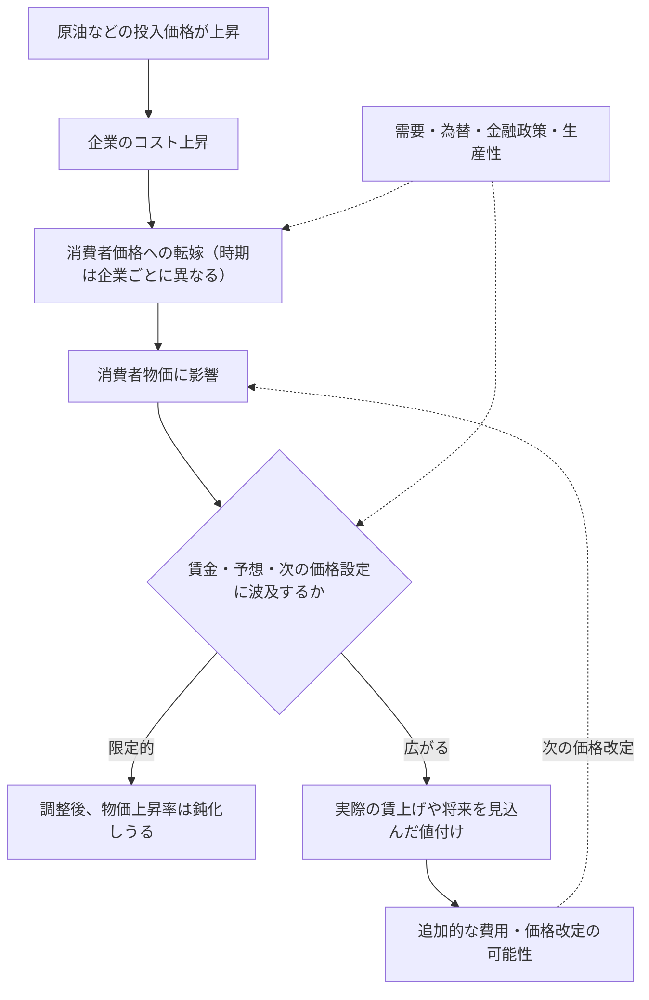

1974年の日本では、物価と名目賃金の上昇率が20～30％に達しました。ところが、1979～80年の第2次石油ショックでは輸入物価が急騰しても、同じ規模の賃金・物価の加速は起きませんでした。**原油高が二度起きたのに、なぜ結果はこれほど違ったのでしょうか。**

この対比を「日銀がうまく利上げしたから」の一言で済ませてよいのでしょうか。二つのショックは発生時期も規模も同一ではなく、賃金交渉、為替、経済構造も違います。歴史を比較するには、**どの差が観察され、どの差が原因だと確認されたのか**を分ける必要があります。

日本銀行の植田和男総裁は、2026年5月27日の開会挨拶で、この違いを考えるために日本の4つの局面を振り返っています。1970年代の2度の石油ショック、2000年代半ばの原油高、そして2021年以降の物価上昇です。

本稿では、まず総裁が何を観察し、どう説明したかを確かめます。そのうえで、**その説明は現代の経済学ではどの程度支持されるのか、何を調べれば本当に原因を確かめられるのか**を考えます。

本稿は「日銀の研究を読み解く」シリーズ第1回です。取り上げるのは新しい因果推定論文ではなく、過去の経験を振り返る**講演**です。歴史的な事実、総裁による解釈、関連研究の推定結果、本稿の考察は区別して扱います。

## 1. 第1次と第2次の石油ショック――何が違ったのか

### 第1次：原油高の前から賃金と物価は上がっていた

第1次石油ショックが起きたのは1973年後半です。しかし植田総裁は、**同年の前半にはすでに物価上昇率が10％近く、名目賃金上昇率が20％近くに達していた**ことを指摘します。原油高がゼロからインフレを発生させたのではありません。

*出典：植田和男（2026）開会挨拶・図表2を引用。横軸の T は1973年10～12月期、青線は「食料・エネルギー除くCPI」の前年比、緑線は名目賃金の前年比。*

図表2では、原油高の基準期である T より前から青線も緑線も高い位置にあります。その後、1974年春の賃金交渉で大幅な賃上げが妥結し、企業は原材料費に加えて労働費用の増加も価格へ転嫁しました。植田総裁は、将来の物価上昇予想も高まり、賃金と物価が互いを押し上げる状態になったと説明します。

ここには二つの違いがあります。原油高によって企業の費用が上がることと、**物価上昇が賃金交渉を変え、その賃金が次の価格設定に反映されること**です。後者は、原油の価格が一度上がるだけでは説明できません。

金融政策についても、総裁は単に「利上げが遅れた」と言っているわけではありません。引き締めは行われたものの、**強いインフレの仕組みができた後であり、物価上昇率の高さに比べて引き締めの程度も不十分だった**と評価しています。後に景気後退と引き締めでインフレは鈍化しましたが、経済的な負担も大きくなりました。

### 第2次：原油高の波及が比較的抑えられた

1979～80年の第2次石油ショックでも、円建て輸入物価は大きく上昇しました。それでも、第1次ほど激しい賃金・物価スパイラルにはなりませんでした。日銀『展望レポート』2026年4月のBOX2によれば、**1980年の実質賃金上昇率はマイナス**でした。物価が上がっても賃上げがその上昇に追いつかないという、家計にとっては厳しい違いです。

*出典：植田和男（2026）開会挨拶・図表3を引用。輸入物価（橙線）は右軸、CPI（青線）と名目賃金（緑線）は左軸。*

植田総裁が挙げる事情は一つではありません。原油高を迎えた時点で物価・賃金上昇率は第1次より落ち着いており、企業や労働組合には前回の苦い経験がありました。金融引き締めはより迅速に行われ、**ショック以前の円高**が輸入価格を押し下げていたほか、企業の省エネ化も進んでいました。

したがって「第2次でインフレが穏やかだったのは、日銀が早く利上げしたからだ」と**一つの理由だけに絞るのは、講演の読み方としても不正確**です。政策の効果と、政策以外の条件の効果は、ここではまだ分けられていません。

:::details 図表2・3の目盛りに注意

- 2つの図では左側の縦軸が異なります。図表2は約マイナス20～40％、図表3は0～10％です。線の高さを直接比較できません。また、図表3の輸入物価は円ベースの**前年比**であり、原油そのものの国際価格の変化率ではありません。
- 図表2で政策金利は右軸、図表3で輸入物価は右軸です。図表3の政策金利は左軸です。各図のTは第1次が1973年Q4、第2次が1979年Q1です。
- CPIと名目賃金は前年比、実質GDPは前期比**年率**です。図表のCPIは食料・エネルギーを除く指数で、日本で一般に「コアCPI」と呼ぶ「生鮮食品を除く総合」とは異なります。

:::

## 2. 2000年代半ばと2021年以降――値上げが続く仕組みは変わったのか

1970年代の比較だけでは、政策対応、労使交渉、為替、省エネのどれが決め手だったのか分かりません。そこで比較の軸を変えます。**価格や賃金が上がりにくかった日本で、2000年代半ばの原油高はその慣行を変えず、2021年以降の広範なコスト高は変え始めたのはなぜか。** これは第1次・第2次の対比で浮かんだ「賃金や値付けの慣行」という仮説を、別の時代から問い直すためです。

### 2000年代半ば：原油高でも、物価と賃金の慣行は変わりにくかった

2000年代半ばには原油などの商品価格が上昇しました。しかし、日本では企業が値上げに慎重で、賃金の伸びや将来の物価上昇予想も低い状態が続きました。2006年に量的緩和政策が終了し、2006～07年に金利引き上げも行われましたが、図表4の対象指標はおおむね低迷しました。

*出典：植田和男（2026）開会挨拶・図表4を引用。青線は食料・エネルギー除くCPIの前年比。*

図表4の青線は長くマイナス圏にとどまります。ただし、**これは日本であらゆる商品の値段が下がり続けたという意味ではありません**。植田総裁は、総合CPIは緩やかに上昇した一方、基調的な物価上昇率はほとんど動かなかったと説明しています。原油高は家計の実質所得を圧迫しましたが、賃金や価格設定の慣行を大きく変えるまでには至らなかった、という解釈です。

総裁はこうした状態を「デフレ均衡」と表現します。経済が好ましい状態で均衡していたという意味ではなく、企業も家計も「価格や賃金はあまり上がらない」と考え、それに沿って行動する状態が続いていた、という説明です。

### 2021年以降：今度は原油だけが上がったわけではない

2021年ごろからの物価上昇では、エネルギーだけでなく、食料、物流、輸入原材料などの費用も上がりました。パンデミック後の世界的な需要回復や円安、労働需給の引き締まりも重なります。

*出典：植田和男（2026）開会挨拶・図表5を引用。横軸の T は2022年1～3月期。費用上昇自体は2021年から始まっており、この T を「ショック以前」とは扱えません。*

図表5では、食料・エネルギーを除くCPIの前年比がマイナス圏からプラスへ移り、名目賃金の前年比も上昇しています。輸入物価（円建て）の**前年比**が後にマイナスになっても、同図のCPI前年比はプラスでした。ただし、輸入物価全体と国内CPIは品目構成が異なり、片方の符号から他方の符号を直接予測できるわけではありません。

この時間差は重要ですが、それだけで賃金・物価スパイラルの証拠にはなりません。前に上がった輸入コストを企業が遅れて転嫁しても、同じような経路になりうるからです。

植田総裁は、広い範囲でのコスト高や円安に加えて、企業の価格転嫁、賃金交渉、物価を巡る慣行の変化を挙げます。ただし、**1970年代前半のような激しいスパイラルが再現されたとは見ていません**。

### 4局面を並べて、何が分かったか

| 局面 | 講演で観察・説明された特徴 | この比較だけでは分からないこと |
| --- | --- | --- |
| 第1次石油ショック | 原油高以前から高い物価・賃金上昇。後に激しいスパイラル | 原油高がなければ物価が何％だったか |
| 第2次石油ショック | 賃金の抑制、迅速な政策、以前の円高、省エネ | それぞれの要因の寄与率 |
| 2000年代半ば | 原油高でも賃金・価格設定の慣行は大きく変わらず | 慣行が変わらなかった原因の強さ |
| 2021年以降 | 広範な費用上昇と円安、賃金・価格設定の変化 | 原油、他の費用、賃金の個別の因果効果 |

ここまでが**植田総裁の歴史的な説明の再整理**です。この説明には納得できる点が多くあります。しかし「もっともらしく説明できる」ことと「本当に原因だったと確かめた」ことの間には、まだ距離があります。

## 3. 「原油が高くなった」と「インフレが続く」は別の話

ここで、原油価格の値上がりが国内の物価に伝わる道筋を整理します。

原油が上がると、燃料や石油由来の原材料が高くなります。製造業だけでなく、輸送費を通じて他の業種にも影響が及びます。企業が増えた費用を販売価格に上乗せすれば、消費者物価も上がります。ここでは投入コスト増が産業間取引を通じて伝わる部分を**一次的な価格転嫁**と呼びます。転嫁には時間がかかるので、原油がそれ以上値上がりしなくなっても、国内の商品価格がしばらく上がることはあります。

一方、生活費の上昇を受けて労働者が賃上げを求め、実際の名目賃金上昇が次の企業の労働費用と価格改定につながる場合も考えられます。労働需給の逼迫など別の要因から賃金が上がる場合もあるため、**名目賃金の上昇それ自体が原油高を起点とする波及を意味するわけではありません。**これは**賃金を通じた二次的な波及**です。予想物価上昇率が高まると、企業の値付けや労使交渉にも影響しえます。なお、日銀2026年4月BOX2は、コスト高を契機に企業が利幅を確保・拡大しようとする経路も二次的波及に含めています。本稿の「二次的波及」を賃金経由だけに限定するのは、その資料の定義とは異なります。

*模式図。費用の転嫁には時間差があり、賃上げ要求が必ず賃上げになるわけでも、賃上げが必ず次の値上げになるわけでもありません。*

例えば、名目賃金が5％上昇しても、家計が購入するものの値段が10％上がれば、購買力は改善しません。賃金が上がったことだけで「望ましい賃金・物価の循環」ができたとは言えないのです。

また、企業が生産性を高めたり、利益を減らしてコストを吸収したりすれば、人件費が増えても販売価格への転嫁は弱くなります。**賃金と物価が一緒に上がるという観察と、賃金が原因で物価が上がったという説明は区別しなければなりません。**

この区別を踏まえると、植田総裁の4局面比較は、原油という外からの価格変化が、企業や労働者の次の行動をどこまで変えたか、という問いになります。

## 4. 「輸入物価が下がったのにCPIは上がる」を読み違えない

図表5では、輸入物価の前年比がマイナスになった後も、食料・エネルギー除くCPIの前年比はプラスでした。しかし、これは**賃金が次の値上げを生んだ証拠ではありません**。前年と比べた価格変化がマイナスになっても、輸入コストが高止まりしていたり、過去の値上がりが流通の川下に遅れて届いたりするからです。

単純な**架空の前期比の例**を考えます。原油価格指数が `100 → 120 → 120` と動き、一般物価指数が `100 → 102 → 104` と動いたとしましょう。原油価格の2期目の前期比は0％でも、一般物価の2期目の前期比は `(104/102−1)×100 ≒ 1.96％` です。一般物価指数が2期連続で上がったことは、**過去の原油高の段階的な転嫁だけでも説明できます**。

この数値例は、賃金上昇も物価予想の変化も仮定していません。現実の図表5は**前年比**であり、この前期比の例をそのまま日銀の数値へ当てはめることもできません。ここで確認できるのは、価格の水準、上昇率、波及の時間差を分けなければ、二次的波及を過大に読み取りかねないという点です。

## 5. 植田総裁の説明は「現代経済学の定説」なのか

原油高による物価上昇を理解するうえで、費用だけでなく、需要、賃金、物価予想、金融政策を考えることは、**現代のマクロ経済学で広く採用されている考え方**です。価格を自由にすぐ変えられない企業や、将来の価格を見込んで行動する企業・家計を考える理論とも矛盾しません。

ただし、ここで二つの問いを分ける必要があります。

- **仕組みとして起こりうるか。** 原材料高が販売価格に転嫁され、次の賃金や値付けへ影響する経路は説明できるか。
- **実際にその仕組みで起きたか。** 第1次と第2次の差や、近年の物価上昇において、その経路がどの程度働いたとデータから言えるか。

前者がもっともらしくても、後者が自動的に正しいとは限りません。そこで、講演とは別の研究を当たります。

### ① 物価上昇の出発点で、賃金への波及は変わるのか

[IMFのBaba・Lee（2022）](https://www.imf.org/en/publications/wp/issues/2022/09/06/second-round-effects-of-oil-price-shocks-implications-for-europes-inflation-outlook-523201)は、欧州39か国のデータを使い、原油高が賃金に伝わる程度と、当初のインフレ環境・労使交渉制度・金融政策の信認の関係を分析しました。著者らの[IMFによる解説](https://www.imf.org/en/Blogs/Articles/2022/09/12/cotw-energy-shocks-amid-rapid-inflation-could-fuel-faster-wage-gains)では、原油価格が10％上昇した後の**1年後の賃金反応**は、基調的インフレ率が4％を超える場合に約0.4％、そうでない場合は0.2％未満と紹介されています。これは、原油高への賃金反応が一様ではないという**大きさを伴った結果**です。

これは、「原油が同じように値上がりしても、受け止める経済の状態によって反応が変わる」という植田総裁の考え方を支える一つの証拠です。ただし、研究対象は欧州であり、**1973年と1979年の日本の違いを直接推定した結果ではありません**。

### ② 第1次と第2次で、実際に何が違っていたのか

日本については、植田総裁の講演と同じ年に公表された、日銀の別の資料が参考になります。[2026年4月『経済・物価情勢の展望』BOX2](https://www.boj.or.jp/mopo/outlook/gor2604b.pdf)は、オイルショック当時の賃金・物価を比べ、さらに**単位労働コスト（ULC）**を確認しています。

単位労働コストとは、**実質生産1単位当たりの名目労働費用**です。同資料では集計上、次のように計算します。

$$
\mathrm{ULC}=\frac{\text{名目雇用者報酬}}{\text{実質GDP}}
$$

例えば、雇用者報酬総額が10％増えても実質生産が10％増えれば、ULCは変わりません。実質生産が横ばいで雇用者報酬だけ10％増えればULCは10％上昇します。労働時間・雇用者数・労働生産性の変化も影響するため、**名目賃金の前年比とULCの伸びは同じものではありません**。

同資料の図表B2-6では、**第1次石油ショック時にULCの伸びが一段と加速した一方、第2次ではその伸びが抑えられていた**と読み取れます。また、BOX2によると1974年の春季賃上げ率は約33％に達し、同資料が示す消費者物価上昇率（約25％）を上回りました。前者は**春季賃上げの妥結率**であり、図表2の名目賃金前年比と定義が同じではありません。この対比は賃金を通じる経路に注目する理由になりますが、指標を混ぜて機械的に差し引くべきではありません。

ただし、**ULCが上がったから物価が上がった、と因果関係が証明されたわけではありません**。図表B2-6はGDPデフレーターを所得分配面からULCと単位利潤等へ分けた図です。ULCの寄与とGDPデフレーターの動きには**会計上の関係**があり、この図の併走を独立した因果証拠と読むのは危険です。さらにGDPデフレーターは国内生産物の価格指標であり、輸入財を含む家計の購入価格を測るCPIとは異なります。分母の実質GDPが景気後退で落ちた場合もULCは押し上げられます。これは日銀自身の別資料であり、外部機関による独立追試ではありません。

一次的転嫁についても同じBOX2は、産業連関表などに基づく試算を示します。**原油価格が100％上昇した場合の産出価格への影響は、1970年代と比べ、近年は全産業で約半分、製造業で約4分の3に縮小**したという結果です（図表B2-2）。産業構造の変化や省エネが候補ですが、これは**1970年代と近年**の比較です。「第1次と第2次の違いの何割が省エネによるものか」を測った数値ではありません。

### ③ 賃金が上がれば、スパイラルが続くのか

もう一つは、いったん賃金が上がれば物価も上がり続けるのか、という問題です。

[IMFのAlvarezほか（2022）](https://www.imf.org/en/publications/wp/issues/2022/11/11/wage-price-spirals-what-is-the-historical-evidence-525073)は、1960年代以降の先進国を調べ、**4四半期のうち少なくとも3四半期で消費者物価上昇率と名目賃金上昇率がともに加速する**局面を操作的に「賃金・物価スパイラル」と定義し、基本データで79局面を特定しました。その後も双方の加速が持続したのは少数でした。ここで重要なのは、**研究上の「短期間に両方が加速した」という分類と、因果的に互いを押し上げる悪循環が持続したという主張は同義ではない**ことです。

日本と欧州については、[安達・加藤（日銀、2025）](https://www.boj.or.jp/research/wps_rev/wps_2025/wp25j05.htm)は、賃金・価格の調整に時間がかかることなどを取り入れた**DSGE（動学的確率的一般均衡）モデル**を日本と欧州のデータに当てはめ、原材料高の一次的効果と賃金を通じた二次的効果を**モデル上で分解**しています。2020年以降について、原材料高の一次効果が物価上昇の主因で、二次効果は緩やかだが持続性を高め、**インフレをさらに加速させたとは限らない**という結果です。モデルの分解は賃金・価格の硬直性などの仮定に依存し、1970年代の二つの日本の石油ショックについて各要因の寄与率を直接推定したものではありません。

両研究は手法も「スパイラル」の捉え方も同じではありません。それでも、**賃金の上昇、二次的波及、持続的なインフレの加速を一つの出来事として扱うべきでない**ことは共通して読み取れます。

### ④ では、まだ何を確かめなければならないのか

ここまでの研究を合わせても、「第2次石油ショックの物価が穏やかだったのは、金融政策の改善によって何％、省エネによって何％、労使の学習によって何％」という答えは出ていません。むしろ、この資料群は**証拠の強さが段階的に違う**ことを示しています。

| 確かめたいこと | 現在ある材料 | そこからは言えないこと |
| --- | --- | --- |
| 第1次・第2次の物価・賃金反応は違ったか | 講演図表2・3、BOX2図表B2-5・B2-6 | 同一の原油ショックへの純粋な反応差とは限らない |
| 労働費用の寄与が異なったか | GDPデフレーターの分配面とULCの推移 | ULCがCPIを因果的に何％押し上げたか |
| インフレ環境によって賃金への波及は変わるか | 欧州39か国のBaba・Lee（2022）の推定 | 日本の1973年と1979年で同じ係数か |
| 近年の持続的な物価上昇はすべてスパイラルか | Alvarezほかの歴史分析、安達・加藤のモデル分解 | 賃金の加速だけで悪循環の持続が確定するわけではない |

この表を最終的な結論にするのではなく、次にどのようなデータがあれば異なる説明を競わせられるかを考えます。

その問いに近づくには、少なくとも次の順序が必要です。

1. **ショックそのものを見分ける。** 原油の供給不足による値上がりか、世界的な需要拡大に伴う値上がりか。原油以外の輸入価格や為替はどう動いたか。
2. **どの経路を通ったか測る。** 輸入物価、企業の販売価格、消費者物価、賃金、ULC、将来の物価予想を時系列で比較する。価格転嫁の遅れと賃金を介する波及を混同しない。
3. **説明が外れる場面を探す。** もし「遅れた一次的転嫁だけ」が主要因なら、投入価格の過去の変化・産業間の波及を考慮した後に、賃金変化が追加的な価格上昇をどれほど説明するでしょうか。逆に賃金経由の二次的波及が重要なら、投入費用や需要などを調整したうえでも、賃金・ULCの動きと後の価格改定に予測可能な関係が残るはずです。ただし、この関係も因果効果と同義ではありません。
4. **政策の効果を識別する。** 政策金利はインフレ情勢に反応して決まるため、利上げ後の物価鈍化をそのまま金融引き締めの効果とはできません。政策決定時の予想外の情報を使う方法などを検討し、為替・需要・原油ショックの同時変化と区別する必要があります。

特に第1次・第2次は、経済構造もショックの性質も異なるので、同じ条件の実験にはなりません。時系列モデルや産業・企業データを利用しても、**推定結果がどの仮定に依存するか**を示す必要があります。

**今回、確かめられたのは「異なる局面で実際に賃金・ULC・物価の動きが違い、その違いに整合するメカニズムは理論と一部の実証研究に見いだせる」というところまでです。** 講演の説明を因果的に証明したわけではなく、反対の結果が出たときに仮説を見直せる比較設計も必要です。

## 6. 理解確認：本文を読み返す前に考える

### Q1：物価上昇率が下がっても、値段は高いまま？

架空の経済で原油価格指数が0期100、1期120、2期120です。一般物価指数は0期100、1期105、2期108、3期108でした。物価上昇率は前期比で計算します。

**問：** 1～3期の一般物価上昇率を求めてください。また、3期の上昇率が0%でも、一般物価水準が0期より高い理由を説明してください。原油価格が2期に横ばいなのに一般物価が上がったことだけで、賃金・物価スパイラルが生じたと言えますか。

:::details 解答と理由

1期は `(105/100-1)×100=5%`、2期は `(108/105-1)×100≒2.8571%`、3期は `(108/108-1)×100=0%` です。物価上昇率が0%なのは**前期からさらに上がっていない**という意味であり、指数108が100に戻ったわけではありません。

2期の物価上昇は、**過去の原油高を遅れて転嫁した**だけでも起こりえます。実際の賃上げ、予想の変化、その後の再度の価格改定などを確認しない限り、スパイラルが成立したとは判断できません。

:::

### Q2：時間差の転嫁と二次的波及をどう見分ける？

架空のA国・B国では、どちらも原油価格が1期に20%上がり、その後一定になります。A国では企業が1期と2期に仕入れ費用を販売価格へ転嫁しましたが、名目賃金と予想物価上昇率には大きな変化が観察されません。B国では最初の転嫁に加え、2期以降に実際の名目賃金が上がり、企業が人件費の増加を理由に再び販売価格を改定しています。

**問：** (1) 両国で物価上昇が複数期にわたったという事実だけで、同じメカニズムだと言えますか。(2) B国について、二次的波及を示唆する事実を挙げ、なお確定できない点も説明してください。

:::details 解答と理由

(1) **言えません。** A国の複数期の値上げは、過去の費用上昇が時間差で転嫁された結果として説明できます。物価上昇率が複数期で正であるというだけでは、持続する仕組みを識別できません。

(2) B国の**実際の名目賃金の上昇**と、それを理由とする**再度の価格改定**は、最初の原油高から賃金・価格設定への二次的な波及を示唆します。ただし、他の費用上昇や需要の変化もありうるため、その事実だけでは原油高の因果効果の大きさ、スパイラルが今後どこまで持続するかを確定できません。

:::

### Q3：賃金のデータから、どこまで原因を言える？

以下は、日本の第1次・第2次石油ショックに関する資料の概要です。

- **第1次（1973年後半〜）**：ショック以前から物価・名目賃金が高い伸びを示し、ショック後には**単位労働コスト（ULC）の伸びも加速**した。
- **第2次（1979〜80年）**：第1次より物価上昇が穏やかで、ULCの伸びも抑制された。ただし、金融政策の対応、ショック前の為替、エネルギー利用効率なども第1次とは異なっていた。

ULCはここでは「名目雇用者報酬÷実質GDP」とします。

**問：** (1) 名目賃金だけでなくULCも確認する意味は何ですか。(2) この情報は「賃金を介する波及が違った」という解釈をどこまで支えますか。(3) 第2次のインフレが穏やかだったのは迅速な金融引き締めのおかげだ、と断定するには何が不足していますか。

:::details 解答と理由

(1) 名目賃金が上がっても、生産量が同程度に増えていれば、生産量当たりの労働費用はあまり変わりません。**賃金と生産を合わせて見る**ことで、企業の価格設定に関係する費用をより具体的に捉えられます。

(2) 第1次と第2次でULCの伸び方が違ったことは、**労働費用を介した価格上昇圧力の違い**と整合的です。ただしULCも物価も景気や生産の変化に影響されます。ULCの動きが原因だったか、その寄与が何％だったかまでは、この比較だけで分かりません。

(3) 為替、原油以外の費用、労使交渉、エネルギー依存度、景気なども違っています。また金融政策は物価情勢に反応して決まります。政策の**純粋な効果**を求めるには、こうした違いを考慮した比較と、政策変化を原因として扱える根拠が必要です。

:::

## まとめ：納得できる説明と、確かめられた原因は違う

4局面を比べると、原油高の前から賃金と物価が上がっていた第1次石油ショック、賃金の反応や政策対応・省エネの状況が異なった第2次、デフレ的な価格設定行動が続いた2000年代半ば、幅広い費用上昇のもとで賃金や値付けの慣行も変化し始めた2021年以降という違いが見えてきます。

植田総裁の説明は賃金・予想・価格設定を重視する現代マクロ経済学の枠組みと整合し、欧州の推定研究や日本・欧州の構造モデルにも関連する結果があります。なかでも、**第1次ではULCが加速し、第2次では抑えられた**という事実は興味深い対比です。ただし、ULCは生産量にも依存し、GDPデフレーターの分配面を構成する指標なので、これ自体を賃金からCPIへの因果効果の証明とは扱えません。

しかし、**「実際にULCの動きが違った」ことと「金融政策・賃金行動・省エネのうち、何がその差をどれだけ生んだか」は別の問い**です。原油価格の動きも、為替も、政策も、それぞれの時代で同じ条件ではありません。

この歴史が提示する次の問いは具体的です。**「1980年に賃金への連鎖が弱かった」という観察は、労使の学習、金融政策、為替、省エネのどの説明にどれだけ結び付くのか。2021年以降の物価上昇は、遅れた転嫁と賃金による持続性をどこまで分けて測れるのか。** 原油価格のグラフ一枚では答えられません。しかし、何を比べ、何がまだ識別されていないかを自分で判断できるようになることこそ、今回の講演を経済学の教材として読む収穫です。

## 出典・参考資料

- 植田和男（2026）「2026年国際コンファランス『金融政策の新たな視野』開会挨拶」『金融研究』45巻4号、37～44頁、日本銀行金融研究所。[金融研究所掲載版](https://www.imes.boj.or.jp/research/papers/japanese/kk45-4-2.pdf) ／ [日本銀行公表の開会挨拶・図表（2026年5月27日、PDF）](https://www.boj.or.jp/about/press/koen_2026/data/ko260527a1.pdf)
- [日本銀行「2026年国際コンファランスにおける開会挨拶」案内ページ](https://www.boj.or.jp/about/press/koen_2026/ko260527a.htm) ― 発表日・原文・図表の確認。
- Baba, Chikako and Jaewoo Lee（2022）[Second-Round Effects of Oil Price Shocks: Implications for Europe’s Inflation Outlook](https://www.imf.org/en/publications/wp/issues/2022/09/06/second-round-effects-of-oil-price-shocks-implications-for-europes-inflation-outlook-523201), IMF Working Paper 2022/173 ― 欧州の状態依存的な波及。
- 安達孔・加藤直也（2025）[「原材料高を起点とした賃金から物価への二次的波及：DSGEモデルによる実証分析」](https://www.boj.or.jp/research/wps_rev/wps_2025/wp25j05.htm)、日本銀行 ― 日本・欧州の一次的・二次的波及。
- Alvarez, Jorge A. et al.（2022）[Wage-Price Spirals: What is the Historical Evidence?](https://www.imf.org/en/publications/wp/issues/2022/11/11/wage-price-spirals-what-is-the-historical-evidence-525073), IMF Working Paper 2022/221 ― 過去の賃金・物価スパイラルの検討。
- 日本銀行（2026）[『経済・物価情勢の展望』（4月、BOX2）](https://www.boj.or.jp/mopo/outlook/gor2604b.pdf) ― 原油高の一次・二次的波及と省エネ・産業構造変化の分析。
- [総務省統計局「消費者物価指数に関するQ&A（A-5）」](https://www.stat.go.jp/data/cpi/4-1.html) ― 「生鮮食品を除く総合」などの指標定義。

講演は過去の経験を振り返る開会挨拶です。本稿で追加した研究比較は既存文献の結果を吟味したものであり、本稿独自の計量的因果推定ではありません。引用図表2〜5は[日銀が公表した2026年5月27日付資料](https://www.boj.or.jp/about/press/koen_2026/data/ko260527a1.pdf)から、図の内容・目盛り・凡例・注記を改変せず必要な箇所を抜き出したものです。出所を各図下に明示し、本文では図の具体的な読み取りと比較を行っています。講演中の歴史的な評価、本文の補助的な経済学的整理、架空の確認問題を混同しないようにしています。『金融研究』の掲載記事に示された見解は著者個人のものであり、日本銀行・金融研究所の公式見解とは限りません。
