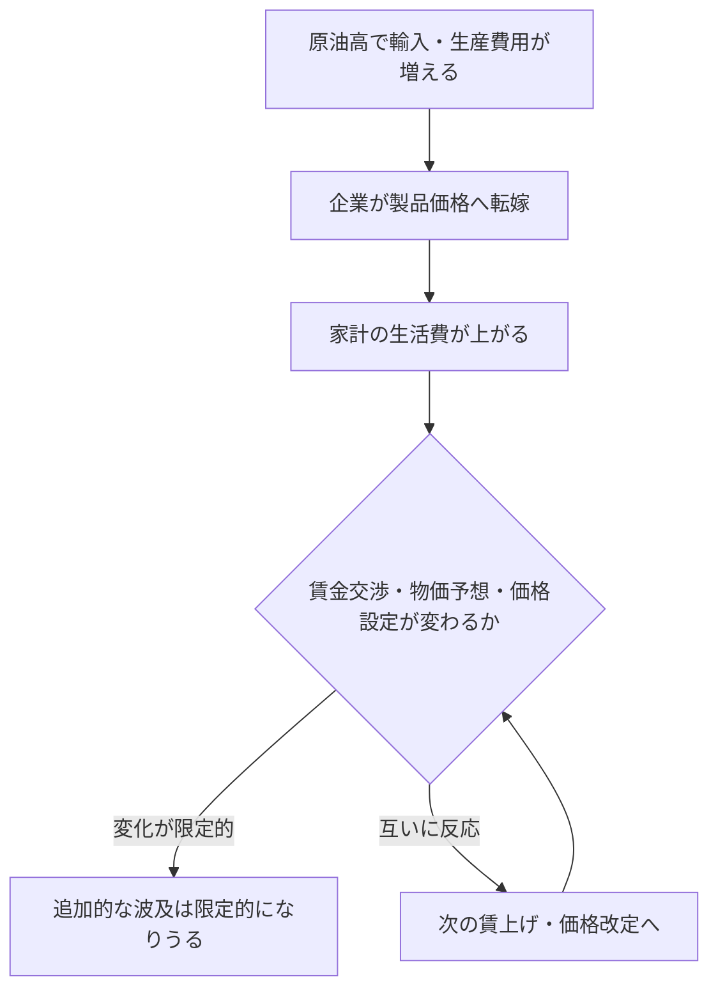
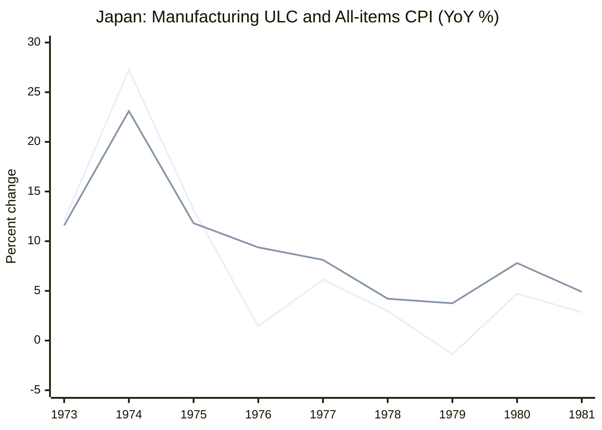

1974年の日本では、物価と名目賃金の上昇率がともに20～30％に達しました。一方、1979～80年の第2次石油ショックでは、輸入物価が急騰しても、第1次ほど激しい賃金・物価スパイラルは起きませんでした。

**原油高が生活費を上げることは分かります。それなのに、賃金と物価が互いに押し上げ合う場合と、そうならない場合があるのはなぜでしょうか。**

植田和男・日本銀行総裁は、2026年5月27日の[開会挨拶](https://www.boj.or.jp/about/press/koen_2026/ko260527a.htm)で、過去の4局面を振り返り、2026年の原油高について問いを投げかけました。

この講演を読む鍵は、**輸入費用の増加が価格に届くこと**と、**それが賃金・物価予想・価格設定を変えて持続すること**を分けることです。

以下では、この違いを説明したうえで、第1次・第2次石油ショック、2000年代半ば、2021年以降を比較します。日銀の『展望レポート』と歴史統計は、講演を理解する助けとして使います。本稿は講演の解説であり、歴史上の因果関係を独自に推定するものではありません。

## 1. 原油高には、二つの「波及」がある

原油が高くなると、輸入原材料や燃料の費用が増え、ガソリン・電気料金からさまざまな財・サービスへ値上がりが広がります。日銀『経済・物価情勢の展望』2026年4月号BOX2は、こうした投入コストの販売価格への転嫁を**一次的波及**と説明します。

しかし、**価格が一度上がることと、高い物価上昇率が続くことは違います。**

仮に、ある商品の価格が100から110になり、翌年も110のままだったとしましょう。最初の年の上昇率は10％、次の年は0％。価格水準は高いままですが、価格上昇は続いていません。これは考え方を示す架空例です。

値上がりがさらに持続する経路の一つは、次のようなものです。

*講演の理解を助ける概念図です。一次的波及も時間差を伴います。右の連鎖が必ず起きるという意味ではありません。*

労働者が生活費の上昇を補おうと賃上げを求め、企業がその費用をさらに価格へ転嫁すれば、次の賃金交渉や物価予想にも影響します。こうした**賃金・物価の相互連鎖**がスパイラルです。

なお、**二次的波及は賃金に限りません。** 企業が収益マージンを維持しようとして値付けを変える経路もあります。原油高の後にCPIが上がっただけでは、賃金・物価スパイラルが起きたとは言えないのです。

## 2. 第1次石油ショック：原油高の前からインフレが進んでいた

第1次石油ショックが起きたのは1973年後半です。総裁がまず注目するのは、**原油高が起きる前の日本でも、すでに物価と賃金が急上昇していた**ことです。

講演によると、1973年前半には、食料・エネルギーを除くCPIの前年比上昇率が10％近く、名目賃金上昇率は20％近くに達していました。

*出典：[植田総裁の2026年5月27日開会挨拶・図表2](https://www.boj.or.jp/about/press/koen_2026/data/ko260527a1.pdf)。T＝1973年10～12月期。CPI（食料・エネルギー除く）と名目賃金は前年比。実質GDPは前期比年率。政策金利は右軸。*

この図で読むべきなのは、「原油高が起きたから初めて物価や賃金が上がった」という順序ではないことです。

すでに物価上昇が進むなかで原油高が重なり、1974年春の賃金交渉では非常に大幅な賃上げが妥結されました。企業は原材料費に加えて人件費の増加も販売価格に転嫁し、将来も物価が上がるという予想が強まりました。

**相対価格のショックが、国内の賃金と幅広い物価の連鎖へ変わった**、というのが総裁の説明です。

金融政策も無関係ではありません。日銀は物価上昇圧力が明確になってから引き締めましたが、総裁は、高インフレの仕組みがすでに形成された後だったうえ、引き締めの度合いも不十分だったと振り返っています。

その後、1974年前半には深刻な景気後退が生じました。原油高による交易条件の悪化、実質所得や企業業績の悪化、金融引き締めなどが重なったためです。最終的にインフレ率は下がりましたが、代償は大きかったと総裁は述べています。

## 3. 第2次石油ショック：どの段階で波及が弱まったのか

1979～80年頃にも原油高によって輸入物価は大きく上昇しました。しかし第1次ほど強い賃金・物価スパイラルにはなりませんでした。

*出典：[植田総裁の図表3](https://www.boj.or.jp/about/press/koen_2026/data/ko260527a1.pdf)。T＝1979年1～3月期。輸入物価（円ベース）は右軸。第1次の図表2とは目盛りや基準期が異なります。*

総裁の挙げた理由を、**波及のどの段階に作用しうるか**で整理してみましょう。

| 波及の段階 | 第2次にあった条件 | どう作用しうるか |
| --- | --- | --- |
| **輸入費用が生産コストへ届く段階** | ショック前の円高、省エネ・原油依存度の低下 | 円建ての輸入費用や生産に必要なエネルギーの負担を和らげる |
| **値上げが賃金交渉に波及する段階** | 低い初期インフレ、第1次の経験から学んだ労使の行動 | 物価上昇をそのまま名目賃上げで補う動きを抑える |
| **賃金・物価の連鎖が続く段階** | より迅速な金融引き締め | 需要と物価上昇圧力の持続を抑える方向に働く |

*これは講演を理解するための概念整理です。段階が厳密に独立するわけではなく、各条件の因果効果や寄与率を推定した表でもありません。*

特に重要なのは、**「原油高で生活費が上がったから、賃金も同じだけ上げよう」という行動が、第1次と第2次で同じではなかった**という点です。

総裁によれば、第1次の経験を経て企業と労働組合は、原油高に伴う物価上昇を名目賃上げで全面的に取り戻そうとすると、かえってさらなる物価上昇を招きかねないと認識していました。

金融政策も重要でしたが、**為替・省エネは初めの負担を和らげ、賃金交渉や物価予想はその後の連鎖に関わる。** 複数の条件を一緒に読むと、第2次の違いが理解しやすくなります。

第2次に物価が上がらなかったわけではありません。経済も減速しました。それでも第1次のような、賃金と物価が強く相互に加速する局面には至らなかったのです。

:::details 二つの講演図表を比較するときの注意

- 青線のCPIは「食料・エネルギー除く」です。日本で通常「コアCPI」と呼ぶ「生鮮食品を除く総合」とは異なります。
- 図表2・3の縦軸は同じ目盛りではありません。線の高さだけを見比べないでください。
- 基準期Tも異なり、同じ強さ・性質の原油ショックを与えた実験ではありません。
- 輸入物価は原油価格そのものではありません。為替やほかの輸入品も関わります。

:::

## 4. 数字で補う：賃金上昇率とULCは何が違う？

日銀の[2026年4月『展望レポート』BOX2・図表B2-5、B2-6](https://www.boj.or.jp/mopo/outlook/gor2604b.pdf#page=49)も、1970年代の賃金経路を補っています。

そこでは、**1974年の春季賃上げ率は約33％**に達したのに対し、第2次ショック期には賃上げ率が抑制され、**1980年の実質賃金上昇率はマイナス**だったと説明されています。前者は賃上げ率、後者は物価を考慮した実質賃金の伸びであり、同じ指標の直接比較ではありません。

日銀は、もう一つ**単位労働コスト（ULC）**にも注目します。これは名目賃金そのものではなく、生産1単位当たりの労働費用です。経済全体については、

$$
\mathrm{ULC}=\frac{\text{名目雇用者報酬}}{\text{実質GDP}}
$$

と表せます。雇用者報酬も実質生産も10％増えれば、ULCは変わりません。生産が増えず報酬だけ10％増えれば、ULCも10％増えます。

日銀の図表B2-6では、第1次の前後にULCの伸びが大幅に加速する一方、第2次では抑制されています。**名目賃金だけでなく、生産量との関係で見た労働費用の伸びも違っていた**と理解できます。ただし、ULCだけで賃金が物価に及ぼした因果効果は分かりません。

:::details 補足データ：OECD製造業ULCと全国総合CPI

日銀のULCは**経済全体**を対象とします。別の歴史統計として、OECDの**製造業**ULC前年比と、全国総合CPI前年比を並べます。

| 年 | 製造業ULC前年比 | 全国総合CPI前年比 |
| --- | ---: | ---: |
| 1973 | +12.08％ | +11.59％ |
| 1974 | +27.25％ | +23.10％ |
| 1979 | −1.38％ | +3.75％ |
| 1980 | +4.72％ | +7.80％ |
| 1981 | +2.85％ | +4.90％ |

*ULCは[FRED収録のOECD系列JPNULCMANAPNMEI](https://fred.stlouisfed.org/data/JPNULCMANAPNMEI)、CPIは[OECD全国総合の年平均指数](https://data-explorer.oecd.org/vis?df%5Bag%5D=OECD.SDD.TPS&df%5Bid%5D=DSD_PRICES_COICOP2018%40DF_PRICES_C2018_ALL&dq=JPN.A.N.CPI.IX._T.N.&pd=1955%2C2024&vw=tb)から計算。製造業と家計の対象範囲が異なり、講演の「食料・エネルギー除くCPI」とも別の系列です。*

*1本目が製造業ULC、2本目が全国総合CPI（ともに前年比）。線の併走から因果関係や寄与率を求めることはできません。*

ULCの歴史系列には、改訂・定義差が残ります。別資料では1979年が約+0.19％、1980年が約−0.48％となり、採用したFRED系列と符号まで異なります。そのため年ごとの符号の反転は結論にせず、**1974年頃と第2次ショック期の大きな伸びの差**に注目します。

別資料：[1981年英国議会に引用されたOECD統計](https://hansard.parliament.uk/Commons/1981-01-26/debates/7c775e34-5df8-4e81-95dc-0b819e64ca9f/UnitLabourCosts)、[1990年の英国議会掲載指数](https://hansard.parliament.uk/Commons/1990-11-19/debates/5d87c114-21a5-4dbc-b2f2-7e4bddbea523/WrittenAnswers)。[固定CSVとPython/R再現コード](https://github.com/Osino-Niso/econ-data-lab/tree/research/oil-shock-data-pilot-20261026/code/oil-shocks-inflation-regimes)。

:::

## 5. 2000年代と2021年以降：原油高への反応はさらに変わった

総裁は1970年代だけで話を終えていません。2000年代半ばと2021年以降の経験を並べることで、**「原油高の影響は、その時代の賃金・価格設定のあり方に左右される」**という見方を補強しています。

### 2000年代半ば：値上げが賃上げの連鎖に広がりにくかった

この時期も原油やコモディティの価格は大きく上がりました。しかし日本では、長く続いたデフレの経験から企業が値上げに慎重になり、家計も価格が上がりにくい環境に慣れていました。名目賃金と予想物価上昇率も低い状態でした。

総裁はこれを「デフレ均衡」と説明します。原油高は企業のコストと家計の生活費を上げましたが、賃金や価格設定の慣行を持続的に変えるまでには至らなかった、という解釈です。

### 2021年以降：値付けや賃金交渉の慣行も変化した

2021年以降は、原油だけでなく、食料・輸入原材料・物流費の上昇、供給網の混乱、世界需要の回復が重なりました。さらに日本では円安が輸入費用を押し上げました。

多くの企業が同時にコスト上昇を経験したため、従来より値上げしやすくなり、春季賃金交渉を通じて名目賃金も上がりました。人手不足も賃金交渉の環境を変えました。

総裁は、企業・家計が長く持っていた「物価も賃金もあまり上がらない」という行動上の慣行（ノルム）が変化し始めたと捉えています。

ただし、**1970年代前半のような賃金・物価スパイラルが再現したと述べているわけではありません**。中長期の物価上昇予想は、指標による差はあるものの、ゼロ近くから1.5～2％台へ緩やかに移ったというのが総裁の説明です。

:::details 講演の図表4・5を見てみる

*出典：[2026年5月27日開会挨拶・図表4・5](https://www.boj.or.jp/about/press/koen_2026/data/ko260527a1.pdf)。青線のCPIは食料・エネルギー除く前年比。図表4のT＝2005年7～9月期、図表5のT＝2022年1～3月期。図表5のTは、2021年から始まった一連の費用上昇より前を意味するものではありません。*

:::

4つの局面をまとめると、次のようになります。

| 局面 | 原油高を迎えた経済と総裁の見方 |
| --- | --- |
| 第1次（1973年～） | すでに高インフレ・高賃金上昇。原油高が強い連鎖を増幅 |
| 第2次（1979年～） | 低い初期インフレ、労使の学習、より迅速な政策、円高や省エネが波及を抑制 |
| 2000年代半ば | デフレ下の価格・賃金慣行が根強く、広範な賃上げ・値上げに波及しにくい |
| 2021年以降 | 広範なコスト高、円安、人手不足のもとで値付けと賃金の慣行が変わり始めた |

この4つは「原油高が同じ強さだった」という比較ではありません。それぞれのショックの性質や、為替・需要・政策も違います。**それでも原油価格だけでは、その後の物価の動きを説明し切れない**というのが講演を通じた共通の視点です。

## 6. 寄り道：CPIが上がるのに、GDPデフレーターは下がりうる

2000年代半ばの説明で、植田総裁は原油高が家計の**実質所得を圧迫した**と述べています。生活費が上がる一方、国内の賃金や企業収益が同じように増えるとは限らないのは、なぜでしょうか。

原油を輸入する日本では、値上がりした原油の代金の一部は海外へ支払われます。この違いを考えるため、二つの「物価」を区別します。

| 指標 | 何を測るか |
| --- | --- |
| CPI（消費者物価指数） | 家計が購入する財・サービスの価格。輸入品の値上がりも反映されうる |
| GDPデフレーター | 国内で生まれた付加価値の価格。名目GDPを実質GDPで割った指数 |

[日銀『展望レポート』BOX2の図表B2-8](https://www.boj.or.jp/mopo/outlook/gor2604b.pdf#page=50)では、同程度の輸入デフレーター上昇をもたらす**5％の円安**と**18％の原油高**を、マクロ計量モデルQ-JEMに別々に与えています。

モデルでは、いずれのショックでもCPI（生鮮食品除く）は上振れます。しかし、原油高ではGDPデフレーターが1～3年目に下振れ、円安では初年の小幅下振れの後に上振れます。

ここでいう上振れ・下振れは**ショックを与えない場合の想定経路（ベースライン）との差**です。「下振れ」は実際の前年比の下落を意味しません。

図表B2-8のGDPデフレーターの寄与分解では、原油高の初期は「ユニット・プロフィット等」のマイナス寄与が大きく、その後ULCにもマイナス寄与が現れます。「ユニット・プロフィット等」は企業の純利益率を意味せず、雇用者報酬以外の付加価値所得等を含む残余です。

**この寄与分解が示すのは、国内付加価値の価格に関する反応であって、企業の利益総額や賃金総額そのものの増減ではありません。** 一方、日銀は別の経路として、原油高による**交易条件の悪化**が家計の実質所得や企業収益を圧迫すると説明しています。同じ輸出品と引き換えに買える輸入原油が減れば、国内で使える購買力には下押し圧力が生じます。

つまり、**家計が直面する価格の上昇と、国内で生み出す付加価値の価格・購買力の動きは別**です。これが、原油高が必ず賃金や企業所得の持続的な上昇へつながるわけではないことを理解する一つの手掛かりになります。

ただし、ここで比べているのは**原油高と円安というショックの種類**です。1973年と1979年の初期条件の違いを証明したモデルではありません。

## 7. 2026年、総裁は何を問いかけたのか

2026年5月27日の講演は、直近の中東紛争に伴う原油高を、過去の4つの局面に続く**「5つ目の原油価格ショック」**と位置付けて終わります。

総裁が示したのは、2026年の原油高が必ずインフレの連鎖を引き起こすという予言ではありません。問いはむしろ次のようなものです。

- いまの日本では、物価上昇予想と賃金交渉はどんな状態にあるのか。
- 原油高が一時的な生活費上昇で終わるのか、賃金や価格設定の慣行まで変えるのか。
- そうした状況に、中央銀行はどう対応するのが望ましいのか。

総裁の講演の結論を一言で整理するなら、**原油高は、すでに存在するインフレ環境と賃金・価格設定のあり方を試す出来事でもある**、となります。

2026年4月の『展望レポート』でも、中東情勢を受けた原油高は、家計の実質所得や企業収益への下押しと消費者物価の押し上げの両方をもたらす要因として扱われています。ただし、これは当時の前提に基づく見通しであり、その後の実績をここで判定しているわけではありません。

## 8. 理解確認

### Q1：原油が上がれば賃金・物価スパイラルになる？

原油価格が上がり、国内のガソリン価格と電気代が上がりました。しかし名目賃金の伸びはほとんど変わらず、将来の物価上昇予想も大きく変わっていません。

**問：** この時点で賃金・物価スパイラルが起きたと判断できますか。理由も述べてください。

:::details 解答と理由

判断できません。生活費の上昇は起きていますが、賃金の引き上げが次の値上げにつながり、それがさらに賃金交渉へ波及するという持続的な連鎖は確認できません。物価上昇とスパイラルを区別する必要があります。

:::

### Q2：第1次と第2次の違いは、金融政策だけで説明できる？

1973年後半の第1次石油ショック時には、すでに物価と名目賃金の上昇率が高くなっていました。一方、1979～80年頃の第2次は、初期の物価上昇率が低く、労使が過去の経験から学び、金融引き締めもより迅速だったと総裁は説明しています。

**問：** 第2次に強いスパイラルが再現しなかった理由を「利上げが早かったから」だけにまとめると、何を見落としますか。

:::details 解答と理由

ショック前からの物価・賃金環境、労使の行動と予想、事前の円高、省エネなどを見落とします。総裁は政策の重要性を認めつつ、複数の条件が重なって波及が抑えられたと説明しています。どの要因が何％寄与したかを、この講演だけで求めることはできません。

:::

### Q3：家計の物価と国内所得は、いつも同じ方向へ動く？

原油を輸入する日本を考えます。あるモデルでは、原油高によってCPIがベースラインより高くなる一方、GDPデフレーターはベースラインより低くなると試算されました。

**問：** これは矛盾ですか。また、この結果だけで第1次と第2次の歴史的な違いを説明したことになりますか。

:::details 解答と理由

矛盾ではありません。CPIは家計が購入する価格、GDPデフレーターは国内で生み出された付加価値の価格だからです。輸入費用の増加は家計の生活費を押し上げつつ、国内企業の利幅や労働費用に下押し圧力をかけることがあります。

歴史的な違いの証明にもなりません。モデルは原油高と円安を比較したもので、第1次・第2次における賃金交渉や物価予想の差の因果効果を推定してはいません。

:::

## おわりに：原油高だけでは、インフレのその後は決まらない

なぜ第2次石油ショックでは、第1次のような賃金・物価スパイラルが繰り返されなかったのでしょうか。

植田総裁は、**原油高の前からあったインフレの勢い、労使が過去の経験から学んだこと、金融政策の対応、為替、省エネなどの違い**を組み合わせて説明しています。

その後の2000年代半ばと2021年以降を見ても、原油高が賃金や価格設定にどこまで波及するかは同じではありませんでした。ここで大切なのは、原油価格という一つの数字から、物価の将来を機械的に決めないことです。

そして、もう一つ区別したいのは、**家計が払う価格が上がることと、国内の賃金・企業所得が同じように上がることは別**だという点です。ULCの歴史系列や日銀BOX2のモデルは、この違いを考える助けになります。

2026年の「5つ目のショック」について、講演は答えを確定するのではなく、**いまの日本の賃金・物価予想・価格設定はどのような状態なのか**という問いを残しています。過去の石油ショックを振り返る意味は、その問いを考えるための視点を得られることにあるのでしょう。

## 参考資料・再現コード

- 植田和男（2026）[「日本における原油価格ショック、物価上昇率と金融政策」2026年5月27日開会挨拶](https://www.boj.or.jp/about/press/koen_2026/ko260527a.htm)（[図表付きPDF](https://www.boj.or.jp/about/press/koen_2026/data/ko260527a1.pdf)）。『金融研究』45巻4号の[掲載情報](https://www.boj.or.jp/research/imes/mes/mes26.htm)。
- 日本銀行（2026）[『経済・物価情勢の展望』2026年4月号、BOX2「原油価格高騰がわが国物価に与える影響」](https://www.boj.or.jp/mopo/outlook/gor2604b.pdf)。
- OECD/FRED [日本の製造業ULC・JPNULCMANAPNMEI](https://fred.stlouisfed.org/data/JPNULCMANAPNMEI)、OECD [日本の全国総合CPI](https://data-explorer.oecd.org/vis?df%5Bag%5D=OECD.SDD.TPS&df%5Bid%5D=DSD_PRICES_COICOP2018%40DF_PRICES_C2018_ALL&dq=JPN.A.N.CPI.IX._T.N.&pd=1955%2C2024&vw=tb)。
- [ULCとCPIの固定CSV、Python/R再現コード、データの出典と留意点](https://github.com/Osino-Niso/econ-data-lab/tree/research/oil-shock-data-pilot-20261026/code/oil-shocks-inflation-regimes)。

*本文の歴史系列は特定公表時点の固定データを用いています。図表2～5は日銀講演資料の引用です。補助資料の統計とモデル実験は、植田総裁の歴史的解釈を新たに因果推定したものではありません。*
