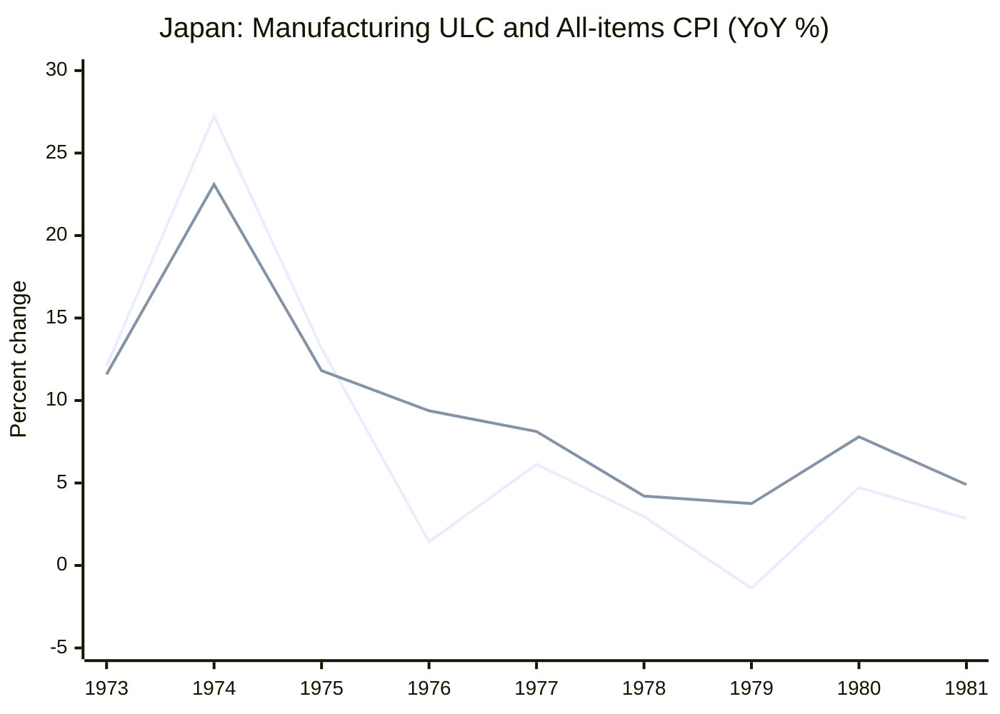

1974年、日本では物価も名目賃金も前年比20～30％という勢いで上昇しました。ところが、1979～80年の第2次石油ショックでは原油や輸入品の価格が再び急騰したにもかかわらず、第1次ほど激しい賃金・物価スパイラルは起きませんでした。

**原油が高くなったのは同じなのに、なぜこれほど違ったのでしょうか。**

植田和男・日本銀行総裁は2026年5月27日の開会挨拶で、その理由として賃金交渉、物価上昇予想、金融政策、為替相場、省エネなどを挙げています。

ところが、賃金・物価の波及を調べるうちに、もう一つの意外な区別が見えてきました。日銀が2026年4月に公表したモデル分析では、原油高は**家計が支払う消費者物価（CPI）を、ショックがない場合より押し上げる一方、国内の付加価値の価格を表すGDPデフレーターを、ショックがない場合より押し下げる**と試算されています。同じ程度の輸入物価上昇を起こす円安では、反応が異なりました。

両方とも**実際の物価水準の上昇・下落を直接示すものではなく、ショックのない想定経路（ベースライン）からの差**です。それでも、原油高の負担が国内の賃金や企業収益にどう現れるかを考える手がかりになります。

この記事では、次の順番で確かめます。

1. **植田総裁は歴史をどう説明したか。**
2. **賃金を通じた波及は、ULC（単位労働コスト）のデータにも表れているか。**
3. **その検討を手がかりに、原油高でCPI・労働費用・企業利潤がなぜ異なる反応をしうるか。**

日銀の**講演による歴史解釈**、公開統計の**観察事実**、別資料の**モデル実験**、本稿の**推論**は、区別して扱います。今回のデータ計算は新しい因果推定ではありません。

## 1. 植田総裁は、第1次と第2次の違いをどう説明したか

### 第1次：原油高の前から物価も賃金も高い伸びだった

第1次石油ショックは1973年後半に起きました。しかし総裁が強調しているのは、その**前から**日本のインフレがかなり進んでいたことです。

1973年前半の時点で、食料・エネルギーを除くCPIの上昇率はすでに10％近く、名目賃金上昇率は20％近くに達していました。

*出典：[植田総裁の2026年5月27日開会挨拶・図表2](https://www.boj.or.jp/about/press/koen_2026/data/ko260527a1.pdf)。T＝1973年10～12月期。青線は食料・エネルギー除くCPI、緑線は名目賃金（ともに前年比）。*

その状態に原油高が重なりました。1974年春の大幅な賃上げ妥結、企業の労働費用・原材料費の価格転嫁、予想物価上昇率の上昇が連鎖した――これが総裁の説明です。

金融引き締めは実施されましたが、総裁は、引き締めが高インフレの仕組みが形成された**後**であり、上昇率の高さに照らしても不十分だったと振り返っています。

大切なのは、原油価格の上昇**だけ**で1974年のインフレを説明していないことです。ショック以前の物価・賃金の勢いと、ショック後の賃金・価格設定の反応を合わせて説明しています。

### 第2次：賃金への波及を抑えた条件が複数あった

1979～80年の第2次石油ショックでも輸入物価は大きく上昇しました。それでも第1次ほどの賃金・物価スパイラルは再現しませんでした。

*出典：[同開会挨拶・図表3](https://www.boj.or.jp/about/press/koen_2026/data/ko260527a1.pdf)。T＝1979年1～3月期。輸入物価（円ベース）は右軸、CPI・名目賃金・政策金利は左軸。*

植田総裁が挙げた条件を、役割ごとに整理すると次のようになります。

| 条件 | 総裁の説明における役割 |
| --- | --- |
| 原油高の前の物価・賃金上昇率が低かった | 賃金・物価がすでに加速している状態とは違った |
| 労使が第1次の経験から学んでいた | 原油高をそのまま名目賃上げで補償する動きを抑えた |
| 金融引き締めがより迅速だった | 物価上昇圧力を抑える方向に働いた |
| ショック前に円高が進んでいた | 円建て輸入物価の出発点を下げていた |
| エネルギー効率が改善していた | 原油への依存を弱めていた |

総裁自身、政策対応だけが理由だとは述べていません。また、第2次の物価上昇が「ゼロだった」という意味でもありません。**第1次のような強い賃金・物価の連鎖にならなかった**という比較です。

ここで総裁の指摘を二つに分けます。**（A）ショックを迎えた時点の賃金・物価・予想などの「初期条件」が、その後の波及を変える**という説明と、**（B）原油高以外に、円安や需要などが同時に起きれば波及の経路自体が変わる**という説明です。前者は歴史上のインフレ・レジームの比較、後者はショックの種類・組み合わせの問題であり、同じ実験ではありません。

まずAの手がかりとして、**「賃金の反応が弱かった」という説明は、名目賃金以外の指標でも確かめられるでしょうか。**

:::details 図表2・3を比較するときの注意点

- 左軸の目盛りが大きく異なるので、二つの図の線の高さをそのまま比較しません。
- CPIは「食料・エネルギー除くCPI」で、日本で一般に「コアCPI」と呼ぶ「生鮮食品を除く総合」とは異なります。
- CPI・名目賃金・輸入物価は前年比、実質GDPは前期比年率です。輸入物価は原油価格そのものではありません。
- Tはそれぞれの歴史的な基準期であり、**同じ強さのショックを実験的に与えた時点**ではありません。

:::

## 2. 賃金の波及を、単位労働コストで確かめる

### 賃金上昇率と「生産1単位当たりの労働費用」は違う

名目賃金が上がると企業のコストは増えそうです。ただし、同時に生産量も増えれば、製品1単位当たりの負担は必ずしも増えません。

そこで参考になるのが、**単位労働コスト（ULC）**です。日銀『経済・物価情勢の展望』2026年4月号BOX2では、経済全体について次のように定義しています。

$$
\mathrm{ULC}=\frac{\text{名目雇用者報酬}}{\text{実質GDP}}
$$

例えば名目雇用者報酬が10％増え、実質GDPも10％増えたなら、ULCは変わりません。生産量が増えず報酬だけ10％増えれば、ULCも10％増えます。これは**賃金そのもの**でも**CPIそのもの**でもありません。

日銀BOX2の図表B2-6では、第1次のころにULCの伸びが大きく加速した一方、第2次のころには抑制されていました。さらに1974年春の賃上げ率は約33％、1980年の実質賃金上昇率はマイナスだったと記述されています。<https://www.boj.or.jp/mopo/outlook/gor2604b.pdf>

ここまでは、植田総裁が語った賃金経路と**整合する観察**です。ただし「ULCが上がったからCPIが何％上がった」とまでは言えません。

### 別の公表系列で1973～81年を追う

講演とは別に、OECDが公表した**日本の製造業ULCの前年比**を使って確かめます。FREDに保存された系列は、年次データで2014年更新の履歴版です。

| 年 | 製造業ULC前年比 | 全国総合CPI前年比 |
| --- | ---: | ---: |
| 1973 | +12.08％ | +11.59％ |
| **1974** | **+27.25％** | **+23.10％** |
| 1975 | +13.16％ | +11.81％ |
| 1976 | +1.43％ | +9.38％ |
| 1977 | +6.13％ | +8.12％ |
| 1978 | +2.96％ | +4.21％ |
| **1979** | **−1.38％** | **+3.75％** |
| **1980** | **+4.72％** | **+7.80％** |
| 1981 | +2.85％ | +4.90％ |

*出典：ULCは[OECD製造業ULC（FRED収録系列JPNULCMANAPNMEI）](https://fred.stlouisfed.org/data/JPNULCMANAPNMEI)、CPIは[OECD全国総合CPIの年平均指数](https://data-explorer.oecd.org/vis?df%5Bag%5D=OECD.SDD.TPS&df%5Bid%5D=DSD_PRICES_COICOP2018%40DF_PRICES_C2018_ALL&dq=JPN.A.N.CPI.IX._T.N.&pd=1955%2C2024&vw=tb)から前年比を再計算。製造業と経済全体という対象の違いに注意。日銀講演の食料・エネルギー除くCPIとは異なる系列です。*

同じ数値を時系列として重ねると、1974年の加速だけでなく、1976年には製造業ULCの伸びが約1.4％に鈍化してもCPIは約9.4％上昇していたこと、1979～80年には両方とも動きが変わったことが分かります。

*折れ線1本目が**製造業ULC**、2本目が**全国総合CPI**です。両線は同じ日本の年次上昇率でも、対象範囲が異なります。線の併走は因果関係やULCのCPIへの寄与率を示しません。図が表示されない環境でも上の表で数値を確認できます。*

単独の1974年と1979年だけを見るより、この並びの方が状況をつかみやすくなります。

- 第1次では、すでに高かった製造業ULC上昇率が1974年にさらに大きく上がりました。
- 第2次では、1979年の製造業ULC上昇率が低く、1980年には再びプラスになりました。しかし1980年の上昇率は、1974年の水準には遠く及びません。
- 一方、1980年の全国総合CPIは前年比約7.80％上昇しました。**労働費用の伸びが第1次より小さくても、消費者物価は上昇しうる**のです。

これで、総裁の説明に沿う数量的な対比は得られました。ただし、**製造業ULCと全国CPIは対象が違い、両ショックの開始時点も強さも異なります**。年次の動きが似ていても、賃金が物価に与えた因果効果を識別したことにはなりません。

:::details ULCは資料の年代によって数値が違う

1979年の製造業ULC前年比は、1981年に英国議会が掲載したOECD資料では−3％、FRED収録のOECD系列では−1.38％、1990年の別の英国議会資料の指数から計算すると約+0.19％でした。

どの差が統計改訂・定義変更によるものかの詳細は確認できていません。このため**「1979年にULCは必ずマイナスだった」ことを結論にしません**。比較的安定しているのは、1974年の強い伸びに比べて1979年は大幅に鈍化していた、という対比です。

[1981年英国議会資料](https://hansard.parliament.uk/Commons/1981-01-26/debates/7c775e34-5df8-4e81-95dc-0b819e64ca9f/UnitLabourCosts) ／ [1990年英国議会資料](https://hansard.parliament.uk/Commons/1990-11-19/debates/5d87c114-21a5-4dbc-b2f2-7e4bddbea523/WrittenAnswers)

:::

## 3. 次の発見：原油高の負担は、賃金と企業利潤のどこへ向かうか

前節で分かったのは、**原油が高くなっても、労働費用やCPIが同じ速さで上がるわけではない**ということでした。これは植田総裁が重視する「賃金を介した波及」を理解する手がかりです。

しかし、そもそも原油高によって増えた支払いは、国内でどのような負担になるのでしょうか。原油を海外から輸入する日本では、家計の生活費が上がる一方、国内企業が利幅を削ったり、労働者の実質的な購買力が下がったりすることも考えられます。

まず「物価」の意味を分けましょう。

| 指標 | 測っているもの |
| --- | --- |
| 消費者物価指数（CPI） | 家計が購入する財・サービスの価格。輸入品や輸入原料の価格変化も反映される |
| GDPデフレーター | 国内で生み出された付加価値の価格。名目GDP÷実質GDPで定義される |

さらに、GDPデフレーターを所得の分配面から表すと、概念的には次のように分解できます。

$$
\underbrace{\frac{\text{名目GDP}}{\text{実質GDP}}}_{\text{GDPデフレーター}}
=
\underbrace{\frac{\text{名目雇用者報酬}}{\text{実質GDP}}}_{\text{ULC}}
+
\underbrace{\frac{\text{その他の付加価値所得・純間接税等}}{\text{実質GDP}}}_{\text{ユニット・プロフィット等}}
$$

日銀の図表に出てくる「ユニット・プロフィット等」は、**企業の純利益率だけを意味するものではありません**。雇用者報酬以外の所得や税等を含む残余です。式が表すのは会計上の関係であり、「賃金が物価を押し上げた」という因果効果ではありません。

### 同じ輸入物価上昇でも、原油高と円安の反応は違う

[日本銀行・2026年4月『展望レポート』BOX2・図表B2-8（PDFの50ページ目、誌面48頁）](https://www.boj.or.jp/mopo/outlook/gor2604b.pdf#page=50) は、ここで役立つ別の分析です。日銀のマクロ計量モデル**Q-JEM**に、次の二つを個別に与えています。

- 円安ショック：ドル円レートが**5％円安**になる。
- 原油高ショック：原油価格が**18％上昇**する。

二つは**輸入デフレーターを同程度押し上げる**ように設定されています。ただし、これは歴史上の第1次・第2次石油ショックを再現したものではありません。**「ショックの種類」を変えるモデル上の比較**です。

ここで最も重要なのが、図表B2-8の縦軸です。単位は**「ベースラインからの乖離率、％」**。マイナスは「実際の価格水準が前年より下落する」という意味ではなく、**ショックがなかった場合の想定経路と比べて価格水準が低い**という意味です。

:::details 例：「ベースラインより0.25％低い」とはどういうこと？

仮にGDPデフレーターが今年100で、ショックがない場合に来年101へ上がると見込まれていたとします。原油高ショックによる来年の水準の乖離率が−0.25％なら、ショック後の値は

101 × (1 − 0.0025) ＝ **100.7475**

です。**101より低い一方、今年の100よりは高い**のです。この数値は架空で、日銀の具体的な予測ではありません。「ベースラインより下振れ」と「前年より物価が下落」を区別するための計算です。

:::

同図の棒グラフからは、次の違いが読み取れます。

| モデル上の影響 | 円安ショック | 原油高ショック |
| --- | --- | --- |
| CPI（生鮮食品除く） | **ベースラインより上振れ**。幅広い財・サービスに波及し、3年目まで影響が拡大 | **ベースラインより上振れ**。エネルギー中心で、波及する品目は相対的に限定的 |
| GDPデフレーター | **1年目は小幅下振れ、2～3年目は上振れ** | **1～3年目ともベースラインより下振れ** |
| GDPデフレーターの内訳 | 1年目は合計で小幅マイナス。2～3年目はユニット・プロフィット等のプラス寄与が大きく、ULCもプラス寄与 | **初期はユニット・プロフィット等のマイナス寄与が大きく、その後ULCにもマイナス寄与** |

*図表B2-8の方向・大小の読解。数値を精密にデジタイズした独自推定ではありません。図のCPIは「除く生鮮食品」であり、植田総裁の図表2～5にある「食料・エネルギー除くCPI」とも異なります。*

注目したいのは、**原油高ショックの初めには国内の利幅等が圧迫され、その後は労働費用の寄与にも影響する**というモデル上の時間差です。輸入物価が上昇しても、その値上がり分が国内の労働者や企業の所得になるわけではありません。

日銀はこの経路を**交易条件の悪化（海外への所得流出）**と説明します。例えば日本が同じ輸出品を売っても、それと引き換えに買える輸入原油の量が減るような状況です。家計が払う価格を押し上げながら、企業の収益マージンや賃金に下押し圧力がかかることは、矛盾しません。

対照的に円安は、輸入品だけでなく幅広い財・サービスの値付け、賃金、利幅の反応も促しやすい、というのが日銀のモデルによる分析です。

ここで、ようやく**第2節のULCに戻れます**。原油高が賃金・物価の二次的波及につながるか知りたいなら、CPIが上がったという観察だけでは不十分です。**ULCと企業の利幅が、その費用をどう受け止めたか**も調べなければなりません。

ただし、モデルの結果は**近年の経済構造に関するメカニズムの例示**です。1974年と1980年のULC上昇率の差が、この経路で何％生じたかを新たに推定したわけではありません。ここで得たのは歴史の決着ではなく、**歴史の説明に必要な視点**です。

### 二つの比較軸を取り違えない

| 比較の軸 | 何を変えているか | 何を考えるのに役立つか |
| --- | --- | --- |
| **A：植田総裁の歴史比較** | 第1次・第2次などの**初期の賃金・物価・期待・政策環境**が異なる | なぜ原油高の二次的波及が異なったのか |
| **B：BOX2のQ-JEM実験** | **原油高と円安というショックの種類**が異なる（輸入物価上昇の大きさをそろえる） | なぜ輸入コスト高でも、国内の賃金・利潤への作用が異なるのか |

BはAの原因を証明しません。それでもBで理解した**賃金・利幅の受け止め方**は、Aの問いに対してどんなデータを追加で調べるべきかを教えてくれます。

## 4. 植田総裁が2026年に突き付けた「第5のショック」

植田総裁の開会挨拶は、1970年代の二つの石油ショック、2000年代半ば、2021年以降の物価上昇を比べたあと、**2026年5月の講演時点で進行していた中東紛争に伴う「第5の原油価格ショック」**に言及して終わります。

総裁の問いは、「今回の原油価格が何ドルになるか」だけではありません。**いまの日本は、原油高が賃金や物価予想の持続的な変化につながる初期条件にあるのか。金融政策はどう対応すべきか。** という問いです。

この問いの位置付けを理解するため、まず残り二つの歴史的な局面も確認します。

### 2000年代半ば：輸入価格は上がっても、値上げと賃上げの慣行は動きにくかった

この時期、日本では企業が値上げに慎重で、名目賃金や予想物価上昇率も低いままでした。総合CPIには上昇があっても、食料・エネルギー除くCPIは弱い状態が続きました。

総裁はこの状態を「デフレ均衡」と捉え、輸入費用の増加が主に家計の実質所得を圧迫し、賃金や価格設定の慣行を大きく変えなかったと説明しています。

### 2021年以降：原油以外にも費用上昇が広がり、賃金・値付けも変化した

近年は原油だけでなく、食料・物流・輸入原材料の費用上昇、円安、需要回復、人手不足が重なりました。企業の値上げが広がり、春季賃金交渉を通じた名目賃金や中長期の予想物価上昇率にも変化がみられた、というのが総裁の解釈です。

:::details 講演の図表4・5でも確認する

*出典：[植田総裁の2026年5月27日開会挨拶・図表4・5](https://www.boj.or.jp/about/press/koen_2026/data/ko260527a1.pdf)。青線はいずれも食料・エネルギー除くCPIの前年比。図表5のT＝2022年1～3月期だが、コスト上昇は2021年から始まっており、ショック前の純粋な基準期ではない。*

:::

2021年以降には**原油高と円安が同時に進んだ**ため、第3節のモデル実験で見た「原油高だけの場合」と「円安だけの場合」の反応の違いが、どちらも実際の経済に関わることになります。ただし、それぞれが何％寄与したかは、講演の図を並べただけでは分かりません。

### 2026年の問いへの接続：現在のインフレ・レジームはどちらに近いか

2026年4月の『展望レポート』BOX2は、総裁の講演より**約1か月前**に公表されました。そこでも同じ中東情勢に伴う原油高を背景に、まず1970年代のULCの違いを確認し、そのうえで第3節のQ-JEMモデルを使って**原油高と円安という二つの経路**を比べています。

そのため、歴史比較（初期条件の違い）とモデル実験（ショックの種類の違い）は、互いの答えを証明するものではなく、**2026年の物価への波及を考えるための、別々の二つの問い**としてつながります。

また、今回の原油高によって収益が圧迫される企業が多くても、物価上昇予想や賃金交渉が高インフレ環境に移れば、二次的波及が強くなる可能性は消えません。逆に、CPIの一時的な上振れだけで1970年代型のスパイラルを断定するのも早計です。ここが総裁の「初期条件が重要」という論点へ戻る場所です。

### この見方は関連研究に支持されるのか

二つの実証研究は、この議論を評価する手がかりになります。

- [Baba and Lee（IMF、2022）](https://www.imf.org/en/publications/wp/issues/2022/09/06/second-round-effects-of-oil-price-shocks-implications-for-europes-inflation-outlook-523201)は、欧州のデータを用い、原油高から賃金への波及が、もともとのインフレ率や労使交渉制度、金融政策への信認によって異なると報告しました。**ショックへの賃金反応は経済の状態に依存する**という植田総裁の説明と整合します。ただし1970年代の日本への直接の推定ではありません。
- [安達・加藤（日銀、2025）](https://www.boj.or.jp/research/wps_rev/wps_2025/wp25j05.htm)は、日欧のデータを用いたDSGEモデルで原材料高の直接的な価格転嫁と、賃金を通じた二次的波及を分けました。近年の二次的波及は穏やかながらインフレの持続性を高めたと推定しています。これは**モデルの仮定に依存する分解**です。

さらに[Alvarezほか（IMF、2022）](https://www.imf.org/en/publications/wp/issues/2022/11/11/wage-price-spirals-what-is-the-historical-evidence-525073)は、名目賃金と物価が短期的に加速しても、その後まで両者の加速が持続した局面は少数だったと報告しています。**賃金上昇が起きたことと、持続的な悪循環が起きたことは別**です。

これらを「植田総裁の説明が現代経済学によって証明された」とまとめるのは行き過ぎです。理論的に起こりうる経路、別の国や時代の推定結果、当時の日本で実際に働いた因果効果は、異なる主張だからです。

## 5. 何が分かり、何がまだ分からないのか

この記事の検討結果を、証拠の種類で整理します。

| 問い | いま言えること | まだ言えないこと |
| --- | --- | --- |
| 第1次・第2次で賃金を通じる圧力は違ったか | 講演、日銀BOX2、製造業ULCの歴史系列は大きな差と整合する | その差を賃金行動・政策・省エネのどれが何％生んだか |
| 同じ輸入物価上昇なら国内所得への影響も同じか | Q-JEMではCPIはベースライン比で上振れ、原油高のGDPデフレーターは下振れ。初期はユニット・プロフィット等のマイナス寄与が大きい | 1970年代のGDPデフレーター・ULCの差をそのモデルで説明し切ったという因果結論 |
| 2021年以降の物価上昇は原油高のせいか | 原油、他の費用、円安、需要回復などが重なった | 原油高だけの寄与率と、賃金を介した効果の厳密な大きさ |
| 2026年の「第5のショック」はどう波及するか | 総裁は初期条件とインフレ・レジームに注目。日銀BOX2は経路をモデルで試算 | 先行きにどの経路が何％作用するか、モデル予測と実際が一致するか |

特に歴史比較では、もう一つの問題があります。**原油の価格が上昇したというだけでは、原油の供給減、世界需要の増加、将来の供給不安のどれが原因だったのか分かりません。** 異なる時代の価格変化を「同じ強さの供給ショック」とみなすのは適切ではありません。

:::details 追加探索：世界の供給量が増えても、原油価格は高騰していた

[EIAの世界石油供給統計](https://digital.library.unt.edu/ark:/67531/metadc706106/m1/52/ocr/)によると、世界の石油供給量（年平均）は1978年から1979年に約4.28％増加しました。一方、[米国に陸揚げされたOPEC産原油の費用](https://www.eia.gov/dnav/pet/hist/LeafHandler.ashx?f=m&n=pet&s=i060000008)を月次値の単純平均で比較すると、約48.88％上昇しています。

それでも、**供給ショックがなかったという証拠にはなりません**。需要に比べて供給が不足した可能性、短期的な供給途絶、在庫や期待の変化を年平均では識別できないからです。また、米国の陸揚げ費用は日本の円建て輸入物価とは別物です。

原油価格の変化を供給・世界需要・石油固有の需要に分ける分析については、[Kilian（2010）](https://www-server1.wto.org/spanish/res_s/publications_s/wtr10_forum_s/wtr10_kilian_s.htm)が参考になります。今回の数値比較は識別の必要性を示す**予備的な観察**であり、その推定を再現したものではありません。

:::

次に本当に検証するなら、少なくとも①ショックの性質、②輸入物価から国内の価格・賃金・ULCへの時間差、③景気や為替、金融政策の同時変化を分ける必要があります。金融政策は物価情勢を見て決まるため、利上げ後に物価が鈍化した事実だけで政策の因果効果は分かりません。

## 6. 理解確認：数字と因果関係を読み分ける

### Q1：1979年のULCだけで第2次石油ショックを語れる？

ある公表系列では、日本の製造業ULC前年比は1974年が+27.25％、1979年が−1.38％、1980年が+4.72％でした。一方、全国総合CPI前年比は1974年+23.10％、1979年+3.75％、1980年+7.80％です。第1次ショックは1973年後半、第2次は1979年頃に起きました。

**問：** (1) ULCについて確かめられる歴史的な違いは何ですか。(2) 1979年だけを見て第2次の波及が弱かったと断定できないのはなぜですか。(3) この表からULCのCPIへの因果効果は求められますか。

:::details 解答と理由

(1) 第1次のころ、とりわけ1974年には製造業ULCの伸びが大きかったのに対し、第2次の初期は小さかったという対比です。

(2) 1980年にはULCの伸びが再びプラスです。ショック発生からの経過時間をそろえて比較しておらず、年平均データでは月次・四半期の変化が見えません。

(3) 求められません。ULCは製造業、CPIは家計消費全体であり、需要、原材料費、為替、政策なども同時に変化します。相関は因果関係の証明ではありません。

:::

### Q2：原油高でCPIは上振れ、GDPデフレーターは下振れ――矛盾する？

日本が原油を海外から輸入する経済を考えます。あるモデルでは、原油高によってCPI（生鮮食品除く）は**ショックがない場合より高く**、GDPデフレーターは**ショックがない場合より低く**なるという結果が得られました。後者の下振れは、初期には企業の利幅等を含む成分に、後にはULCの成分にも表れました。

**問：** (1) CPIとGDPデフレーターの反応が逆でも、なぜ矛盾ではないのですか。(2) 今年のGDPデフレーターが100、ショックなしの来年の水準が101と予想され、ショックによる乖離率が−0.25％なら、来年は100を下回りますか。(3) このモデルだけで第1次・第2次石油ショックの歴史的な違いを証明できますか。

:::details 解答と理由

(1) CPIは家計の購入価格、GDPデフレーターは国内で生み出された付加価値の価格です。原油価格が上がれば生活費が増える一方、海外に支払う輸入費用の増加によって、国内の企業利幅や賃金には下押し圧力がかかりえます。国内で買える輸入原油が、同じ輸出品の対価に対して少なくなる状況を、**交易条件の悪化**といいます。

(2) 下回りません。来年のGDPデフレーターは `101 × (1−0.0025)=100.7475` です。ショックなしの101より低いですが、今年の100より高いままです。「ベースラインより低い」と「前年比で下落」を混同してはいけません。

(3) 証明できません。モデルは原油高という**ショックの種類**の影響を考えていますが、歴史的な第1次・第2次の比較では**初期の賃金・予想・政策環境**などが異なります。モデル上の反応が当時の因果的な寄与率を示したわけではありません。

:::

### Q3：「賃金・物価スパイラル」と断定してよい？

ある国で原油高の後、CPIと名目賃金の前年比がともに上がり、企業も値上げを続けたとします。原材料費は時間差で転嫁され、同時期には労働需給も逼迫していました。

**問：** この情報だけで、「原油高が賃金を上げ、その賃金が次の物価上昇を引き起こした」と確定できますか。必要な追加の証拠を二つ挙げてください。

:::details 解答と理由

確定できません。少なくとも、①過去の原材料費上昇が遅れて転嫁された分と、賃金上昇を受けて追加的に価格改定された分の区別、②労働需給や需要、為替、政策など賃金と物価に同時に影響する要因を考慮した分析が必要です。賃金が上がったという事実だけでは、相互に加速する因果的な悪循環を確定できません。

:::

## 結論：原油高で家計の物価が上がっても、国内の賃金・利潤が同じように上がるとは限らない

植田総裁の講演を出発点にした疑問は、**「なぜ第2次石油ショックでは、第1次のような賃金・物価スパイラルが再現しなかったのか」**でした。

総裁は、その違いを初期の賃金・インフレ予想、労使の学習、金融政策、為替、省エネなど複数の条件から説明しています。日銀の歴史的な資料と製造業ULCの時系列も、**第1次と第2次で生産1単位当たりの労働費用の伸びが大きく異なった**という観察を支えます。

その検討をさらに進めて得たのが、**原油高はCPIをベースラインより押し上げても、国内のGDPデフレーターをベースラインより押し下げうる**という別の日銀モデルの結果です。原油高の負担は、初めは企業利潤等を圧迫し、その後のULCにも作用しうる。**生活費の上昇と、国内の賃金・利潤の上昇は同じ出来事ではない**のです。

したがって、原油価格とCPIだけを見て賃金・物価スパイラルの有無を判断するのではなく、**賃金、ULC、企業の利幅、物価予想がどう反応したか**を確かめる必要があります。

もちろん、**近年を前提としたモデル実験は1970年代の原因の証明ではありません**。また、「初期条件の違い」と「ショックの種類の違い」は別の比較です。だからこそ、2026年5月に総裁が投げかけた「第5の原油価格ショック」に対しても、**同じ原油高がまた起きた**というだけで結果を決めつけることはできません。

この記事の収穫は、「まだ証明できない」と言うだけではありません。**原油高の影響を、家計の価格と国内の所得、そしてその後の賃金・価格設定に分けて考えられるようになったこと**です。

## 参考資料・再現コード

- 植田和男（2026）「開会挨拶」『金融研究』45巻4号。[2026年5月27日講演・図表2～5](https://www.boj.or.jp/about/press/koen_2026/data/ko260527a1.pdf) ／ [掲載版](https://www.imes.boj.or.jp/research/papers/japanese/kk45-4-2.pdf)
- 日本銀行（2026）[『経済・物価情勢の展望』4月号、BOX2（図表B2-5・B2-6・B2-8）](https://www.boj.or.jp/mopo/outlook/gor2604b.pdf)
- OECD / FRED [日本製造業ULC、JPNULCMANAPNMEI](https://fred.stlouisfed.org/data/JPNULCMANAPNMEI) ／ OECD [全国総合CPI](https://data-explorer.oecd.org/vis?df%5Bag%5D=OECD.SDD.TPS&df%5Bid%5D=DSD_PRICES_COICOP2018%40DF_PRICES_C2018_ALL&dq=JPN.A.N.CPI.IX._T.N.&pd=1955%2C2024&vw=tb)
- Baba and Lee（2022）[Second-Round Effects of Oil Price Shocks](https://www.imf.org/en/publications/wp/issues/2022/09/06/second-round-effects-of-oil-price-shocks-implications-for-europes-inflation-outlook-523201), IMF WP/22/173.
- 安達・加藤（2025）[原材料高を起点とした賃金から物価への二次的波及](https://www.boj.or.jp/research/wps_rev/wps_2025/wp25j05.htm)、日本銀行WP/25-J-5.
- Alvarezほか（2022）[Wage-Price Spirals: What is the Historical Evidence?](https://www.imf.org/en/publications/wp/issues/2022/11/11/wage-price-spirals-what-is-the-historical-evidence-525073), IMF WP/22/221.
- Kilian（2010）[Oil Price Volatility: Origins and Effects](https://www-server1.wto.org/spanish/res_s/publications_s/wtr10_forum_s/wtr10_kilian_s.htm).
- [歴史データ3本・Python/Rの計算コード・出典と検証上の制約](https://github.com/Osino-Niso/econ-data-lab/tree/research/oil-shock-data-pilot-20261026/code/oil-shocks-inflation-regimes).

本稿のOECD時系列は手入力で保存した固定スナップショットを再計算したものであり、統計の定義変更・改訂を完全に解消したものではありません。図表2～5は出所を明示した日本銀行資料の引用です。Q-JEMの結果はモデル実験であって、本稿独自の実証的因果推定ではありません。
