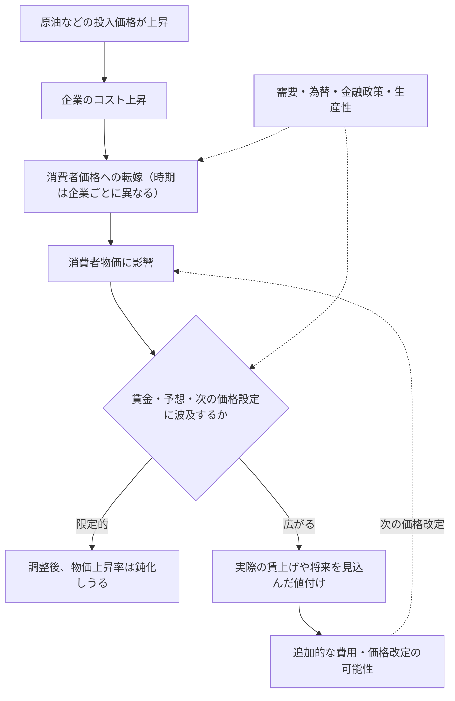

1974年の日本では、物価だけでなく名目賃金の上昇率も20～30％に達しました。第1次石油ショックのころです。ところが、その約6年後に起きた第2次石油ショックでは、再び原油価格が大きく上がったにもかかわらず、同じ激しさの賃金・物価スパイラルは生じませんでした。

原油が高くなれば、ガソリンや輸送、製品の原材料費が上がるのは分かります。**では、なぜその値上がりが、賃金や別の商品まで巻き込むこともあれば、そうならないこともあるのでしょうか。**

日本銀行の植田和男総裁は、2026年5月27日の開会挨拶で、この違いを考えるために日本の4つの局面を振り返っています。1970年代の2度の石油ショック、2000年代半ばの原油高、そして2021年以降の物価上昇です。

本稿では、まず総裁が何を観察し、どう説明したかを確かめます。そのうえで、**その説明は現代の経済学ではどの程度支持されるのか、何を調べれば本当に原因を確かめられるのか**を考えます。

取り上げるのは新しい因果推定論文ではなく、過去の経験を振り返る**講演**です。歴史的な事実、総裁による解釈、関連研究の推定結果、本稿の考察は区別して扱います。

## 1. 第1次と第2次の石油ショック――何が違ったのか

### 第1次：原油高の前から賃金と物価は上がっていた

第1次石油ショックが起きたのは1973年後半です。しかし植田総裁は、**同年の前半にはすでに物価上昇率が10％近く、名目賃金上昇率が20％近くに達していた**ことを指摘します。原油高がゼロからインフレを発生させたのではありません。


*出典：植田和男（2026）開会挨拶・図表2を引用。横軸の T は1973年10～12月期、青線は「食料・エネルギー除くCPI」の前年比、緑線は名目賃金の前年比。*

図表2では、原油高の基準期である T より前から青線も緑線も高い位置にあります。その後、1974年春の賃金交渉で大幅な賃上げが妥結し、企業は原材料費に加えて労働費用の増加も価格へ転嫁しました。植田総裁は、将来の物価上昇予想も高まり、賃金と物価が互いを押し上げる状態になったと説明します。

ここには二つの違いがあります。原油高によって企業の費用が上がることと、**物価上昇が賃金交渉を変え、その賃金が次の価格設定に反映されること**です。後者は、原油の価格が一度上がるだけでは説明できません。

金融政策についても、総裁は単に「利上げが遅れた」と言っているわけではありません。引き締めは行われたものの、**強いインフレの仕組みができた後であり、物価上昇率の高さに比べて引き締めの程度も不十分だった**と評価しています。後に景気後退と引き締めでインフレは鈍化しましたが、経済的な負担も大きくなりました。

### 第2次：原油高の波及が比較的抑えられた

1979～80年の第2次石油ショックでも、輸入価格は大きく上昇しました。それでも、第1次ほど激しい賃金・物価スパイラルにはなりませんでした。


*出典：植田和男（2026）開会挨拶・図表3を引用。輸入物価（橙線）は右軸、CPI（青線）と名目賃金（緑線）は左軸。*

植田総裁が挙げる事情は一つではありません。原油高を迎えた時点で物価・賃金上昇率は第1次より落ち着いており、企業や労働組合には前回の苦い経験がありました。金融引き締めはより迅速に行われ、**ショック以前の円高**が輸入価格を押し下げていたほか、企業の省エネ化も進んでいました。

したがって「第2次でインフレが穏やかだったのは、日銀が早く利上げしたからだ」と**一つの理由だけに絞るのは、講演の読み方としても不正確**です。政策の効果と、政策以外の条件の効果は、ここではまだ分けられていません。

:::details 図表2・3の目盛りに注意

- 2つの図では左側の縦軸が異なります。図表2はおよそマイナス20～40％、図表3は0～10％です。線の見た目の高さをそのまま比較できません。
- 図表2で政策金利は右軸、図表3で輸入物価は右軸です。図表3の政策金利は左軸です。
- CPIと名目賃金は前年比、実質GDPは前期比**年率**です。図表のCPIは食料・エネルギーを除く指数で、日本で一般に「コアCPI」と呼ぶ「生鮮食品を除く総合」とは異なります。

:::

## 2. 2000年代半ばと2021年以降――値上げが続く仕組みは変わったのか

1970年代には、原油高を迎える前のインフレ環境や労使交渉、政策対応が違っていました。では、長く物価が上がりにくかった時代の日本ではどうだったのでしょうか。

### 2000年代半ば：原油高でも、物価と賃金の慣行は変わりにくかった

2000年代半ばには原油などの商品価格が上昇しました。しかし、日本では企業が値上げに慎重で、賃金の伸びや将来の物価上昇予想も低い状態が続きました。


*出典：植田和男（2026）開会挨拶・図表4を引用。青線は食料・エネルギー除くCPIの前年比。*

図表4の青線は長くマイナス圏にとどまります。ただし、**これは日本であらゆる商品の値段が下がり続けたという意味ではありません**。植田総裁は、総合CPIは緩やかに上昇した一方、基調的な物価上昇率はほとんど動かなかったと説明しています。原油高は家計の実質所得を圧迫しましたが、賃金や価格設定の慣行を大きく変えるまでには至らなかった、という解釈です。

総裁はこうした状態を「デフレ均衡」と表現します。経済が好ましい状態で均衡していたという意味ではなく、企業も家計も「価格や賃金はあまり上がらない」と考え、それに沿って行動する状態が続いていた、という説明です。

### 2021年以降：今度は原油だけが上がったわけではない

2021年ごろからの物価上昇では、エネルギーだけでなく、食料、物流、輸入原材料などの費用も上がりました。パンデミック後の世界的な需要回復や円安、労働需給の引き締まりも重なります。


*出典：植田和男（2026）開会挨拶・図表5を引用。横軸の T は2022年1～3月期。費用上昇自体は2021年から始まっており、この T を「ショック以前」とは扱えません。*

図表5では、食料・エネルギーを除くCPIがマイナス圏からプラスへ移り、名目賃金も上昇しています。輸入物価の**上昇率**が後にマイナスになっても、国内CPIの上昇率はプラス圏でした。

この時間差は重要ですが、それだけで賃金・物価スパイラルの証拠にはなりません。前に上がった輸入コストを企業が遅れて転嫁しても、同じような経路になりうるからです。

植田総裁は、広い範囲でのコスト高や円安に加えて、企業の価格転嫁、賃金交渉、物価を巡る慣行の変化を挙げます。ただし、**1970年代前半のような激しいスパイラルが再現されたとは見ていません**。

### 4局面を並べて、何が分かったか

| 局面 | 講演で観察・説明された特徴 | この比較だけでは分からないこと |
| --- | --- | --- |
| 第1次石油ショック | 原油高以前から高い物価・賃金上昇。後に激しいスパイラル | 原油高がなければ物価が何％だったか |
| 第2次石油ショック | 賃金の抑制、迅速な政策、以前の円高、省エネ | それぞれの要因の寄与率 |
| 2000年代半ば | 原油高でも賃金・価格設定の慣行は大きく変わらず | 慣行が変わらなかった原因の強さ |
| 2021年以降 | 広範な費用上昇と円安、賃金・価格設定の変化 | 原油、他の費用、賃金の個別の因果効果 |

ここまでが**植田総裁の歴史的な説明の再整理**です。この説明には納得できる点が多くあります。しかし「もっともらしく説明できる」ことと「本当に原因だったと確かめた」ことの間には、まだ距離があります。

## 3. 「原油が高くなった」と「インフレが続く」は別の話

ここで、原油価格の値上がりが国内の物価に伝わる道筋を整理します。

原油が上がると、燃料や石油由来の原材料が高くなります。製造業だけでなく、輸送費を通じて他の業種にも影響が及びます。企業が増えた費用を販売価格に上乗せすれば、消費者物価も上がります。これは**一次的な価格転嫁**です。転嫁には時間がかかるので、原油がそれ以上値上がりしなくなっても、国内の商品価格がしばらく上がることはあります。

一方、生活費の上昇を受けて労働者が賃上げを求め、実際の賃金上昇が次の企業のコスト増と価格改定につながる場合も考えられます。これは**賃金を通じた二次的な波及**です。予想物価上昇率が高まると、企業の値付けや労使交渉にも影響しえます。



*模式図。費用の転嫁には時間差があり、賃上げ要求が必ず賃上げになるわけでも、賃上げが必ず次の値上げになるわけでもありません。*

例えば、名目賃金が5％上昇しても、家計が購入するものの値段が10％上がれば、購買力は改善しません。賃金が上がったことだけで「望ましい賃金・物価の循環」ができたとは言えないのです。

また、企業が生産性を高めたり、利益を減らしてコストを吸収したりすれば、人件費が増えても販売価格への転嫁は弱くなります。**賃金と物価が一緒に上がるという観察と、賃金が原因で物価が上がったという説明は区別しなければなりません。**

この区別を踏まえると、植田総裁の4局面比較は、原油という外からの価格変化が、企業や労働者の次の行動をどこまで変えたか、という問いになります。

## 4. 数字で確かめる：値上がりが続くことと、スパイラルは違う

図表5では、輸入物価の前年比が下がった後も、国内のCPIは上がっていました。これを理解するには、**価格が高いこと**と**価格がさらに上がること**を区別する必要があります。

原油価格の架空の指数が `100 → 120 → 120` と動いた場合、原油の**価格水準は高いまま**ですが、原油価格の**前期比上昇率**は `+20% → 0%` です。原油価格指数と、商品・サービス全体の**一般物価指数**は異なります。

一般物価指数を $P_t$ とすると、前期比の物価上昇率は

$$
\pi_t=\left(\frac{P_t}{P_{t-1}}-1\right)\times100
$$

です。ここでは計算を分かりやすくするため**前期比**を使います。日銀の歴史的図表にあるCPI・名目賃金は**前年比**なので、数字をそのまま比較してはいけません。

同じ原油価格の変化に対し、**一般物価が仮に**次のように動くとします。

| 架空の一般物価指数 | 0期 | 1期 | 2期 | 3期 | 前期比上昇率（1～3期） |
| --- | ---: | ---: | ---: | ---: | --- |
| A：一度だけ上昇 | 100 | 104 | 104 | 104 | 4%, 0%, 0% |
| B：転嫁に時間差 | 100 | 102 | 104 | 104 | 2%, 約1.96%, 0% |
| C：上昇が継続 | 100 | 104 | 108.16 | 112.4864 | 4%, 4%, 4% |

Bの2期は `(104/102-1)×100 ≒ 1.96%` です。「指数が2ポイント上がった」と「2%上昇した」は同じではありません。

AとBは、同じ原油高が**一度に転嫁される場合と、時間をかけて転嫁される場合**の違いを表す架空例です。Bでは一般物価が2期連続で上がりますが、賃金を介する新しい波及は仮定していません。Cは物価上昇が続く**結果だけ**を仮定した数列です。原油高が原因で持続した、まして賃金・物価スパイラルが起きた、という証拠ではありません。

:::details Python：上記の架空の指数を再計算する

```python
paths = {
    "A 一度だけ": [100, 104, 104, 104],
    "B 遅れて転嫁": [100, 102, 104, 104],
    "C 上昇が持続": [100, 104, 108.16, 112.4864],
}
for name, prices in paths.items():
    rates = [(prices[t] / prices[t - 1] - 1) * 100
             for t in range(1, len(prices))]
    print(name, [round(x, 4) for x in rates])
```

:::

:::details R：同じ架空の指数を再計算する

```r
paths <- list(
  "A 一度だけ" = c(100, 104, 104, 104),
  "B 遅れて転嫁" = c(100, 102, 104, 104),
  "C 上昇が持続" = c(100, 104, 108.16, 112.4864)
)
for (name in names(paths)) {
  p <- paths[[name]]
  rates <- 100 * (p[-1] / p[-length(p)] - 1)
  print(list(name = name, inflation = round(rates, 4)))
}
```

:::

これは計算結果を再現するコードであり、歴史データの推定や原油ショックの因果分析ではありません。

## 5. 植田総裁の説明は「現代経済学の定説」なのか

原油高による物価上昇を理解するうえで、費用だけでなく、需要、賃金、物価予想、金融政策を考えることは、**現代のマクロ経済学で広く採用されている考え方**です。価格を自由にすぐ変えられない企業や、将来の価格を見込んで行動する企業・家計を考える理論とも矛盾しません。

ただし、ここで二つの問いを分ける必要があります。

- **仕組みとして起こりうるか。** 原材料高が販売価格に転嫁され、次の賃金や値付けへ影響する経路は説明できるか。
- **実際にその仕組みで起きたか。** 第1次と第2次の差や、近年の物価上昇において、その経路がどの程度働いたとデータから言えるか。

前者がもっともらしくても、後者が自動的に正しいとは限りません。そこで、講演とは別の研究を当たります。

### ① 物価上昇の出発点で、賃金への波及は変わるのか

IMFのBaba・Lee（2022）は、欧州諸国のデータを分析し、**原油高が賃金に伝わる程度は、もともとのインフレ率や労使交渉制度、金融政策への信認と関係していた**と報告しています。初期のインフレ率が高いほど賃金への波及が大きく、金融政策への信認が高いほど小さくなる傾向がみられた、という結果です。

これは、「原油が同じように値上がりしても、受け止める経済の状態によって反応が変わる」という植田総裁の考え方を支える一つの証拠です。ただし、研究対象は欧州であり、**1973年と1979年の日本の違いを直接推定した結果ではありません**。

### ② 第1次と第2次で、実際に何が違っていたのか

日本については、植田総裁の講演と同じ年に公表された、日銀の別の資料が参考になります。[2026年4月『経済・物価情勢の展望』BOX2](https://www.boj.or.jp/mopo/outlook/gor2604b.pdf)は、オイルショック当時の賃金・物価を比べ、さらに**単位労働コスト（ULC）**を確認しています。

単位労働コストとは、大まかには**生産物を一定量作るのにかかる労働費用**です。同資料では集計上、次のように計算します。

$$
\mathrm{ULC}=\frac{\text{名目雇用者報酬}}{\text{実質GDP}}
$$

例えば、雇用者への報酬総額が10％増えても、生産量も10％増えれば、ULCは変わりません。逆に、生産量が変わらず報酬だけ10％増えれば、ULCは10％上昇します。したがって**名目賃金だけでなく、生産との関係を見る**ことに意味があります。

同資料の図表B2-6では、**第1次石油ショック時にULCの伸びが一段と加速した一方、第2次ではその伸びが抑えられていた**と読み取れます。また、1974年の春季賃上げ率は約33％に達し、当時の消費者物価上昇率（約25％）を上回ったと説明されています。これは、講演の「第1次では賃金の波及が重要だった」という見解を、別の指標で具体的に確かめる材料です。

ただし、**ULCが上がったから物価が上がった、とここで因果関係が証明されたわけではありません**。生産量の変化、需要、利潤、原材料費なども同時に動きます。ULCは物価の一部分を考えるための指標であって、消費者物価指数そのものでもありません。またこの資料は日銀による追加分析であり、外部機関の独立した追試ではありません。

省エネについても同じBOX2は、産業構造やエネルギー利用効率の変化を考慮すると、**原油価格が100％上がった場合の産出価格への一次的な影響は、1970年代より近年の方が小さい**と試算しています。これはショックの伝わりやすさを調べる数量的な手掛かりになりますが、「第1次と第2次の差の何割が省エネによるものか」まで示すものではありません。

### ③ 賃金が上がれば、スパイラルが続くのか

もう一つは、いったん賃金が上がれば物価も上がり続けるのか、という問題です。

IMFのAlvarezほか（2022）は、先進国の1960年代以降を調べ、一定の条件で「賃金・物価スパイラル」に分類した過去の局面でも、**その後の賃金と物価の加速が持続したのは少数だった**と報告しています。つまり、名目賃金が高い伸びを示したことだけで、持続的なインフレの悪循環を予想することはできません。

日本と欧州については、[安達・加藤（日銀、2025）](https://www.boj.or.jp/research/wps_rev/wps_2025/wp25j05.htm)が経済モデルで原材料高の一次的な価格転嫁と、賃金を通じた二次的波及を分けて推定しています。2020年以降については、**原材料高の一次的効果が物価上昇の主因で、二次的効果は緩やかだが持続性を高めた可能性**がある、という結果です。

両研究は手法も「スパイラル」の捉え方も同じではありません。それでも、**賃金の上昇、二次的波及、持続的なインフレの加速を一つの出来事として扱うべきでない**ことは共通して読み取れます。

### ④ では、まだ何を確かめなければならないのか

ここまでの研究を合わせても、「第2次石油ショックの物価が穏やかだったのは、金融政策の改善によって何％、省エネによって何％、労使の学習によって何％」という答えは出ていません。

その問いに近づくには、少なくとも次の順序が必要です。

1. **ショックそのものを見分ける。** 原油の供給不足による値上がりか、世界的な需要拡大に伴う値上がりか。原油以外の輸入価格や為替はどう動いたか。
2. **どの経路を通ったか測る。** 輸入物価、企業の販売価格、消費者物価、賃金、ULC、将来の物価予想を時系列で比較する。価格転嫁の遅れと賃金を介する波及を混同しない。
3. **別の原因を差し引く。** 政策はインフレを見て決められるため、利上げ後に物価が落ち着いたという順番だけでは、金融政策の因果効果は測れない。需要や為替などを考慮し、何を原因として識別できるか、モデルの仮定を吟味する。

特に第1次・第2次は、経済構造もショックの性質も異なるので、同じ条件の実験にはなりません。時系列モデルや産業・企業データを利用しても、**推定結果がどの仮定に依存するか**を示す必要があります。

**今回、確かめられたのは「総裁の説明は理論に整合し、いくつかの経路には関連研究や追加の数量的根拠がある」というところまでです。4つの歴史的結果を、その説明だけで因果的に解き明かしたわけではありません。**

## 6. 理解確認：本文を読み返す前に考える

### Q1：物価上昇率が下がっても、値段は高いまま？

架空の経済で原油価格指数が0期100、1期120、2期120です。一般物価指数は0期100、1期105、2期108、3期108でした。物価上昇率は前期比で計算します。

**問：** 1～3期の一般物価上昇率を求めてください。また、3期の上昇率が0%でも、一般物価水準が0期より高い理由を説明してください。原油価格が2期に横ばいなのに一般物価が上がったことだけで、賃金・物価スパイラルが生じたと言えますか。

:::details 解答と理由

1期は `(105/100-1)×100=5%`、2期は `(108/105-1)×100≒2.8571%`、3期は `(108/108-1)×100=0%` です。物価上昇率が0%なのは**前期からさらに上がっていない**という意味であり、指数108が100に戻ったわけではありません。

2期の物価上昇は、**過去の原油高を遅れて転嫁した**だけでも起こりえます。実際の賃上げ、予想の変化、その後の再度の価格改定などを確認しない限り、スパイラルが成立したとは判断できません。

:::

### Q2：時間差の転嫁と二次的波及をどう見分ける？

架空のA国・B国では、どちらも原油価格が1期に20%上がり、その後一定になります。A国では企業が1期と2期に仕入れ費用を販売価格へ転嫁しましたが、名目賃金と予想物価上昇率には大きな変化が観察されません。B国では最初の転嫁に加え、2期以降に実際の名目賃金が上がり、企業が人件費の増加を理由に再び販売価格を改定しています。

**問：** (1) 両国で物価上昇が複数期にわたったという事実だけで、同じメカニズムだと言えますか。(2) B国について、二次的波及を示唆する事実を挙げ、なお確定できない点も説明してください。

:::details 解答と理由

(1) **言えません。** A国の複数期の値上げは、過去の費用上昇が時間差で転嫁された結果として説明できます。物価上昇率が複数期で正であるというだけでは、持続する仕組みを識別できません。

(2) B国の**実際の名目賃金の上昇**と、それを理由とする**再度の価格改定**は、最初の原油高から賃金・価格設定への二次的な波及を示唆します。ただし、他の費用上昇や需要の変化もありうるため、その事実だけでは原油高の因果効果の大きさ、スパイラルが今後どこまで持続するかを確定できません。

:::


### Q3：第2次石油ショックの説明を、どう検証する？

次は**因果関係の考え方を確認する問題**です。

「第2次石油ショックでは、第1次より金融引き締めが迅速で、物価上昇率も相対的に低かった。したがって、両者の差は金融政策によって生じた」

ただし、第2次ショック以前には円高や省エネ化も進み、賃金の動きも第1次とは異なっていたとします。

**問：** (1) この説明のうち、観察された事実と、まだ立証されていない因果的主張を分けてください。(2) 金融政策の効果を確かめるため、ほかに何を調べ、どのような比較をするべきでしょうか。(3) 賃金・物価上昇率がともに高いことだけで、持続的なスパイラルと判断できますか。

:::details 解答と理由

(1) **政策対応の速さと物価上昇率の違い**は観察された事実として検討できます。しかし、金融政策の違いが物価の差を**どれだけ生んだか**は、それだけでは分かりません。

(2) 原油・その他の輸入価格、為替、政策金利、予想物価上昇率、労働需給、名目賃金、エネルギー依存度などが必要です。比較対象を増やし、他の要因を考慮する推定が考えられます。ただし政策金利も物価情勢に反応するため、単純な金利と物価の相関では因果効果を求められません。

(3) **できません。** 最初のコスト上昇の遅れた転嫁でも、複数期にわたる物価上昇が起きます。賃金と物価が互いの次の上昇を引き起こしているのか、どの程度持続したのかを別に確認する必要があります。

:::


## まとめ：納得できる説明と、確かめられた原因は違う

4局面を比べると、原油高の前から賃金と物価が上がっていた第1次石油ショック、賃金の反応や政策対応・省エネの状況が異なった第2次、デフレ的な価格設定行動が続いた2000年代半ば、幅広い費用上昇のもとで賃金や値付けの慣行も変化し始めた2021年以降という違いが見えてきます。

植田総裁の説明には、現代のマクロ経済学と整合する考え方があり、関連研究にも支持する結果があります。なかでも、日銀『展望レポート』に示された**第1次と第2次の単位労働コストの違い**は、講演で強調された賃金を介する経路を考える具体的な証拠です。

しかし、**「実際にULCの動きが違った」ことと「金融政策・賃金行動・省エネのうち、何がその差をどれだけ生んだか」は別の問い**です。原油価格の動きも、為替も、政策も、それぞれの時代で同じ条件ではありません。

この講演から学べるのは、単に「初期条件が重要」という一般論ではありません。**原油高の結果を説明しようとするとき、価格転嫁と賃金への波及を分け、さらに観察できた違いと推定が必要な因果関係を分ける**。そこに歴史的な比較を読む意義があります。

## 出典・参考資料

- 植田和男（2026）「2026年国際コンファランス『金融政策の新たな視野』開会挨拶」『金融研究』45巻4号、37～44頁、日本銀行金融研究所。[金融研究所掲載版](https://www.imes.boj.or.jp/research/papers/japanese/kk45-4-2.pdf) ／ [日本銀行公表の開会挨拶・図表（2026年5月27日、PDF）](https://www.boj.or.jp/about/press/koen_2026/data/ko260527a1.pdf)
- [日本銀行「2026年国際コンファランスにおける開会挨拶」案内ページ](https://www.boj.or.jp/about/press/koen_2026/ko260527a.htm) ― 発表日・原文・図表の確認。
- Baba, Chikako and Jaewoo Lee（2022）[Second-Round Effects of Oil Price Shocks: Implications for Europe’s Inflation Outlook](https://www.imf.org/en/publications/wp/issues/2022/09/06/second-round-effects-of-oil-price-shocks-implications-for-europes-inflation-outlook-523201), IMF Working Paper 2022/173 ― 欧州の状態依存的な波及。
- 安達孔・加藤直也（2025）[「原材料高を起点とした賃金から物価への二次的波及：DSGEモデルによる実証分析」](https://www.boj.or.jp/research/wps_rev/wps_2025/wp25j05.htm)、日本銀行 ― 日本・欧州の一次的・二次的波及。
- Alvarez, Jorge A. et al.（2022）[Wage-Price Spirals: What is the Historical Evidence?](https://www.imf.org/en/publications/wp/issues/2022/11/11/wage-price-spirals-what-is-the-historical-evidence-525073), IMF Working Paper 2022/221 ― 過去の賃金・物価スパイラルの検討。
- 日本銀行（2026）[『経済・物価情勢の展望』（4月、BOX2）](https://www.boj.or.jp/mopo/outlook/gor2604b.pdf) ― 原油高の一次・二次的波及と省エネ・産業構造変化の分析。
- [総務省統計局「消費者物価指数に関するQ&A（A-5）」](https://www.stat.go.jp/data/cpi/4-1.html) ― 「生鮮食品を除く総合」などの指標定義。

講演は過去の経験を振り返る開会挨拶です。本稿で追加した研究比較は既存文献の結果を吟味したものであり、本稿独自の計量的因果推定ではありません。引用図表2〜5は[日銀が公表した2026年5月27日付資料](https://www.boj.or.jp/about/press/koen_2026/data/ko260527a1.pdf)から、図の内容・目盛り・凡例・注記を改変せず必要な箇所を抜き出したものです。出所を各図下に明示し、本文では図の具体的な読み取りと比較を行っています。講演中の歴史的な評価、本文の補助的な経済学的整理、架空の確認問題を混同しないようにしています。『金融研究』の掲載記事に示された見解は著者個人のものであり、日本銀行・金融研究所の公式見解とは限りません。
