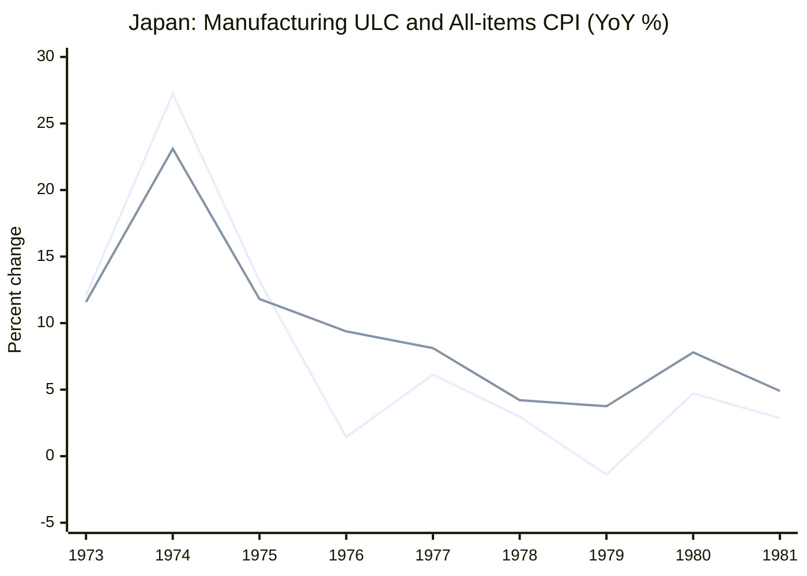

1974年の日本では、物価と名目賃金の上昇率がともに20～30％に達しました。ところが、1979～80年の第2次石油ショックでは、原油価格が再び大きく上昇したにもかかわらず、第1次のような賃金・物価スパイラルは起きませんでした。

**同じように原油が高くなっても、なぜ結果は違ったのでしょうか。**

植田和男・日本銀行総裁は、2026年5月27日の開会挨拶「日本における原油価格ショック、物価上昇率と金融政策」で、日本が経験した原油高の局面を振り返っています。総裁が強調するのは、**原油価格の上昇幅だけでなく、それを迎えた経済の状態が重要だ**という点です。

この記事では講演を中心に、日銀の図表と公開統計を補いながら、次の順番で読み解きます。

1. 原油高はどうして賃金・物価スパイラルにつながるのか。
2. 第1次と第2次では、何が違ったと総裁は説明しているのか。
3. 2000年代半ばと2021年以降の経験から、何が見えてくるのか。
4. その視点は、2026年に総裁が提示した「5つ目のショック」を考えるうえでどう役立つのか。

本稿は**講演の解説記事**です。総裁の歴史解釈を新たな因果推定で証明するものではありません。本文中では、講演そのものの説明と、理解を助けるために加えた別資料を区別します。

## 1. 原油高と賃金・物価スパイラルは、なぜ同じではないのか

原油を輸入する国では、原油高によってガソリン代や電気代、原油を原料に使う製品の費用が上がります。こうした価格上昇は、まず家計の生活費を押し上げます。

しかし、**生活費が一度上がることと、物価上昇が賃金を通じて持続することは別**です。

例えば、企業が輸入原材料の値上がりを販売価格へ転嫁するとします。労働者は生活費が増えたため、次の賃金交渉でより高い賃上げを要求するかもしれません。賃金の増加が企業の費用をさらに押し上げ、企業が再び値上げすれば、次の賃金交渉にも影響します。

原材料費の上昇から始まった物価上昇が、**賃金交渉・企業の価格設定・将来の物価についての予想**を変え、互いに影響を与えながら続いていく。これが講演で問題になっている賃金・物価スパイラルのイメージです。

逆に、値上げによって家計の実質的な購買力が減ったり、企業が利益を削って費用を負担したりしても、賃金や価格設定の行動が大きく変わらなければ、持続的なスパイラルになるとは限りません。

この違いを頭に置くと、植田総裁による1970年代の比較が読みやすくなります。

## 2. 第1次石油ショック：原油高の前からインフレが進んでいた

第1次石油ショックが起きたのは1973年後半です。総裁がまず注目するのは、**原油高が起きる前の日本でも、すでに物価と賃金が急上昇していた**ことです。

講演によると、1973年前半には、食料・エネルギーを除くCPIの前年比上昇率が10％近く、名目賃金上昇率は20％近くに達していました。

*出典：[植田総裁の2026年5月27日開会挨拶・図表2](https://www.boj.or.jp/about/press/koen_2026/data/ko260527a1.pdf)。T＝1973年10～12月期。CPI（食料・エネルギー除く）と名目賃金は前年比。実質GDPは前期比年率。政策金利は右軸。*

この図で読むべきなのは、「原油高が起きたから初めて物価や賃金が上がった」という順序ではないことです。

すでに物価上昇が進むなかで原油高が重なり、1974年春の賃金交渉では非常に大幅な賃上げが妥結されました。企業は原材料費に加えて人件費の増加も販売価格に転嫁し、将来も物価が上がるという予想が強まりました。

**相対価格のショックが、国内の賃金と幅広い物価の連鎖へ変わった**、というのが総裁の説明です。

金融政策も無関係ではありません。日銀は物価上昇圧力が明確になってから引き締めましたが、総裁は、高インフレの仕組みがすでに形成された後だったうえ、引き締めの度合いも不十分だったと振り返っています。

その後、1974年前半には深刻な景気後退が生じました。原油高による交易条件の悪化、実質所得や企業業績の悪化、金融引き締めなどが重なったためです。最終的にインフレ率は下がりましたが、代償は大きかったと総裁は述べています。

## 3. 第2次石油ショック：原油高を迎える条件が変わっていた

1979～80年頃の第2次石油ショックでも、輸入物価は大きく上昇しました。それでも、第1次のような激しい賃金・物価スパイラルは繰り返されませんでした。

*出典：[同開会挨拶・図表3](https://www.boj.or.jp/about/press/koen_2026/data/ko260527a1.pdf)。T＝1979年1～3月期。輸入物価は円ベースで右軸。第1次の図とは縦軸の目盛りが異なる。*

総裁は、主に次の違いを挙げています。

| 第2次を迎えたときの状況 | なぜ波及が変わりうるのか |
| --- | --- |
| ショック前の物価上昇率が第1次より低い | すでに賃金と物価が激しく加速している状態ではなかった |
| 労使が第1次の経験から学んでいた | 物価上昇を名目賃金で一律に取り戻そうとすると、再び物価を押し上げる可能性があると認識していた |
| 金融引き締めがより迅速だった | 物価上昇圧力を抑える方向に働いた |
| それ以前に円高が進んでいた | 円建ての輸入物価を相対的に抑えた状態で原油高を迎えた |
| 企業のエネルギー効率が改善していた | 同じ生産活動に必要なエネルギーへの依存が弱まっていた |

ここで特に重要なのが、**労使の行動は固定されていない**という点です。

原油高が家計の生活費を上げれば、労働者が賃上げを求める理由にはなります。しかし、どの程度の賃上げを交渉するか、企業がどの程度価格へ転嫁するかは、その時々の物価予想や過去の経験によって変わります。

金融政策も同様に重要ですが、総裁は「第2次では早く利上げしたから解決した」と単一の理由にまとめてはいません。**賃金交渉、予想、為替、省エネ、金融政策が重なった**という説明です。

もちろん、第2次に物価が上がらなかったわけではありません。重要なのは、輸入価格の上昇が、第1次と同じ規模の持続的な賃金・物価の連鎖にはならなかったという違いです。

:::details 図表2・3を比較するときの注意点

- 両図の「CPI」は食料・エネルギーを除く系列です。日本で一般に「コアCPI」と呼ばれる「生鮮食品を除く総合」とは違います。
- 名目賃金・CPI・輸入物価は前年比、実質GDPは図表2では前期比年率です。
- 第1次と第2次ではTとされた基準期が異なり、同じ大きさの原油ショックを与えた実験ではありません。
- 縦軸も異なります。線の高さだけを見比べず、それぞれの指標と目盛りを確認してください。

:::

## 4. 補助資料：賃金の動きを「生産1単位当たり」で見る

総裁が重視した賃金経路を理解するには、「名目賃金が何％上がったか」に加え、企業にとっての**生産1単位当たりの労働費用**を見る方法があります。

これを単位労働コスト（ULC）と呼びます。経済全体の国民経済計算では、例えば次のように表せます。

$$
\mathrm{ULC}=\frac{\text{名目雇用者報酬}}{\text{実質GDP}}
$$

雇用者報酬が10％増えても、実質生産量も10％増えれば、ULCは変わりません。生産量が変わらず報酬だけ増えれば、ULCは上がります。つまり、ULCは名目賃金そのものとは異なります。

[日銀『経済・物価情勢の展望』2026年4月号BOX2](https://www.boj.or.jp/mopo/outlook/gor2604b.pdf)でも、過去の石油ショックを考える補助指標としてULCが使われています。

もう一つ、OECDが公表した日本の**製造業**ULCの歴史系列を見てみましょう。次の値はFREDに保存された2014年更新のOECD系列による前年比です。

| 年 | 製造業ULCの前年比 | 全国総合CPIの前年比 |
| --- | ---: | ---: |
| 1973 | +12.08％ | +11.59％ |
| **1974** | **+27.25％** | **+23.10％** |
| 1975 | +13.16％ | +11.81％ |
| 1979 | −1.38％ | +3.75％ |
| **1980** | **+4.72％** | **+7.80％** |
| 1981 | +2.85％ | +4.90％ |

*出典： [OECD製造業ULC（FRED系列JPNULCMANAPNMEI）](https://fred.stlouisfed.org/data/JPNULCMANAPNMEI)、[OECD全国総合CPI指数](https://data-explorer.oecd.org/vis?df%5Bag%5D=OECD.SDD.TPS&df%5Bid%5D=DSD_PRICES_COICOP2018%40DF_PRICES_C2018_ALL&dq=JPN.A.N.CPI.IX._T.N.&pd=1955%2C2024&vw=tb)より計算。ULCは製造業、CPIは家計向け全国総合であり、同一対象の寄与分解ではありません。*

1974年の製造業ULCは大幅に上昇しています。一方、第2次ショック期の1979～80年は、**採用した系列では第1次よりずっと小さい伸び**です。総裁が説明する賃金経路の違いを具体的な数字として捉えやすくなります。

9年間を通して見ると、単純にULCとCPIが同じ割合で動いているわけでもありません。

*1本目が**製造業ULC**、2本目が**全国総合CPI**の前年比です。図が表示されない場合は上の表と[再現用CSV](https://github.com/Osino-Niso/econ-data-lab/tree/research/oil-shock-data-pilot-20261026/code/oil-shocks-inflation-regimes)も参照できます。*

ただし、このグラフから「ULCがCPIを何％押し上げた」とは言えません。製造業と家計の対象範囲が違い、為替・原材料費・需要なども同時に変化します。これは**総裁の説明を理解するための補助データ**であり、因果効果を識別した分析ではありません。

:::details 歴史的なULCの数値は資料によって違う

採用したFRED収録のOECD系列では1979年が−1.38％、1980年が+4.72％です。しかし、[1981年の英国議会掲載資料](https://hansard.parliament.uk/Commons/1981-01-26/debates/7c775e34-5df8-4e81-95dc-0b819e64ca9f/UnitLabourCosts)では1979年が−3％、[1990年の別資料](https://hansard.parliament.uk/Commons/1990-11-19/debates/5d87c114-21a5-4dbc-b2f2-7e4bddbea523/WrittenAnswers)の日本製造業ULC指数から計算すると1979年は約+0.19％、1980年は約−0.48％です。

改訂や定義の差を完全には特定できていません。そのため「1980年に必ずULCが上昇へ転じた」といった符号に依存する結論は取りません。ここで注目するのは、1974年の著しい増加に対し、第2次ショック期の伸びがかなり小さかったという大きな対比です。日銀BOX2のULCは経済全体を対象にしており、この製造業系列と同じものではありません。

:::

## 5. 2000年代と2021年以降：原油高への反応はさらに変わった

総裁は1970年代だけで話を終えていません。2000年代半ばと2021年以降の経験を並べることで、**「原油高の影響は、その時代の賃金・価格設定のあり方に左右される」**という見方を補強しています。

### 2000年代半ば：値上げが賃上げの連鎖に広がりにくかった

この時期も原油やコモディティの価格は大きく上がりました。しかし日本では、長く続いたデフレの経験から企業が値上げに慎重になり、家計も価格が上がりにくい環境に慣れていました。名目賃金と予想物価上昇率も低い状態でした。

総裁はこれを「デフレ均衡」と説明します。原油高は企業のコストと家計の生活費を上げましたが、賃金や価格設定の慣行を持続的に変えるまでには至らなかった、という解釈です。

### 2021年以降：値付けや賃金交渉の慣行も変化した

2021年以降は、原油だけでなく、食料・輸入原材料・物流費の上昇、供給網の混乱、世界需要の回復が重なりました。さらに日本では円安が輸入費用を押し上げました。

多くの企業が同時にコスト上昇を経験したため、従来より値上げしやすくなり、春季賃金交渉を通じて名目賃金も上がりました。人手不足も賃金交渉の環境を変えました。

総裁は、企業・家計が長く持っていた「物価も賃金もあまり上がらない」という行動上の慣行（ノルム）が変化し始めたと捉えています。

ただし、**1970年代前半のような賃金・物価スパイラルが再現したと述べているわけではありません**。中長期の物価上昇予想は、指標による差はあるものの、ゼロ近くから1.5～2％台へ緩やかに移ったというのが総裁の説明です。

:::details 講演の図表4・5を見てみる

*出典：[2026年5月27日開会挨拶・図表4・5](https://www.boj.or.jp/about/press/koen_2026/data/ko260527a1.pdf)。青線のCPIは食料・エネルギー除く前年比。図表4のT＝2005年7～9月期、図表5のT＝2022年1～3月期。図表5のTは、2021年から始まった一連の費用上昇より前を意味するものではありません。*

:::

4つの局面をまとめると、次のようになります。

| 局面 | 原油高を迎えた経済と総裁の見方 |
| --- | --- |
| 第1次（1973年～） | すでに高インフレ・高賃金上昇。原油高が強い連鎖を増幅 |
| 第2次（1979年～） | 低い初期インフレ、労使の学習、より迅速な政策、円高や省エネが波及を抑制 |
| 2000年代半ば | デフレ下の価格・賃金慣行が根強く、広範な賃上げ・値上げに波及しにくい |
| 2021年以降 | 広範なコスト高、円安、人手不足のもとで値付けと賃金の慣行が変わり始めた |

この4つは「原油高が同じ強さだった」という比較ではありません。それぞれのショックの性質や、為替・需要・政策も違います。**それでも原油価格だけでは、その後の物価の動きを説明し切れない**というのが講演を通じた共通の視点です。

## 6. もう一つの補助資料：物価が上がるのに国内所得は圧迫される？

ここで、2000年代半ばの「原油高が家計の実質所得を圧迫した」という説明を、少し掘り下げます。

原油高で消費者が払う価格は上がります。しかし、その値上がり分がそのまま国内企業の利益や労働者の所得になるわけではありません。輸入原油の代金の一部は海外へ支払われるからです。

その違いを見るために、物価指標を二つに分けます。

- **CPI（消費者物価指数）**：家計が購入する財・サービスの価格。輸入品や輸入原材料の価格上昇も反映される。
- **GDPデフレーター**：国内で生み出された付加価値の価格。名目GDPを実質GDPで割って求める。

2026年4月の日銀『展望レポート』BOX2・[図表B2-8](https://www.boj.or.jp/mopo/outlook/gor2604b.pdf#page=50)は、この違いを理解する助けになります。

日銀のマクロ計量モデルQ-JEMでは、**5％の円安**と**18％の原油高**を別々に与え、輸入デフレーターへの影響が同程度になるように比較しています。

| モデルでの反応 | 円安ショック | 原油高ショック |
| --- | --- | --- |
| CPI（生鮮食品除く） | ベースラインより上振れ | ベースラインより上振れ |
| GDPデフレーター | 初年は小幅下振れ、その後は上振れ | 1～3年目に下振れ |

ここでいう上振れ・下振れは、**ショックがなかった場合の想定経路（ベースライン）との差**です。GDPデフレーターが下振れるからといって、実際の前年比がマイナスになるとは限りません。

日銀はGDPデフレーターを、単位労働コスト（ULC）と「ユニット・プロフィット等」の寄与に分けて示しています。後者は企業の純利益率だけではなく、雇用者報酬以外の付加価値所得などを含む残余です。

図表B2-8では、原油高の初期にユニット・プロフィット等のマイナス寄与が大きく、その後はULCにもマイナス寄与が見られます。つまり、**家計が直面する価格が上がる一方で、国内で生まれる所得のうち企業・労働者が受け取る部分には下押し圧力がかかりうる**ということです。

これは講演の「生活費の上昇が、必ずしも持続的な賃金上昇に転化しない」という話を理解するための**補助的なモデル実験**です。ただし、ここで比べているのは原油高と円安というショックの種類であって、第1次と第2次の初期条件ではありません。**このモデルによって1970年代の違いを証明したわけではありません。**

## 7. 2026年、総裁は何を問いかけたのか

2026年5月27日の講演は、直近の中東紛争に伴う原油高を、過去の4つの局面に続く**「5つ目の原油価格ショック」**と位置付けて終わります。

総裁が示したのは、2026年の原油高が必ずインフレの連鎖を引き起こすという予言ではありません。問いはむしろ次のようなものです。

- いまの日本では、物価上昇予想と賃金交渉はどんな状態にあるのか。
- 原油高が一時的な生活費上昇で終わるのか、賃金や価格設定の慣行まで変えるのか。
- そうした状況に、中央銀行はどう対応するのが望ましいのか。

総裁の講演の結論を一言で整理するなら、**原油高は、すでに存在するインフレ環境と賃金・価格設定のあり方を試す出来事でもある**、となります。

2026年4月の『展望レポート』でも、中東情勢を受けた原油高は、家計の実質所得や企業収益への下押しと消費者物価の押し上げの両方をもたらす要因として扱われています。ただし、これは当時の前提に基づく見通しであり、その後の実績をここで判定しているわけではありません。

## 8. 理解確認

### Q1：原油が上がれば賃金・物価スパイラルになる？

原油価格が上がり、国内のガソリン価格と電気代が上がりました。しかし名目賃金の伸びはほとんど変わらず、将来の物価上昇予想も大きく変わっていません。

**問：** この時点で賃金・物価スパイラルが起きたと判断できますか。理由も述べてください。

:::details 解答と理由

判断できません。生活費の上昇は起きていますが、賃金の引き上げが次の値上げにつながり、それがさらに賃金交渉へ波及するという持続的な連鎖は確認できません。物価上昇とスパイラルを区別する必要があります。

:::

### Q2：第1次と第2次の違いは、金融政策だけで説明できる？

1973年後半の第1次石油ショック時には、すでに物価と名目賃金の上昇率が高くなっていました。一方、1979～80年頃の第2次は、初期の物価上昇率が低く、労使が過去の経験から学び、金融引き締めもより迅速だったと総裁は説明しています。

**問：** 第2次に強いスパイラルが再現しなかった理由を「利上げが早かったから」だけにまとめると、何を見落としますか。

:::details 解答と理由

ショック前からの物価・賃金環境、労使の行動と予想、事前の円高、省エネなどを見落とします。総裁は政策の重要性を認めつつ、複数の条件が重なって波及が抑えられたと説明しています。どの要因が何％寄与したかを、この講演だけで求めることはできません。

:::

### Q3：家計の物価と国内所得は、いつも同じ方向へ動く？

原油を輸入する日本を考えます。あるモデルでは、原油高によってCPIがベースラインより高くなる一方、GDPデフレーターはベースラインより低くなると試算されました。

**問：** これは矛盾ですか。また、この結果だけで第1次と第2次の歴史的な違いを説明したことになりますか。

:::details 解答と理由

矛盾ではありません。CPIは家計が購入する価格、GDPデフレーターは国内で生み出された付加価値の価格だからです。輸入費用の増加は家計の生活費を押し上げつつ、国内企業の利幅や労働費用に下押し圧力をかけることがあります。

歴史的な違いの証明にもなりません。モデルは原油高と円安を比較したもので、第1次・第2次における賃金交渉や物価予想の差の因果効果を推定してはいません。

:::

## おわりに：原油高だけでは、インフレのその後は決まらない

なぜ第2次石油ショックでは、第1次のような賃金・物価スパイラルが繰り返されなかったのでしょうか。

植田総裁は、**原油高の前からあったインフレの勢い、労使が過去の経験から学んだこと、金融政策の対応、為替、省エネなどの違い**を組み合わせて説明しています。

その後の2000年代半ばと2021年以降を見ても、原油高が賃金や価格設定にどこまで波及するかは同じではありませんでした。ここで大切なのは、原油価格という一つの数字から、物価の将来を機械的に決めないことです。

そして、もう一つ区別したいのは、**家計が払う価格が上がることと、国内の賃金・企業所得が同じように上がることは別**だという点です。ULCの歴史系列や日銀BOX2のモデルは、この違いを考える助けになります。

2026年の「5つ目のショック」について、講演は答えを確定するのではなく、**いまの日本の賃金・物価予想・価格設定はどのような状態なのか**という問いを残しています。過去の石油ショックを振り返る意味は、その問いを考えるための視点を得られることにあるのでしょう。

## 参考資料・再現コード

- 植田和男（2026）[「日本における原油価格ショック、物価上昇率と金融政策」2026年5月27日開会挨拶](https://www.boj.or.jp/about/press/koen_2026/ko260527a.htm)（[図表付きPDF](https://www.boj.or.jp/about/press/koen_2026/data/ko260527a1.pdf)）。『金融研究』45巻4号の[掲載情報](https://www.boj.or.jp/research/imes/mes/mes26.htm)。
- 日本銀行（2026）[『経済・物価情勢の展望』2026年4月号、BOX2「原油価格高騰がわが国物価に与える影響」](https://www.boj.or.jp/mopo/outlook/gor2604b.pdf)。
- OECD/FRED [日本の製造業ULC・JPNULCMANAPNMEI](https://fred.stlouisfed.org/data/JPNULCMANAPNMEI)、OECD [日本の全国総合CPI](https://data-explorer.oecd.org/vis?df%5Bag%5D=OECD.SDD.TPS&df%5Bid%5D=DSD_PRICES_COICOP2018%40DF_PRICES_C2018_ALL&dq=JPN.A.N.CPI.IX._T.N.&pd=1955%2C2024&vw=tb)。
- [ULCとCPIの固定CSV、Python/R再現コード、データの出典と留意点](https://github.com/Osino-Niso/econ-data-lab/tree/research/oil-shock-data-pilot-20261026/code/oil-shocks-inflation-regimes)。

*本文の歴史系列は特定公表時点の固定データを用いています。図表2～5は日銀講演資料の引用です。補助資料の統計とモデル実験は、植田総裁の歴史的解釈を新たに因果推定したものではありません。*

