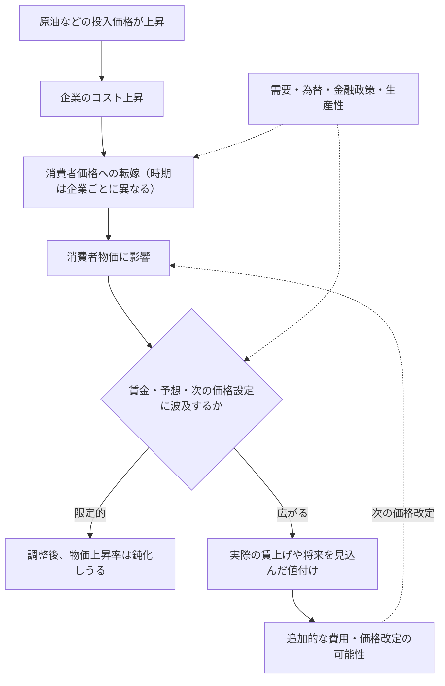

**1973年後半に原油価格が急騰する前、日本の物価上昇率はすでに10%近く、名目賃金の上昇率は20%近くに達していました。** その後、賃金と物価の上昇率は20～30%に達します。一方、1979～80年にも大きな原油高が起きましたが、同じ激しさの賃金・物価スパイラルにはなりませんでした。

「石油ショックがインフレを起こした」とだけ覚えていると、この違いを説明できません。

日本銀行総裁・植田和男氏は2026年5月27日の開会挨拶で、1973年、1979～80年、2000年代半ば、2021年以降を比較しました。本稿は『金融研究』2026年10月号にも収録された**講演の歴史的な観察事実**を起点に、「原油高が既存のインフレを増幅する場合と、物価・賃金の動きを大きく変えない場合を分けるのは何か」を考えます。

植田総裁は、この違いを原油高そのものだけでなく、**賃金、企業の値付け、将来の物価予想、金融政策**などから説明しています。では、それは総裁個人の歴史解釈にとどまるのでしょうか。それとも、現在の経済学の研究とも合っているのでしょうか。

この記事では4局面を振り返ったうえで、関連する理論と実証研究を手がかりに、**説明できていることと、まだ確かめる必要があること**を分けて考えます。

この記事は「日銀の研究を読み解く」シリーズ第1回です。扱うのは新しい因果推定論文ではなく、過去を振り返る**総裁の講演**です。数値を使った後半の例題は本記事独自の架空例であり、日本の実測値ではありません。なお、講演は2026年当時の5つ目の原油価格ショックにも触れていますが、ここでは詳しく振り返られた過去4局面に絞ります。

## 4局面の見取り図：原油高だけでなく「受け止める経済」を見る

| 時期 | ショック前後の状態 | 何が違ったか |
| --- | --- | --- |
| **1973年・第1次石油ショック** | ショック以前から物価・賃金が急上昇 | 原油高がすでに形成されていたインフレ的な動きを強め、賃金・物価スパイラルへ |
| **1979～80年・第2次石油ショック** | 物価・賃金の初期条件が比較的落ち着いていた | 早期の金融引き締め、前回の経験、事前の円高、省エネ化が重なり、波及は相対的に抑制 |
| **2000年代半ば** | 値上げに慎重な企業、弱い賃金、低い予想物価上昇率 | 原油高は実質所得を圧迫したが、基調的な物価上昇率の変化は小さかった |
| **2021年以降** | 複数の費用上昇と円安、労働需給・価格設定行動の変化 | 価格転嫁や賃金・期待へ波及。ただし1970年代前半ほどのスパイラルではない |

これらは講演の**歴史解釈を整理した表**であり、4回のショックの大きさや政策以外の条件が同一だったことを意味しません。

結論は「どの時代も原油が高ければインフレになる」でも「金融政策だけで違いが決まる」でもありません。**外から来たコスト上昇が、すでにある賃金・価格設定・期待の仕組みを通じてどう広がるか**が違ったのです。

## 1. 1973年と1979～80年：2度の石油ショックで何が違ったか

### 第1次：原油高の前からインフレが進んでいた

植田総裁は、1973年後半に第1次石油ショックが始まる**前**、物価上昇率が10%近く、名目賃金上昇率が20%近くに達していたと指摘します。1974年には賃金と物価の上昇率が約20～30%となり、典型的な賃金・物価スパイラルが生じました。


*引用：植田和男（2026）「開会挨拶」日本銀行公表資料・図表2。グラフ・凡例・注記は原図のまま。*

図表2の緑線（名目賃金）はショック前の `T-2` の時点からすでに高く、青線（食料・エネルギー除くCPI）も上昇しています。**ショック後のピークだけでなく、ショック前の位置を見る**ことが重要です。

ショックが「ゼロからインフレを生んだ」という説明では、1973年前半の状態が抜け落ちます。すでに物価が上がり、賃金も上がっていたところへ原油高が重なった、という時間順序が重要です。

企業が仕入れ価格の上昇を販売価格へ転嫁し、家計が生活費の上昇を受けて賃上げを求め、**実際に大きな賃上げが妥結**され、企業が上昇した労働費用も価格へ反映する。ここでいう**名目賃金の上昇**は、そのまま購買力の改善を意味しません。賃金が5%上がっても消費者物価がそれ以上に上がれば、実質賃金は下がりえます。将来も価格が上がるとの予想が広がれば、さらに値付けや賃金交渉に影響します。原油の価格上昇そのものとは別に、**経済内の賃金と価格が相互に作用する経路**ができたわけです。

金融政策にも注意が必要です。植田総裁は「引き締めが遅かった」だけでなく、**高インフレの仕組みが形成された後の引き締めであり、物価上昇率の高さに対して引き締めの度合いも明らかに不十分だった**と評価しています。後に景気後退と引き締めが物価上昇率を低下させましたが、交易条件の悪化や実質所得の減少などを伴い、経済的負担は大きなものでした。

ここで言えるのは、物価上昇が原油高**だけ**から始まったのではない、ということです。原油価格上昇がなければ1974年の物価上昇率が何%だったかは、この講演からは分かりません。

### 第2次：原油高が再来しても、同じスパイラルにはならなかった

1979～80年の第2次石油ショックも大きな原油高でした。しかし、講演は第1次と比べて物価上昇が相対的に穏やかで、以前と同じ賃金・物価スパイラルは起こらなかったと述べます。**物価上昇がゼロだったという意味ではありません**。景気は減速し、物価上昇率も高まりました。


*引用：植田和男（2026）「開会挨拶」日本銀行公表資料・図表3。グラフ・凡例・注記は原図のまま。*

図表3では輸入物価の前年比（橙線、**右軸**）が大きく上昇する一方、国内の名目賃金（緑線、左軸）と食料・エネルギー除くCPI（青線、左軸）は第1次ほど上昇していません。**輸入価格への衝撃がそのまま国内賃金の上昇率になるわけではない**という観察です。異なる目盛りの線の高さはそのまま比較できません。

この違いに、植田総裁は複数の事情を挙げています。

| 事情 | 第2次ショックを理解する上での意味 |
| --- | --- |
| 低めの初期インフレ・抑制的な賃金 | 第1次ほど強い賃金・物価の循環から出発していなかった |
| より迅速な金融引き締め | 物価上昇圧力への政策対応が早かった |
| 企業と労働組合の経験 | 名目賃上げだけで価格上昇を追うと再びスパイラルになりかねないという認識 |
| **ショック前**の円高 | 輸入物価全般が押し下げられた状態で原油高を迎えた |
| エネルギー効率の改善 | 生産に必要な原油への依存度が下がっていた |

金融政策は重要ですが、**「引き締めの速さだけで第1次との差が生まれた」とは説明できません**。また、円高は原油高が始まる**前**の出来事であり、ショック期間中の為替が一貫して円高だったという意味ではありません。

### 2枚の図表を比較するときの落とし穴

上に引用した図表2・3を見比べてください。第1次は `T=1973年Q4`、第2次は `T=1979年Q1` を起点として、前後の時期を並べています。

**二つの図は縦軸の目盛りが違います。** 第1次の左軸はおよそ-20～40%、第2次は0～10%です。グラフの線の傾きや画面上の高さだけで比較すると読み違えます。また、賃金とCPIは前年比、実質GDPは**前期比年率**です（図表4・5の実質GDPは前期比で、年率換算されていません）。**第1次の図表2では政策金利が右目盛り、第2次の図表3では輸入物価が右目盛りで、政策金利は左目盛り**です。各図の凡例・注記・縦軸を確認し、**別の指標や計算期間を混ぜて比較しない**ことが、歴史の議論の出発点になります。

もう一つ大切なのが物価指標です。これらの図表で使われた青線の凡例は**「CPI（除く食料・エネルギー）」**です。日本で一般に「コアCPI」と呼ばれる**「生鮮食品を除く総合」**とは一致しません。講演本文では「コアCPI」という語も使われていますが、本文の呼び方を根拠に図表の指標を読み替えてはいけません。日本の指標名は[総務省統計局のQ&A](https://www.stat.go.jp/data/cpi/4-1.html)でも確認できます。

## 2. 2000年代半ばと2021年以降：デフレ的な慣行は変わったか

### 2000年代半ば：原油高でも基調的なインフレは動きにくかった

下の引用図表4では、食料・エネルギーを除くCPIの前年比が、対象期間の大部分でマイナス圏にあります。原油高が生じても、この指標は大きく上方へ動きませんでした。


*引用：植田和男（2026）「開会挨拶」日本銀行公表資料・図表4。グラフ・凡例・注記は原図のまま。*

重要なのは青線がゼロ近傍の負の領域に長くとどまったことで、**原油価格が上がらなかったという意味ではありません**。植田総裁は、同時期に**総合CPIは緩やかに上昇した一方、基調的な物価上昇率はほとんど動かなかった**と述べています。青線の弱さを、家計が直面するすべての価格が下がったという意味に読み替えてはいけません。

これは「家計が値上げの負担を感じなかった」という意味ではありません。原油高は企業のコストを増やし、家計の実質所得を下押ししました。植田総裁が強調するのは、**賃金・予想物価上昇率・価格設定行動を持続的に変えるまでには至らなかった**ことです。

1990年代後半以降のデフレ経験の中で、企業は値上げに慎重になり、家計も価格があまり上がらない状態に慣れていました。経済の回復は、こうした行動を変えるほど強くありませんでした。講演はこれを「デフレ均衡」と説明しています。「均衡」といっても好ましい状態だったという意味ではなく、**値上げしにくい企業行動と低い賃金・物価予想が持続していた状態**を指します。

### 2021年以降：原油だけではない費用上昇が広がった

下の引用図表5では、食料・エネルギー除くCPIの前年比がマイナス圏からプラスへ移り、賃金も上昇しています。図表の起点は `T=2022年Q1` であり、本文が述べる「2021年頃から始まる出来事」の開始時期と同じではありません。**この `T` は、費用上昇が一切始まる前の観測値ではありません。**


*引用：植田和男（2026）「開会挨拶」日本銀行公表資料・図表5。グラフ・凡例・注記は原図のまま。*

図表4と比較すると、青線の上昇がよりはっきり現れています。ただし**右軸の輸入物価上昇率と左軸の国内CPI・賃金上昇率は同じ目盛りではありません**。

ここでは**原油だけ**が上がったのではありません。エネルギー、食料、物流、輸入原材料などの費用上昇が重なり、パンデミック後の世界的な需要回復と円安が加わりました。多くの企業が同時にコスト高に直面し、値上げへの抵抗が弱まったと植田総裁は説明します。

また、労働需給の引き締まりは賃金交渉の条件を変えました。企業も家計も、長く続いてきた「物価と賃金はあまり上がらない」という**ノルム（共有された行動の慣行）**から離れ始めます。中長期の予想物価上昇率も、講演によれば、指標による違いはあるもののゼロ近くから1.5～2%台へ緩やかに上昇しました。

重要なのは、**1970年代前半と同じ激烈なスパイラルが再現されたわけではない**ことです。近年の賃金上昇と物価上昇が相互に関係していても、その大きさ・持続性・初期条件まで同じとは言えません。

## 3. 原油高が、長引く物価上昇につながるまで

4局面を読み終えたところで、原因を考えるための道具を整理しましょう。**燃料費が上がって価格に転嫁されること**と、**その後も賃金や値付けを通じて物価上昇が続くこと**は、同じではありません。前者は直接的な価格転嫁、後者は二次的波及として考えます。



*概念図：必ずこの順序・強さで反応するわけではありません。家計の賃上げ要求と**実際の賃金上昇**は別です。*

賃金が上がっても生産性改善や利益率の縮小によって企業が負担を吸収すれば、その分だけ販売価格への転嫁は弱くなりえます。予想物価上昇率が上がっても、必ず同じ率で物価が上がるわけではありません。為替・需要・政策・他の供給ショックも影響します。

これを日銀の講演に沿ってまとめると、**第1次はすでにインフレ的な仕組みが強まり、第2次はその広がりが抑制され、2000年代半ばはデフレ的な仕組みが維持され、2021年以降にはその慣行が変わり始めた**、という違いになります。

ただし、これは**波及する可能性を描いた概念図**です。4時期を見比べただけでは、賃金・期待・金融政策などがそれぞれどの程度結果を変えたかは分かりません。では、現代の研究では何が確認されているのでしょうか。


## 4. 植田総裁の説明は、経済学の研究でどこまで支持されるか

植田総裁は、4局面の違いを、原油高を迎えたときの物価・賃金の状態、企業の価格設定、予想物価上昇率、金融政策、為替などから説明しています。

**この説明の基本的な考え方は、現代のマクロ経済学で広く用いられる枠組みと整合的**です。原油高で企業のコストが上がるとしても、最終的な物価や賃金の変化は、需要、将来の物価予想、賃金交渉、政策対応などにも左右されると考えます。ただし「理論と矛盾しない」ことと「総裁が挙げた各原因が実証された」ことは違います。

### 研究は実際に何を示しているか

| 研究 | 分析で示されたこと | この講演を読む際の意味 |
| --- | --- | --- |
| [Baba・Lee（IMF、2022）](https://www.imf.org/en/publications/wp/issues/2022/09/06/second-round-effects-of-oil-price-shocks-implications-for-europes-inflation-outlook-523201) | 欧州での原油高の賃金への波及は、当初のインフレ率、労使交渉の仕組み、金融政策への信認などに応じて異なった | **ショックを迎える経済の状態が重要**という見方を支持する。ただし欧州の推計を日本の各石油ショックへそのまま当てはめられない |
| [安達・加藤（日銀、2025）](https://www.boj.or.jp/research/wps_rev/wps_2025/wp25j05.htm) | 日本・欧州のDSGEモデルによる分析では、2020年以降の物価上昇の主因は原材料高の一次的な転嫁で、賃金を介する二次的波及は緩やかだが持続性を高めた可能性が示された | **最初のコスト高と、その後の波及を分ける**という説明に対応する。ただし推計値はモデルの仮定に依存する |
| [Alvarezほか（IMF、2022）](https://www.imf.org/en/publications/wp/issues/2022/11/11/wage-price-spirals-what-is-the-historical-evidence-525073) | 先進国の過去の事例で、物価と名目賃金がともに加速しても、持続的な加速に至ったのは少数だった | **賃金が上がれば必ずスパイラルになるわけではない**。賃金と物価の相互作用と、上昇率が加速し続けることは区別する |

また、[日本銀行『経済・物価情勢の展望』（2026年4月、BOX2）](https://www.boj.or.jp/mopo/outlook/gor2604b.pdf)は、産業構造や省エネの変化を考慮した推計により、原油高の一次的な産出価格への影響が1970年代より小さくなったと示しています。第2次石油ショック以降に省エネが進んだという説明を検討する手がかりです。ただし、これは日銀自身の分析であり、外部研究による独立した検証とは区別します。

これらから言えるのは、**植田総裁の説明と整合する理論や実証的な証拠がある**ということです。「4局面の違いがすべて、その説明どおりの因果関係で生まれた」と立証されたわけではありません。

### 説明の妥当性を、さらに確かめるには？

例えば第2次石油ショックは第1次より金融引き締めが早く、物価上昇も相対的に穏やかでした。しかし、**だからといって両者の差を金融政策だけの効果とみなすことはできません**。事前の円高、省エネ、賃金交渉、ショックの性質も違ったからです。

裏付けを強めるためには、まず輸入原材料・為替・総合CPI・食料とエネルギーを除くCPI・名目賃金を同じ時間軸で追い、**原材料費の遅れた転嫁**と**賃金を介した新しい価格上昇**を区別する必要があります。

その上で、企業の価格改定頻度、労働需給、物価予想、エネルギー使用割合、金融政策の変化などを調べます。原油の供給制約による値上がりと世界的な需要増による値上がりも同じではありません。複数の時期・国・企業を比較し、他の原因を考慮したモデルで検証することが考えられます。

それでも、金利はインフレへの対応として動くため、金利と物価が一緒に変化したという相関だけでは政策の効果を測れません。観察データから何を原因として識別できるか、モデルの仮定まで吟味する必要があります。

**現代経済学の考え方と整合すること、関連研究に支持されること、個別の歴史を因果的に説明し切ること。この三つは同じではありません。**

## 5. 補助教材：原油価格の「水準」と「上昇率」を分ける

ここまでの歴史の議論で、ひとつ数学的な区別を補います。

原油価格の架空の指数が `100 → 120 → 120` と動いた場合、原油の**価格水準は高いまま**ですが、原油価格の**前期比上昇率**は `+20% → 0%` です。原油価格指数と、商品・サービス全体の**一般物価指数**は異なります。

一般物価指数を $P_t$ とすると、前期比の物価上昇率は

$$
\pi_t=\left(\frac{P_t}{P_{t-1}}-1\right)\times100
$$

です。ここでは計算を分かりやすくするため**前期比**を使います。日銀の歴史的図表にあるCPI・名目賃金は**前年比**なので、数字をそのまま比較してはいけません。

同じ原油価格の変化に対し、**一般物価が仮に**次のように動くとします。

| 架空の一般物価指数 | 0期 | 1期 | 2期 | 3期 | 前期比上昇率（1～3期） |
| --- | ---: | ---: | ---: | ---: | --- |
| A：一度だけ上昇 | 100 | 104 | 104 | 104 | 4%, 0%, 0% |
| B：転嫁に時間差 | 100 | 102 | 104 | 104 | 2%, 約1.96%, 0% |
| C：上昇が継続 | 100 | 104 | 108.16 | 112.4864 | 4%, 4%, 4% |

Bの2期は `(104/102-1)×100 ≒ 1.96%` です。「指数が2ポイント上がった」と「2%上昇した」は同じではありません。

AとBは**過去の費用上昇を価格へ反映する時間の違い**をイメージした例です。複数の期に物価上昇が現れても、それだけで賃金・物価スパイラルが成立したとは言えません。Cは上昇が持続する**結果を仮定した数列**であり、原油高を原因とする予測モデルではありません。持続する仕組みを説明するには、実際の賃金、期待、需要、他の費用などを別途確かめる必要があります。

:::details Python：上記の架空の指数を再計算する

```python
paths = {
    "A 一度だけ": [100, 104, 104, 104],
    "B 遅れて転嫁": [100, 102, 104, 104],
    "C 上昇が持続": [100, 104, 108.16, 112.4864],
}
for name, prices in paths.items():
    rates = [(prices[t] / prices[t - 1] - 1) * 100
             for t in range(1, len(prices))]
    print(name, [round(x, 4) for x in rates])
```

:::

:::details R：同じ架空の指数を再計算する

```r
paths <- list(
  "A 一度だけ" = c(100, 104, 104, 104),
  "B 遅れて転嫁" = c(100, 102, 104, 104),
  "C 上昇が持続" = c(100, 104, 108.16, 112.4864)
)
for (name in names(paths)) {
  p <- paths[[name]]
  rates <- 100 * (p[-1] / p[-length(p)] - 1)
  print(list(name = name, inflation = round(rates, 4)))
}
```

:::

これは計算結果を再現するコードであり、歴史データの推定や原油ショックの因果分析ではありません。

## 6. 理解確認：本文を読み返す前に考える

### Q1：物価上昇率が下がっても、値段は高いまま？

架空の経済で原油価格指数が0期100、1期120、2期120です。一般物価指数は0期100、1期105、2期108、3期108でした。物価上昇率は前期比で計算します。

**問：** 1～3期の一般物価上昇率を求めてください。また、3期の上昇率が0%でも、一般物価水準が0期より高い理由を説明してください。原油価格が2期に横ばいなのに一般物価が上がったことだけで、賃金・物価スパイラルが生じたと言えますか。

:::details 解答と理由

1期は `(105/100-1)×100=5%`、2期は `(108/105-1)×100≒2.8571%`、3期は `(108/108-1)×100=0%` です。物価上昇率が0%なのは**前期からさらに上がっていない**という意味であり、指数108が100に戻ったわけではありません。

2期の物価上昇は、**過去の原油高を遅れて転嫁した**だけでも起こりえます。実際の賃上げ、予想の変化、その後の再度の価格改定などを確認しない限り、スパイラルが成立したとは判断できません。

:::

### Q2：時間差の転嫁と二次的波及をどう見分ける？

架空のA国・B国では、どちらも原油価格が1期に20%上がり、その後一定になります。A国では企業が1期と2期に仕入れ費用を販売価格へ転嫁しましたが、名目賃金と予想物価上昇率には大きな変化が観察されません。B国では最初の転嫁に加え、2期以降に実際の名目賃金が上がり、企業が人件費の増加を理由に再び販売価格を改定しています。

**問：** (1) 両国で物価上昇が複数期にわたったという事実だけで、同じメカニズムだと言えますか。(2) B国について、二次的波及を示唆する事実を挙げ、なお確定できない点も説明してください。

:::details 解答と理由

(1) **言えません。** A国の複数期の値上げは、過去の費用上昇が時間差で転嫁された結果として説明できます。物価上昇率が複数期で正であるというだけでは、持続する仕組みを識別できません。

(2) B国の**実際の名目賃金の上昇**と、それを理由とする**再度の価格改定**は、最初の原油高から賃金・価格設定への二次的な波及を示唆します。ただし、他の費用上昇や需要の変化もありうるため、その事実だけでは原油高の因果効果の大きさ、スパイラルが今後どこまで持続するかを確定できません。

:::

### Q3：次の原油高に備えるなら、何を追加で見る？

次の二つは、**仕組みを考えるための架空の局面**です。日銀図表4・5の実測値を再現したものではありません。

- **A局面：** 基準期Tの「食料・エネルギー除くCPI」前年比はマイナス。その8四半期後も同指標はマイナスで、名目賃金の伸びは弱い。
- **B局面：** 基準期Tの同指標はAよりも低いマイナス値。しかし8四半期後には2%を超え、名目賃金も上がっている。基準期の前から輸入コストは上がっていた。

ある人は「BはTのインフレ率がより低いから、次に原油が上がっても二次的な物価波及は弱いはずだ」と判断しました。

**問：** (1) この判断のどこが不十分ですか。(2) あなたが次の原油高の波及を見極めるなら、CPIの直近の数値以外に**確認したい情報を三つ**挙げ、それぞれ何を調べるためか説明してください。(3) A・Bの情報だけで、賃金上昇や金融政策が二つの物価経路の違いを引き起こしたと断定できますか。

:::details 解答と理由

(1) **直近CPIだけで、その後の二次的波及の強さを決めつけている**点です。BはAよりも低い値を示していても、その後の経路は反対です。さらに、Bの基準期はコスト上昇が始まる前とは限らず、比較対象のショックが同一という保証もありません。

(2) 解答例は、**名目賃金の伸びと賃金交渉**（価格上昇が次の賃金設定に反映されるか）、**中長期の予想物価上昇率**（将来の値付け・交渉の想定が変わったか）、**費用上昇の広がりと企業の価格転嫁状況**（一部の輸入品だけか、広い業種に及んでいるか）の三つです。為替、労働需給、需要、エネルギー効率、政策対応なども候補です。**三つの指標を並べるだけでなく、どの経路を検討するためか**まで説明できることが重要です。

(3) **断定できません。** 賃金と物価がともに上がっても、費用ショックの広がりや需要などが同時に動いています。金融政策も状況に応じて変更されます。特定の原因の寄与を評価するには、追加データと因果識別の方法が必要です。

:::

## まとめ：出発点が低い方が、後に大きく上がることもある

植田総裁の4局面比較からは、原油高そのものだけでは日本の物価と賃金の反応を説明できないことが分かります。

第1次石油ショック以前の日本では、すでに物価・賃金の上昇が進んでいました。第2次では、賃金交渉・政策対応・為替・省エネなどの条件が異なり、同じ激しさのスパイラルは生じませんでした。

さらに日銀図表4・5を同じ時点 `T+8` で読み直すと、**2022年Q1の方が基準期の食料・エネルギー除くCPI上昇率は低かったのに、その後は2005年Q3を起点とする局面より大きく上昇した**ことが確認できます。また近年は輸入物価上昇率がマイナスになった後も、このCPI上昇率はプラス圏でした。

ここから得られる答えは、単に「ショック前の物価上昇率が重要」ということではありません。**企業や家計がどう値付けし、賃金を交渉し、将来の物価を予想するか、その仕組み自体が変わりうる**ことまで視野に入れる必要があります。

ただし、原図の観察と総裁の解釈は、個々の原因の効果を測った実証結果とは異なります。**何が起きたかを確認することと、なぜ起きたかを因果的に立証することは別**です。この区別を保ったまま4局面を比べることに、過去の原油ショックを読み解く意義があると考えます。

## 出典・参考資料

- 植田和男（2026）「2026年国際コンファランス『金融政策の新たな視野』開会挨拶」『金融研究』45巻4号、37～44頁、日本銀行金融研究所。[金融研究所掲載版](https://www.imes.boj.or.jp/research/papers/japanese/kk45-4-2.pdf) ／ [日本銀行公表の開会挨拶・図表（2026年5月27日、PDF）](https://www.boj.or.jp/about/press/koen_2026/data/ko260527a1.pdf)
- [日本銀行「2026年国際コンファランスにおける開会挨拶」案内ページ](https://www.boj.or.jp/about/press/koen_2026/ko260527a.htm) ― 発表日・原文・図表の確認。
- [総務省統計局「消費者物価指数に関するQ&A（A-5）」](https://www.stat.go.jp/data/cpi/4-1.html) ― 「生鮮食品を除く総合」などの指標定義。

講演は過去の経験を振り返る開会挨拶であり、本記事独自の図表比較は観察事実の再整理であって計量的因果推定ではありません。引用図表2〜5は[日銀が公表した2026年5月27日付資料](https://www.boj.or.jp/about/press/koen_2026/data/ko260527a1.pdf)から、図の内容・目盛り・凡例・注記を改変せず必要な箇所を抜き出したものです。出所を各図下に明示し、本文では図の具体的な読み取りと比較を行っています。講演中の歴史的な評価、本文の補助的な経済学的整理、架空の確認問題を混同しないようにしています。『金融研究』の掲載記事に示された見解は著者個人のものであり、日本銀行・金融研究所の公式見解とは限りません。
