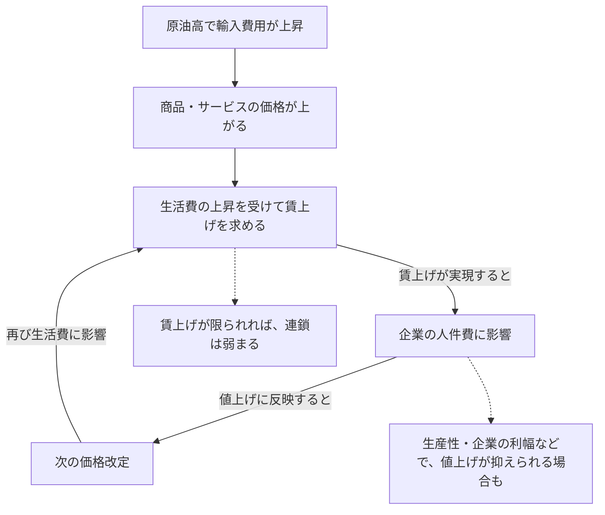

1974年の日本では、物価と名目賃金の上昇率がともに20～30％に達しました。ところが、1979年に始まる第2次石油ショックでは、原油高が起きても、第1次ほど激しい賃金・物価の連鎖にはなりませんでした。

**原油が値上がりすると生活費が上がる。それなら、なぜ賃金と物価が激しく上がり続ける場合と、そうならない場合があるのでしょうか。**

この疑問を考える手掛かりが、植田和男・日本銀行総裁の[2026年5月27日の開会挨拶](https://www.boj.or.jp/about/press/koen_2026/ko260527a.htm)です。総裁は日本の4つの局面を振り返り、同じような原油高でも、その後の物価の動きは経済の状態によって異なると説明しています。

最初に答えを述べると、**原油高で価格が上がることと、賃上げと値上げが繰り返されることは別だから**です。後者が起きるかどうかは、企業や労働者の行動、需要、物価についての予想、政策対応などに左右されます。

この記事では、専門的なモデルや計算は使わず、講演の図表を読みながら、この違いを自分の言葉で説明できることを目指します。

## 1. 一度の値上げと、上がり続ける物価は違う

例えば、ある商品の価格が今年100円から110円に上がり、来年も110円だったとします。

| 時点 | 価格 | 前年からの値上がり率 |
| --- | ---: | ---: |
| 値上げ前 | 100円 | ― |
| 値上げした年 | 110円 | 10％ |
| 翌年 | 110円 | 0％ |

価格は110円のまま高い水準にあります。それでも、**価格がもう上がっていなければ、次の年の上昇率は0％**です。

実際の物価はさまざまな商品やサービスの価格から決まるため、この例ほど単純ではありません。それでも、**「価格が高いこと」と「価格が上がり続けること」は区別できる**と分かります。

原油高が起きると、ガソリン、輸送費、原材料費などが高くなり、その費用の一部が商品やサービスの販売価格に転嫁されます。これを日銀は**一次的波及**と呼んでいます。

では、最初の値上げが終わった後にも物価が上がることはあるのでしょうか。

## 2. 賃金と物価が互いに影響する仕組み

物価が上がると、同じ給料でも買えるものが少なくなります。労働者が生活を守るために賃上げを求めるのは自然なことです。

その要求が実現して名目賃金（物価の変化を差し引く前の給料）が上がると、企業の人件費が増える場合があります。企業がその増加分を販売価格に反映すれば、今度は値上げが次の賃金交渉に影響するかもしれません。

これが、**物価の上昇が賃金へ、賃金の上昇が再び物価へと波及する**仕組みです。

*この図は理解のための模式図です。矢印は「必ず起きる」という意味ではありません。賃金上昇以外に、企業が利益率を維持しようとして値上げする経路もあります。*

ここで大切なのは、**循環が始まっても、それが必ず激しくなるわけではない**という点です。

例えば、企業に賃上げの余力がなければ、労働者の要求がすべて実現するとは限りません。賃金が上がっても、生産性の改善や企業の利幅の調整によって、販売価格への転嫁が小さくなることもあります。需要が弱ければ、値上げ自体が難しくなる場合もあります。

反対に、物価は今後も大きく上がるという予想が広がり、賃上げと値上げを互いに強く求める状態が続けば、循環は強まりえます。

整理すると、原油高の後には次のような違いがあります。

| 何が起きているか | どう考えればよいか |
| --- | --- |
| **主に最初の値上げが起きる** | 原油高の費用が価格へ届くが、賃金などへの追加的な広がりは小さい |
| **賃金や価格設定にも緩やかに広がる** | **二次的波及**はあるが、激しい高インフレとは限らない |
| **賃上げと値上げが強く増幅し合う** | 高い物価上昇率が続く、激しい**賃金・物価スパイラル**が生じうる |

この三つに明確な境界線があるわけではありません。重要なのは、「少しでも賃金が上がったらスパイラルだ」と考えないことです。

では、過去の日本では、なぜ循環の強さが違ったのでしょうか。

## 3. 第1次と第2次石油ショックは、なぜ違った？

### 第1次：原油高の前から賃金も物価も上がっていた

第1次石油ショックが起きたのは1973年後半です。植田総裁が強調するのは、**原油高が起きる前から、すでに日本の物価と賃金が急上昇していた**という事実です。

*出典：[植田総裁の開会挨拶・図表2](https://www.boj.or.jp/about/press/koen_2026/data/ko260527a1.pdf)。T＝1973年10～12月期。青線のCPI（食料・エネルギー除く）と緑線の名目賃金は前年比です。*

**図の左側、Tより前に注目してください。** 青線の物価上昇率はすでに10％近く、緑線の名目賃金上昇率は20％近くに達しています。

この状態で原油高が重なりました。1974年の春季賃金交渉では大幅な賃上げが妥結され、企業は原材料費だけでなく人件費の上昇も販売価格に転嫁しました。さらに物価が上がるという予想も強まり、賃金と物価の連鎖が激しくなった、と総裁は説明しています。

金融引き締めも行われましたが、総裁は高インフレの仕組みが形成された後だったことや、引き締めが不十分だったことを指摘しています。その後の景気後退には、原油高による実質所得の悪化や引き締めなど、複数の要因が重なりました。

**最初からインフレが強かったところへ、さらに原油高が加わった**のが第1次の特徴です。

### 第2次：原油高は起きても、賃金への広がり方が違った

1979～80年頃にも輸入物価は大きく上昇しました。しかし、国内の賃金・物価上昇率は第1次ほど高くなりませんでした。

*出典：[同講演・図表3](https://www.boj.or.jp/about/press/koen_2026/data/ko260527a1.pdf)。T＝1979年1～3月期。オレンジ線の輸入物価は右側の目盛り。図表2とは目盛りが異なります。*

オレンジ線の輸入物価は大幅に上がっています。一方、青線のCPI（食料・エネルギー除く）や緑線の名目賃金は、第1次に見られた20～30％台には達していません。

なぜでしょうか。総裁は、金融政策だけでなく、次のような条件が違ったと説明しています。

| 当時の条件 | 原油高の影響をどう変えたか |
| --- | --- |
| **ショック前の円高・省エネ** | 円建ての輸入費用やエネルギー使用の負担を和らげた |
| **第1次の経験を踏まえた労使の対応** | 生活費の上昇を、大幅な名目賃上げでそのまま取り戻そうとする動きが抑えられた |
| **比較的低い初期の物価上昇率と迅速な金融引き締め** | 物価上昇圧力が強く続くのを抑える方向に作用した |

*作用の整理は本稿によるものです。どの条件が何％効いたかを実証した表ではありません。*

第2次でも物価は上がり、景気も減速しました。**「影響がなかった」のではなく、「第1次のような激しい連鎖には至らなかった」**のです。

## 4. 2000年代と2021年以降も比べてみよう

原油高の結果が違うのは、1970年代だけの話ではありません。植田総裁は、さらに二つの時期を比較しています。

### 2000年代半ば：値上げをしにくい慣行が残っていた

2000年代半ばにも原油などの国際商品価格は上昇しました。しかし、日本では長いデフレの経験から、企業は値上げに慎重で、家計も価格があまり上がらない状態に慣れていました。名目賃金の伸びや、将来の物価上昇予想も低いままでした。

*出典：[同講演・図表4](https://www.boj.or.jp/about/press/koen_2026/data/ko260527a1.pdf)。T＝2005年7～9月期。*

青線のCPI（食料・エネルギー除く）は大部分の期間でゼロ以下です。原油高で家計の生活費は圧迫されても、**賃金や幅広い値付けの慣行が変わるほどの波及にはならなかった**、というのが総裁の解釈です。

### 2021年以降：賃金と値付けの慣行が変わり始めた

2021年以降は、原油だけでなく、食料、物流、さまざまな輸入原材料も値上がりしました。円安も輸入費用を押し上げました。

しかし、2000年代との違いはコスト高の広がりだけではありません。感染症流行後の需要回復、企業収益の増加、人手不足も、企業の値上げや賃上げを後押ししました。日銀の[2026年4月『展望レポート』BOX2](https://www.boj.or.jp/mopo/outlook/gor2604b.pdf#page=49)も、これらの条件を挙げています。

*出典：[同講演・図表5](https://www.boj.or.jp/about/press/koen_2026/data/ko260527a1.pdf)。T＝2022年1～3月期。2021年からのコスト高が始まる前の時点ではありません。*

図では、オレンジ線の輸入物価が大きく上昇した後、青線のCPI（食料・エネルギー除く）や緑線の名目賃金にも変化が見られます。ただし、線の動きだけから「賃金が物価を上げた」と因果関係を証明することはできません。

総裁は、**物価も賃金もあまり上がらないという従来の慣行が変わり始めた**と説明しています。それでも、1970年代前半のような激しいスパイラルにはなっていません。日銀はこの時期の賃金と物価の連関を、**緩やかな二次的波及**として捉えています。

### 4つの局面を一覧にする

| 局面 | 原油高などのショック | 賃金・価格設定の状況 | 結果 |
| --- | --- | --- | --- |
| **1973年～** | 第1次石油ショック | すでに物価・賃金上昇率が高かった | 激しいスパイラル |
| **1979年～** | 第2次石油ショック | 初期インフレが比較的低く、労使の対応や政策も異なった | 第1次ほどの連鎖は起きず |
| **2000年代半ば** | 原油・商品価格の上昇 | 企業は値上げに慎重で賃金の伸びも弱かった | 基調的な物価上昇は弱いまま |
| **2021年以降** | 広範なコスト高・円安 | 当初の慣行が、需要回復や人手不足などを背景に変化した | 緩やかな二次的波及 |

*植田総裁の講演に基づく本稿の整理です。ショックの規模や種類をそろえた比較ではありません。*

4つの局面では、原油高の特徴だけでなく、**原油高を迎えた時点で企業や労働者がどのように賃金や価格を決めていたか**が違います。こうした賃金・価格設定の慣行や物価予想を含む経済の状態を、講演では**インフレ・レジーム**という言葉で捉えています。

しかも、2021年以降のように、ショックをきっかけとして、その慣行自体が変わっていく場合もあります。

## 5. 2026年の「5つ目の原油価格ショック」にはどう向き合う？

植田総裁は2026年5月の講演で、当時の中東紛争に伴う原油高を**「5つ目の原油価格ショック」**と位置づけました。

4局面を学んだ後なら、**原油価格が上がったというニュースだけで、激しいインフレが続くと決めることはできない**と分かります。

その後を考えるには、例えば次の点に注目する必要があります。

- 輸入費用の上昇が、商品やサービスの値上げへどこまで広がるか。
- 生活費の上昇が、次の賃金交渉へどれほど反映されるか。
- 企業が賃金上昇を価格に転嫁するか、需要や収益によってその動きが変わるか。
- 将来の物価上昇について、家計や企業がどのように予想するか。

なお、**原油高は生活費を上げると同時に、企業の収益や家計の実質的な購買力を圧迫することもあります。** だから「物価が上がるなら賃金も必ず大幅に上がる」とは言えません。

日銀の[2026年4月『展望レポート』](https://www.boj.or.jp/mopo/outlook/gor2604b.pdf)も、原油高による消費者物価の押し上げと、実質所得・景気への下押しを同時に見込んでいました。一方、追加的に賃金上昇率が大幅に加速し、1974年型の激しい連鎖に至る可能性は、当時は高くないとみていました。

**これは2026年4～5月に公表された見方の紹介**であり、その後の実績や現在の政策判断を示したものではありません。

## 6. 理解確認：自分の言葉で説明できる？

ここまで読んだら、まず解答を開かずに考えてみてください。

### Q1：110円のままなのに、インフレは続いている？

ある商品の価格が1年目に100円、2年目に110円、3年目も110円だったとします。

**問：** 2年目と3年目の前年比の値上がり率はいくらですか。また、3年目も価格が高いことと、3年目にも値上げが続いていることは同じですか。

:::details 解答と理由

2年目は**10％**、3年目は**0％**です。

3年目も価格は100円より高いままですが、2年目から3年目にかけて価格は上がっていません。**価格の水準と、その上昇率は別**だからです。

実際の消費者物価指数には多くの商品・サービスが含まれますが、原油高で一度価格が上がっただけで、高い物価上昇率がいつまでも続くとは限らない、という点は同じです。

:::

### Q2：原油高が同じでも、なぜ結果が違う？

二つの架空の経済AとBに、同じ大きさの原油高が起きたとします。

- **A**では、原油高の前から物価と名目賃金が急上昇し、将来も物価が大きく上がると予想されています。
- **B**では、原油高の前の物価上昇率が比較的低く、企業と労働者は大幅な賃上げや値上げに慎重です。

**問：** どちらで激しい賃金・物価の連鎖が生じやすいと考えられますか。また、その理由を「賃金交渉」「企業の値上げ」という言葉を使って説明してください。

:::details 解答と理由

ほかの条件が同じなら、**Aの方が激しい連鎖へつながりやすい**と考えられます。

物価がさらに上がるという予想が強いと、労働者が大幅な賃上げを求め、それが実現すれば企業の人件費が上がる可能性があります。企業がその費用を値上げに反映すれば、次の賃金交渉にも影響するためです。

Bではその両方の反応が弱ければ、原油高による値上げが起きても、その後の連鎖は限定的になりえます。ただし、Aで必ずスパイラルが起きるという意味ではありません。

:::

### Q3：賃金と物価が同時に上がればスパイラル？

ある国で、輸入品の値上がりとともに、名目賃金と消費者物価の上昇率がともに高くなりました。

**問：** この事実だけで、賃金と物価が互いに押し上げ合う激しいスパイラルが生じたと断定できますか。判断するために、ほかに何を確認したいですか。

:::details 解答と理由

**断定できません。** 輸入費用の上昇だけでなく、需要の回復や人手不足などによって、賃金と物価が同時に上がる場合もあります。

賃上げが次の価格改定につながっているか、価格改定がさらに次の賃金交渉へ波及しているか、予想物価上昇率がどう変わっているかなどを確認する必要があります。

また、賃金・物価の緩やかな相互上昇があっても、1974年型の激しいスパイラルと同じとは限りません。

:::

## おわりに：原油高の「その後」を決めるもの

原油高によって商品やサービスの価格は上がりえます。しかし、その後も賃上げと値上げが強く続くかどうかは、最初の原油高だけでは決まりません。

第1次石油ショックでは、すでに強いインフレが進んでいたところに原油高が加わりました。第2次では、労使の行動、為替、省エネ、金融政策などの条件が違っていました。2000年代半ばには値上げに慎重な慣行が残り、2021年以降にはその慣行が変わり始めました。

**つまり、原油高そのものだけでなく、企業や労働者がその後どう行動するかが重要なのです。** この仕組みを説明できれば、植田総裁の4局面を読む目的は達成できたと考えます。

### 次回予告：循環の強さをもう少し詳しく考える

今回は「なぜ結果が違うのか」を直感的に整理しました。次回の発展編では、賃金と物価の循環が**どれほど強く、どれほど長く続くか**を、簡単なモデルやデータで考えます。名目賃金と**単位労働コスト（ULC）**の違い、CPIとGDPデフレーターの違いなども、その際に詳しく扱う予定です。

## 参考資料

- 植田和男（2026）[「日本における原油価格ショック、物価上昇率と金融政策」2026年5月27日開会挨拶](https://www.boj.or.jp/about/press/koen_2026/ko260527a.htm)（[図表2～5を含むPDF](https://www.boj.or.jp/about/press/koen_2026/data/ko260527a1.pdf)）。
- 日本銀行（2026）[『経済・物価情勢の展望』2026年4月、BOX2「原油価格高騰がわが国物価に与える影響」](https://www.boj.or.jp/mopo/outlook/gor2604b.pdf)。

*図表2～5は植田総裁の講演資料の引用です。4局面の比較表と循環図は、講演・日銀資料を理解するための本稿独自の整理です。*