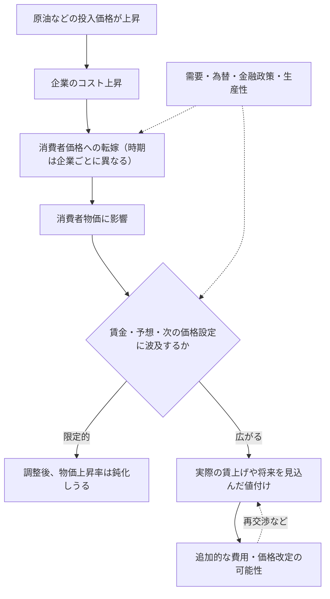

**1973年後半に原油価格が急騰する前、日本の物価上昇率はすでに10%近く、名目賃金の上昇率は20%近くに達していました。** その後、賃金と物価の上昇率は20～30%に達します。一方、1979～80年にも大きな原油高が起きましたが、同じ激しさの賃金・物価スパイラルにはなりませんでした。

「石油ショックがインフレを起こした」とだけ覚えていると、この違いを説明できません。

日本銀行総裁・植田和男氏は2026年5月27日の開会挨拶で、1973年、1979～80年、2000年代半ば、2021年以降を比較しました。本稿は『金融研究』2026年10月号にも収録された**講演の歴史的な観察事実**を起点に、「原油高が既存のインフレを増幅する場合と、物価・賃金の動きを大きく変えない場合を分けるのは何か」を考えます。

この記事は「日銀の研究を読み解く」シリーズ第1回です。扱うのは新しい因果推定論文ではなく、過去を振り返る**総裁の講演**です。数値を使った後半の例題は本記事独自の架空例であり、日本の実測値ではありません。なお、講演は2026年当時の5つ目の原油価格ショックにも触れていますが、ここでは詳しく振り返られた過去4局面に絞ります。

## 先に結論：原油高だけでなく「受け止める経済」を見る

| 時期 | ショック前後の状態 | 何が違ったか |
| --- | --- | --- |
| **1973年・第1次石油ショック** | ショック以前から物価・賃金が急上昇 | 原油高がすでに形成されていたインフレ的な動きを強め、賃金・物価スパイラルへ |
| **1979～80年・第2次石油ショック** | 物価・賃金の初期条件が比較的落ち着いていた | 早期の金融引き締め、前回の経験、事前の円高、省エネ化が重なり、波及は相対的に抑制 |
| **2000年代半ば** | 値上げに慎重な企業、弱い賃金、低い予想物価上昇率 | 原油高は実質所得を圧迫したが、基調的な物価上昇率の変化は小さかった |
| **2021年以降** | 複数の費用上昇と円安、労働需給・価格設定行動の変化 | 価格転嫁や賃金・期待へ波及。ただし1970年代前半ほどのスパイラルではない |

これらは講演の**歴史解釈を整理した表**であり、4回のショックの大きさや政策以外の条件が同一だったことを意味しません。

結論は「どの時代も原油が高ければインフレになる」でも「金融政策だけで違いが決まる」でもありません。**外から来たコスト上昇が、すでにある賃金・価格設定・期待の仕組みを通じてどう広がるか**が違ったのです。

## 1. 1973年と1979～80年：2度の石油ショックで何が違ったか

### 第1次：原油高の前からインフレが進んでいた

植田総裁は、1973年後半に第1次石油ショックが始まる**前**、物価上昇率が10%近く、名目賃金上昇率が20%近くに達していたと指摘します。1974年には賃金と物価の上昇率が約20～30%となり、典型的な賃金・物価スパイラルが生じました（講演本文・図表2）。

ショックが「ゼロからインフレを生んだ」という説明では、1973年前半の状態が抜け落ちます。すでに物価が上がり、賃金も上がっていたところへ原油高が重なった、という時間順序が重要です。

企業が仕入れ価格の上昇を販売価格へ転嫁し、家計が生活費の上昇を受けて賃上げを求め、**実際に大きな賃上げが妥結**され、企業が上昇した労働費用も価格へ反映する。将来も価格が上がるとの予想が広がれば、さらに値付けや賃金交渉に影響します。原油の価格上昇そのものとは別に、**経済内の賃金と価格が相互に作用する経路**ができたわけです。

金融政策にも注意が必要です。植田総裁は「引き締めが遅かった」だけでなく、**高インフレの仕組みが形成された後の引き締めであり、物価上昇率の高さに対して引き締めの度合いも明らかに不十分だった**と評価しています。後に景気後退と引き締めが物価上昇率を低下させましたが、交易条件の悪化や実質所得の減少などを伴い、経済的負担は大きなものでした。

ここで言えるのは、物価上昇が原油高**だけ**から始まったのではない、ということです。原油価格上昇がなければ1974年の物価上昇率が何%だったかは、この講演からは分かりません。

### 第2次：原油高が再来しても、同じスパイラルにはならなかった

1979～80年の第2次石油ショックも大きな原油高でした。しかし、講演は第1次と比べて物価上昇が相対的に穏やかで、以前と同じ賃金・物価スパイラルは起こらなかったと述べます（図表3）。**物価上昇がゼロだったという意味ではありません**。景気は減速し、物価上昇率も高まりました。

この違いに、植田総裁は複数の事情を挙げています。

| 事情 | 第2次ショックを理解する上での意味 |
| --- | --- |
| 低めの初期インフレ・抑制的な賃金 | 第1次ほど強い賃金・物価の循環から出発していなかった |
| より迅速な金融引き締め | 物価上昇圧力への政策対応が早かった |
| 企業と労働組合の経験 | 名目賃上げだけで価格上昇を追うと再びスパイラルになりかねないという認識 |
| **ショック前**の円高 | 輸入物価全般が押し下げられた状態で原油高を迎えた |
| エネルギー効率の改善 | 生産に必要な原油への依存度が下がっていた |

金融政策は重要ですが、**「引き締めの速さだけで第1次との差が生まれた」とは説明できません**。また、円高は原油高が始まる**前**の出来事であり、ショック期間中の為替が一貫して円高だったという意味ではありません。

### 2枚の図表を比較するときの落とし穴

[日銀公表の図表2・3（PDFの8～9ページ）](https://www.boj.or.jp/about/press/koen_2026/data/ko260527a1.pdf#page=8)を見てください。第1次は `T=1973年Q4`、第2次は `T=1979年Q1` を起点として、前後の時期を並べています。

**二つの図は縦軸の目盛りが違います。** 第1次の左軸はおよそ-20～40%、第2次は0～10%です。グラフの線の傾きや画面上の高さだけで比較すると読み違えます。また、賃金とCPIは前年比、実質GDPは前期比です。**第1次の図表2では政策金利が右目盛り、第2次の図表3では輸入物価が右目盛り**です。各図の凡例・注記・縦軸を確認し、**別の指標や計算期間を混ぜて比較しない**ことが、歴史の議論の出発点になります。

もう一つ大切なのが物価指標です。これらの図表で使われた青線の凡例は**「CPI（除く食料・エネルギー）」**です。日本で一般に「コアCPI」と呼ばれる**「生鮮食品を除く総合」**とは一致しません。講演本文では「コアCPI」という語も使われていますが、本文の呼び方を根拠に図表の指標を読み替えてはいけません。日本の指標名は[総務省統計局のQ&A](https://www.stat.go.jp/data/cpi/4-1.html)でも確認できます。

### 独自の検証：米国でも同じように物価上昇は抑えられたのか？

ここまでは植田総裁が説明した**日本国内の比較**です。では、日本の第1次と第2次の差は、原油高に直面したどの国にも共通する現象だったのでしょうか。講演自体は米国との比較を行っていません。以下は本記事で追加した**独自の記述統計による確認**です。

世界銀行 World Development Indicators の「消費者物価上昇率（年次、総合）」について、日本と米国の1970～1983年を同じ縦軸に描きました。系列は [日本（FRED）](https://fred.stlouisfed.org/data/FPCPITOTLZGJPN) と [米国（FRED）](https://fred.stlouisfed.org/data/FPCPITOTLZGUSA) です。


*図：世界銀行 WDI（IMF IFS、FRED経由）の年次インフレ率をもとに筆者作成。陰影は1974年・1980年を示す。［再現用のCSV・Pythonコード］(https://github.com/Osino-Niso/econ-data-lab/tree/main/code/oil-shocks-inflation-regimes)。*

| 対象年・期間 | 日本 | 米国 |
| --- | ---: | ---: |
| 1974年 | **23.2%** | 11.1% |
| 1980年 | 7.8% | **13.5%** |
| 1973～76年の4年間平均 | **14.0%** | 8.0% |
| 1979～82年の4年間平均 | 4.8% | **10.3%** |

1974年は日本の方が大きく上昇しましたが、1980年には米国の方が高い上昇率でした。ショックの前後を含む**4年間の単純平均**で比較しても、大小関係は逆転しています。したがって「第2次の方が第1次より物価上昇が穏やかだった」という日本の経験を、米国へそのまま一般化することはできません。

**ただし、これは原油高や金融政策の因果効果を推定したものではありません。** 原油の輸入依存度、為替、金融政策、賃金交渉、需要、その他の供給ショックなどが国ごとに違います。また、ここでの**総合CPIの暦年平均上昇率**は、植田総裁の図表の**「食料・エネルギー除くCPI」の前年比**とは別の指標です。4年間平均も特定期間の記述統計であって、ショックの効果を測る推定量ではありません。

この追加比較から得られる発見は、特定要因の効果を「証明した」ことではなく、**世界的な原油高という共通の出来事でも、日本と米国の物価上昇の経路は相当に違った**という観察事実です。この違いの原因を調べるには、物価だけでなく賃金・為替・金融政策・需給などをそろえ、どの変化を原油高の影響とみなせるか検討する必要があります。

## 2. 2000年代半ばと2021年以降：デフレ的な慣行は変わったか

### 2000年代半ば：原油高でも基調的なインフレは動きにくかった

[図表4（PDFの9ページ）](https://www.boj.or.jp/about/press/koen_2026/data/ko260527a1.pdf#page=9)では、食料・エネルギーを除くCPIの前年比が、対象期間の大部分でマイナス圏にあります。原油高が生じても、この指標は大きく上方へ動きませんでした。

これは「家計が値上げの負担を感じなかった」という意味ではありません。原油高は企業のコストを増やし、家計の実質所得を下押ししました。植田総裁が強調するのは、**賃金・予想物価上昇率・価格設定行動を持続的に変えるまでには至らなかった**ことです。

1990年代後半以降のデフレ経験の中で、企業は値上げに慎重になり、家計も価格があまり上がらない状態に慣れていました。経済の回復は、こうした行動を変えるほど強くありませんでした。講演はこれを「デフレ均衡」と説明しています。「均衡」といっても好ましい状態だったという意味ではなく、**値上げしにくい企業行動と低い賃金・物価予想が持続していた状態**を指します。

### 2021年以降：原油だけではない費用上昇が広がった

[図表5（PDFの10ページ）](https://www.boj.or.jp/about/press/koen_2026/data/ko260527a1.pdf#page=10)では、食料・エネルギー除くCPIの前年比がマイナス圏からプラスへ移り、賃金も上昇しています。図表の起点は `T=2022年Q1` であり、本文が述べる「2021年頃から始まる出来事」の開始時期と同じではありません。

ここでは**原油だけ**が上がったのではありません。エネルギー、食料、物流、輸入原材料などの費用上昇が重なり、パンデミック後の世界的な需要回復と円安が加わりました。多くの企業が同時にコスト高に直面し、値上げへの抵抗が弱まったと植田総裁は説明します。

また、労働需給の引き締まりは賃金交渉の条件を変えました。企業も家計も、長く続いてきた「物価と賃金はあまり上がらない」という**ノルム（共有された行動の慣行）**から離れ始めます。中長期の予想物価上昇率も、講演によれば、指標による違いはあるもののゼロ近くから1.5～2%台へ緩やかに上昇しました。

重要なのは、**1970年代前半と同じ激烈なスパイラルが再現されたわけではない**ことです。近年の賃金上昇と物価上昇が相互に関係していても、その大きさ・持続性・初期条件まで同じとは言えません。

## 3. 4つの歴史から見えた「波及経路」

4局面を一つの問いに戻しましょう。**費用上昇が起きたとき、値上げは一度で終わるのか、それとも次の賃金交渉や値付けに影響するのか。**



*概念図：必ずこの順序・強さで反応するわけではありません。家計の賃上げ要求と**実際の賃金上昇**は別です。*

賃金が上がっても生産性改善や利益率の縮小によって企業が負担を吸収すれば、その分だけ販売価格への転嫁は弱くなりえます。予想物価上昇率が上がっても、必ず同じ率で物価が上がるわけではありません。為替・需要・政策・他の供給ショックも影響します。

これを日銀の講演に沿ってまとめると、**第1次はすでにインフレ的な仕組みが強まり、第2次はその広がりが抑制され、2000年代半ばはデフレ的な仕組みが維持され、2021年以降にはその慣行が変わり始めた**、という違いになります。

ただし、この整理は**原文に基づく解釈**であり、原油高・金融政策・賃金交渉などの**個別の因果効果を数量的に特定した結果ではありません**。4時期は同じ規模の原油高を無作為に与えた実験ではないからです。

## 4. 補助教材：原油価格の「水準」と「上昇率」を分ける

ここまでの歴史の議論で、ひとつ数学的な区別を補います。

原油価格の架空の指数が `100 → 120 → 120` と動いた場合、原油の**価格水準は高いまま**ですが、原油価格の**前期比上昇率**は `+20% → 0%` です。原油価格指数と、商品・サービス全体の**一般物価指数**は異なります。

一般物価指数を $P_t$ とすると、前期比の物価上昇率は

$$
\pi_t=\left(\frac{P_t}{P_{t-1}}-1\right)\times100
$$

です。ここでは計算を分かりやすくするため**前期比**を使います。日銀の歴史的図表にあるCPI・名目賃金は**前年比**なので、数字をそのまま比較してはいけません。

同じ原油価格の変化に対し、**一般物価が仮に**次のように動くとします。

| 架空の一般物価指数 | 0期 | 1期 | 2期 | 3期 | 前期比上昇率（1～3期） |
| --- | ---: | ---: | ---: | ---: | --- |
| A：一度だけ上昇 | 100 | 104 | 104 | 104 | 4%, 0%, 0% |
| B：転嫁に時間差 | 100 | 102 | 104 | 104 | 2%, 約1.96%, 0% |
| C：上昇が継続 | 100 | 104 | 108.16 | 112.4864 | 4%, 4%, 4% |

Bの2期は `(104/102-1)×100 ≒ 1.96%` です。「指数が2ポイント上がった」と「2%上昇した」は同じではありません。

AとBは**過去の費用上昇を価格へ反映する時間の違い**をイメージした例です。複数の期に物価上昇が現れても、それだけで賃金・物価スパイラルが成立したとは言えません。Cは上昇が持続する**結果を仮定した数列**であり、原油高を原因とする予測モデルではありません。持続する仕組みを説明するには、実際の賃金、期待、需要、他の費用などを別途確かめる必要があります。

:::details Python：上記の架空の指数を再計算する

```python
paths = {
    "A 一度だけ": [100, 104, 104, 104],
    "B 遅れて転嫁": [100, 102, 104, 104],
    "C 上昇が持続": [100, 104, 108.16, 112.4864],
}
for name, prices in paths.items():
    rates = [(prices[t] / prices[t - 1] - 1) * 100
             for t in range(1, len(prices))]
    print(name, [round(x, 4) for x in rates])
```

:::

:::details R：同じ架空の指数を再計算する

```r
paths <- list(
  "A 一度だけ" = c(100, 104, 104, 104),
  "B 遅れて転嫁" = c(100, 102, 104, 104),
  "C 上昇が持続" = c(100, 104, 108.16, 112.4864)
)
for (name in names(paths)) {
  p <- paths[[name]]
  rates <- 100 * (p[-1] / p[-length(p)] - 1)
  print(list(name = name, inflation = round(rates, 4)))
}
```

:::

これは計算結果を再現するコードであり、歴史データの推定や原油ショックの因果分析ではありません。

## 5. 理解確認：本文を読み返す前に考える

### Q1：物価上昇率が下がっても、値段は高いまま？

架空の経済で原油価格指数が0期100、1期120、2期120です。一般物価指数は0期100、1期105、2期108、3期108でした。物価上昇率は前期比で計算します。

**問：** 1～3期の一般物価上昇率を求めてください。また、3期の上昇率が0%でも、一般物価水準が0期より高い理由を説明してください。原油価格が2期に横ばいなのに一般物価が上がったことだけで、賃金・物価スパイラルが生じたと言えますか。

:::details 解答と理由

1期は `(105/100-1)×100=5%`、2期は `(108/105-1)×100≒2.8571%`、3期は `(108/108-1)×100=0%` です。物価上昇率が0%なのは**前期からさらに上がっていない**という意味であり、指数108が100に戻ったわけではありません。

2期の物価上昇は、**過去の原油高を遅れて転嫁した**だけでも起こりえます。実際の賃上げ、予想の変化、その後の再度の価格改定などを確認しない限り、スパイラルが成立したとは判断できません。

:::

### Q2：時間差の転嫁と二次的波及をどう見分ける？

架空のA国・B国では、どちらも原油価格が1期に20%上がり、その後一定になります。A国では企業が1期と2期に仕入れ費用を販売価格へ転嫁しましたが、名目賃金と予想物価上昇率には大きな変化が観察されません。B国では最初の転嫁に加え、2期以降に実際の名目賃金が上がり、企業が人件費の増加を理由に再び販売価格を改定しています。

**問：** (1) 両国で物価上昇が複数期にわたったという事実だけで、同じメカニズムだと言えますか。(2) B国について、二次的波及を示唆する事実を挙げ、なお確定できない点も説明してください。

:::details 解答と理由

(1) **言えません。** A国の複数期の値上げは、過去の費用上昇が時間差で転嫁された結果として説明できます。物価上昇率が複数期で正であるというだけでは、持続する仕組みを識別できません。

(2) B国の**実際の名目賃金の上昇**と、それを理由とする**再度の価格改定**は、最初の原油高から賃金・価格設定への二次的な波及を示唆します。ただし、他の費用上昇や需要の変化もありうるため、その事実だけでは原油高の因果効果の大きさ、スパイラルが今後どこまで持続するかを確定できません。

:::

### Q3：第1次と第2次の違いから、何を主張できる？

ある資料には、日本の第1次石油ショック（1973年後半）前には物価上昇率が10%近く、賃金上昇率が20%近く、1974年には両者が約20～30%に達したとあります。第2次（1979～80年）でも原油価格は大きく上がりましたが、第1次ほど激しい賃金・物価スパイラルは生じませんでした。第2次には、より迅速な金融政策対応、低めの初期物価上昇率、企業・労働組合の経験、ショック前の円高、省エネ化がありました。

**問：** (1) 「原油高は、すでに進んでいたインフレを強めうる」はこの資料と整合的ですか。(2) 「二つのショックの結果の差の8割は金融政策による」はこの資料だけで言えますか。(3) 後者を検証するには、どんな追加資料・分析が必要でしょうか。

:::details 解答と理由

(1) **整合的です。** 第1次ショック前からインフレが進み、ショック後さらに強まったという時間順序を説明しています。ただし原油高がなかった場合の反実仮想までは測定していません。

(2) **言えません。** ほかにも複数の条件が同時に異なり、寄与度を定量的に分けた分析が提示されていないからです。金融政策が重要だったという**定性的評価**と「8割」という**定量的な因果寄与**は別です。

(3) 例えば物価・賃金・政策金利・為替・需要・エネルギー投入比率などの時系列、ショックの規模・持続性に関する資料が必要です。これらを収集しても、単純な相関だけでは政策効果を識別できません。政策がインフレに**反応して決まる**ことや、同時期の別の変化を考慮する分析設計がさらに必要です。

:::

## まとめ：石油ショックは、その時代のインフレの仕組みを映す

1973年と1979～80年の違いは、単なる原油価格の動きの違いではありません。第1次の前にはすでに賃金・物価上昇が進み、第2次には事前条件、学習、政策、為替、エネルギー依存度が異なっていました。

2000年代半ばと2021年以降の比較でも、同じように費用が増えたからといって、企業の値付けや賃金交渉が同じように反応するわけではないと分かります。植田総裁が示したのは、**原油高がその時代のインフレの仕組みを試す**という見方です。

その意味では、原油の値段を見るだけでは足りません。一方で、4つの歴史例だけで各要因の因果効果を分解できるわけでもありません。この区別が、講演を読むうえで最も大事だと考えます。

## 出典・参考資料

- 植田和男（2026）「2026年国際コンファランス『金融政策の新たな視野』開会挨拶」『金融研究』45巻4号、37～44頁、日本銀行金融研究所。[金融研究所掲載版](https://www.imes.boj.or.jp/research/papers/japanese/kk45-4-2.pdf) ／ [日本銀行公表の開会挨拶・図表（2026年5月27日、PDF）](https://www.boj.or.jp/about/press/koen_2026/data/ko260527a1.pdf)
- [日本銀行「2026年国際コンファランスにおける開会挨拶」案内ページ](https://www.boj.or.jp/about/press/koen_2026/ko260527a.htm) ― 発表日・原文・図表の確認。
- [総務省統計局「消費者物価指数に関するQ&A（A-5）」](https://www.stat.go.jp/data/cpi/4-1.html) ― 「生鮮食品を除く総合」などの指標定義。

講演は過去の経験を振り返る開会挨拶であり、本記事に独自の計量的因果推定はありません。講演中の歴史的な評価、本文の補助的な経済学的整理、架空の確認問題を混同しないようにしています。『金融研究』の掲載記事に示された見解は著者個人のものであり、日本銀行・金融研究所の公式見解とは限りません。
