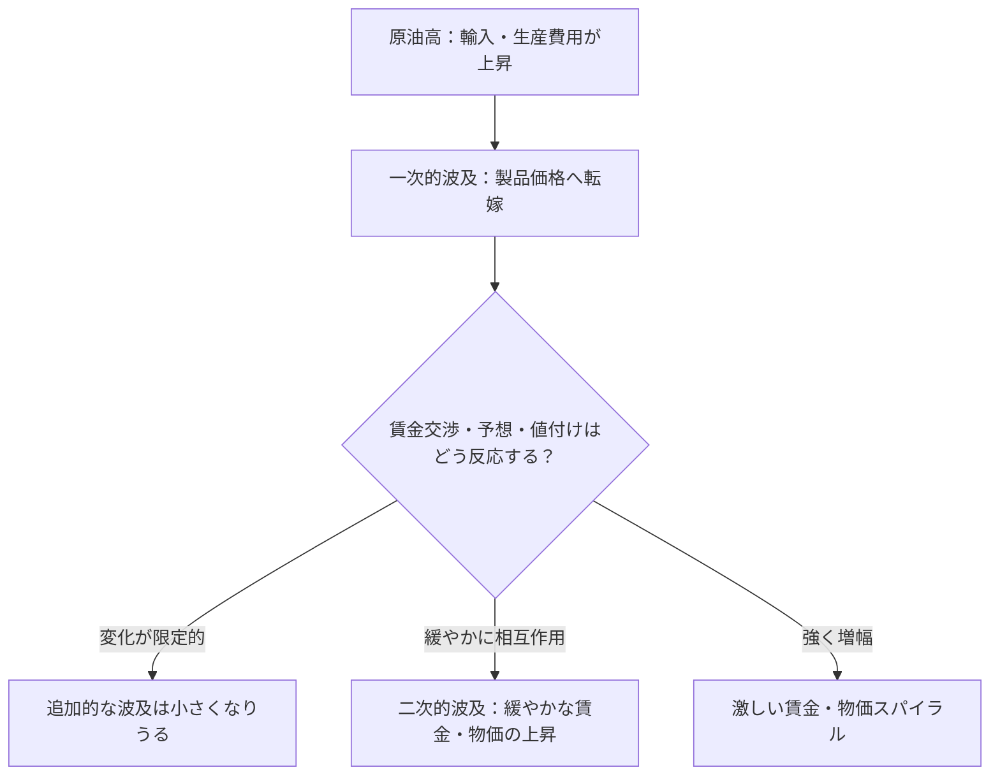
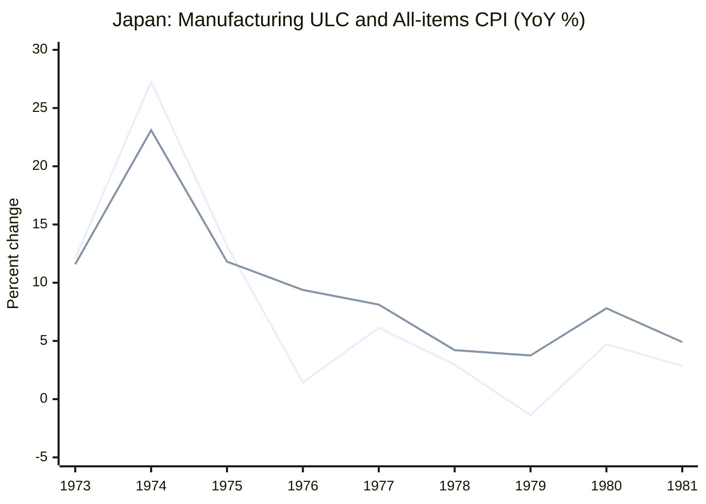

1974年の日本では、物価と名目賃金の上昇率がともに20～30％に達しました。一方、1979～80年の第2次石油ショックでは、輸入物価が急騰しても、第1次ほど激しい賃金・物価スパイラルは起きませんでした。

**原油高が生活費を上げることは分かります。それなのに、賃金と物価が互いに押し上げ合う場合と、そうならない場合があるのはなぜでしょうか。**

植田和男・日本銀行総裁は、2026年5月27日の[開会挨拶](https://www.boj.or.jp/about/press/koen_2026/ko260527a.htm)で、過去の4局面を振り返り、2026年の原油高について問いを投げかけました。

この講演を読む鍵は、**輸入費用の価格転嫁、穏やかな二次的波及、激しい賃金・物価スパイラルを混同しないこと**です。

以下では、この違いを説明したうえで、第1次・第2次石油ショック、2000年代半ば、2021年以降を比較します。日銀の『展望レポート』と歴史統計は、講演を理解する助けとして使います。本稿は講演の解説であり、歴史上の因果関係を独自に推定するものではありません。

## 1. 原油高の後には、三つの違う展開がありうる

原油高で輸入原材料や燃料が値上がりし、企業が製品・サービスへ転嫁する。日銀の[2026年4月『展望レポート』BOX2](https://www.boj.or.jp/mopo/outlook/gor2604b.pdf#page=47)は、これを**一次的波及効果**と呼んでいます。

ここで混同しやすいのが、**価格水準の上昇**と、**物価上昇率が高い状態の持続**です。架空の商品が100円から110円に値上がりして翌年も110円なら、上昇率は最初の年に10％、次の年に0％となります。高い価格が残っても、価格が上がり続けるとは限りません。

一方、生活費の上昇を受けて賃上げが進み、それを企業が販売価格へ転嫁したり、物価予想を受けて値付けを変えたりすれば、**二次的波及効果**が生まれます。日銀は賃金だけでなく、企業が収益マージンを確保しようとする動きも二次的波及に含めています。

ここで、結果を「スパイラルが起きた／起きなかった」の二択にしないことが大切です。

| 原油高の後の展開 | 何が起きているか |
| --- | --- |
| **① 主に一次的な価格転嫁** | 輸入費用の上昇は価格に届くが、賃金や物価予想の変化は限られる |
| **② 緩やかな二次的波及** | 賃金・価格設定・物価予想にも影響が広がり、緩やかな相互上昇が続く |
| **③ 激しい賃金・物価スパイラル** | 賃上げと値上げが強く増幅し合い、高いインフレ率が持続・加速する |

**②も二次的波及です。しかし、③のような激しいスパイラルとは同じではありません。** 2022年以降の日本について、日銀BOX2は賃金と物価が緩やかに相互上昇する「マイルドな二次的波及」を指摘しています。植田総裁も、近年はデフレ的な慣行が変わり始めた一方、1970年代前半のようなスパイラルには至っていないと説明しています。

流れを模式的に描くと、次のようになります。

*この図は概念整理です。三つに明確な境界や決まった閾値があるわけではなく、一次的波及自体も時間差を伴います。原油高の影響は為替・需要・政策によっても変わります。*

つまり、この記事で比べたいのは**原油価格がどれだけ上がったか**だけでなく、**その上昇を受け止めた社会の賃金交渉・予想・価格設定がどう反応したか**なのです。

## 2. 第1次石油ショック：原油高の前からインフレが進んでいた

第1次石油ショックが起きたのは1973年後半です。総裁がまず注目するのは、**原油高が起きる前の日本でも、すでに物価と賃金が急上昇していた**ことです。

講演によると、1973年前半には、食料・エネルギーを除くCPIの前年比上昇率が10％近く、名目賃金上昇率は20％近くに達していました。

*出典：[植田総裁の2026年5月27日開会挨拶・図表2](https://www.boj.or.jp/about/press/koen_2026/data/ko260527a1.pdf)。T＝1973年10～12月期。CPI（食料・エネルギー除く）と名目賃金は前年比。実質GDPは前期比年率。政策金利は右軸。*

**図表2の読み方：** まずショック基準期T（1973年10～12月期）より左を見てください。青線のCPI（食料・エネルギー除く）はすでに前年比10％前後、緑線の名目賃金も20％前後に達しています。**原油高が起きてから初めて上がったわけではない**のです。

すでに物価上昇が進むなかで原油高が重なり、1974年春の賃金交渉では非常に大幅な賃上げが妥結されました。企業は原材料費に加えて人件費の増加も販売価格に転嫁し、将来も物価が上がるという予想が強まりました。

**相対価格のショックが、国内の賃金と幅広い物価の連鎖へ変わった**、というのが総裁の説明です。

金融政策も無関係ではありません。日銀は物価上昇圧力が明確になってから引き締めましたが、総裁は、高インフレの仕組みがすでに形成された後だったうえ、引き締めの度合いも不十分だったと振り返っています。

その後、1974年前半には深刻な景気後退が生じました。原油高による交易条件の悪化、実質所得や企業業績の悪化、金融引き締めなどが重なったためです。最終的にインフレ率は下がりましたが、代償は大きかったと総裁は述べています。

## 3. 第2次石油ショック：どの段階で波及が弱まったのか

1979～80年頃にも原油高によって輸入物価は大きく上昇しました。しかし第1次ほど強い賃金・物価スパイラルにはなりませんでした。

*出典：[植田総裁の図表3](https://www.boj.or.jp/about/press/koen_2026/data/ko260527a1.pdf)。T＝1979年1～3月期。輸入物価（円ベース）は右軸。第1次の図表2とは目盛りや基準期が異なります。*

**図表3の読み方：** オレンジ線の輸入物価（円ベース、右軸）はT後に急騰します。一方、青線のCPI（食料・エネルギー除く）と緑線の名目賃金（左軸）は、第1次のような20～30％台には達していません。**輸入費用の急騰と国内の賃金・物価の反応は同じ大きさではない**ことが分かります。

この違いについて総裁が挙げた理由を、**波及のどの段階に作用しうるか**で整理してみましょう。

| 波及の段階 | 第2次にあった条件 | どう作用しうるか |
| --- | --- | --- |
| **輸入費用が生産コストへ届く段階** | ショック前の円高、省エネ・原油依存度の低下 | 円建ての輸入費用や生産に必要なエネルギーの負担を和らげる |
| **値上げが賃金交渉に波及する段階** | 低い初期インフレ、第1次の経験から学んだ労使の行動 | 物価上昇をそのまま名目賃上げで補う動きを抑える |
| **賃金・物価の連鎖が続く段階** | より迅速な金融引き締め | 需要と物価上昇圧力の持続を抑える方向に働く |

*これは講演を理解するための概念整理です。段階が厳密に独立するわけではなく、各条件の因果効果や寄与率を推定した表でもありません。*

特に重要なのは、**「原油高で生活費が上がったから、賃金も同じだけ上げよう」という行動が、第1次と第2次で同じではなかった**という点です。

総裁によれば、第1次の経験を経て企業と労働組合は、原油高に伴う物価上昇を名目賃上げで全面的に取り戻そうとすると、かえってさらなる物価上昇を招きかねないと認識していました。

金融政策も重要でしたが、**為替・省エネは初めの負担を和らげ、賃金交渉や物価予想はその後の連鎖に関わる。** 複数の条件を一緒に読むと、第2次の違いが理解しやすくなります。

第2次に物価が上がらなかったわけではありません。経済も減速しました。それでも第1次のような、賃金と物価が強く相互に加速する局面には至らなかったのです。

:::details 二つの講演図表を比較するときの注意

- 青線のCPIは「食料・エネルギー除く」です。日本で通常「コアCPI」と呼ぶ「生鮮食品を除く総合」とは異なります。
- 図表2・3の縦軸は同じ目盛りではありません。線の高さだけを見比べないでください。
- 基準期Tも異なり、同じ強さ・性質の原油ショックを与えた実験ではありません。
- 輸入物価は原油価格そのものではありません。為替やほかの輸入品も関わります。

:::

## 4. 数字で補う：賃金上昇率とULCは何が違う？

日銀の[2026年4月『展望レポート』BOX2・図表B2-5、B2-6](https://www.boj.or.jp/mopo/outlook/gor2604b.pdf#page=49)も、1970年代の賃金経路を補っています。

そこでは、**1974年の春季賃上げ率は約33％**に達したのに対し、第2次ショック期には賃上げ率が抑制され、**1980年の実質賃金上昇率はマイナス**だったと説明されています。前者は賃上げ率、後者は物価を考慮した実質賃金の伸びであり、同じ指標の直接比較ではありません。

日銀は、もう一つ**単位労働コスト（ULC）**にも注目します。これは名目賃金そのものではなく、生産1単位当たりの労働費用です。経済全体については、

$$
\mathrm{ULC}=\frac{\text{名目雇用者報酬}}{\text{実質GDP}}
$$

と表せます。雇用者報酬も実質生産も10％増えれば、ULCは変わりません。生産が増えず報酬だけ10％増えれば、ULCも10％増えます。

日銀の図表B2-6では、第1次の前後にULCの伸びが大幅に加速する一方、第2次では抑制されています。**名目賃金だけでなく、生産量との関係で見た労働費用の伸びも違っていた**と理解できます。ただし、ULCだけで賃金が物価に及ぼした因果効果は分かりません。

:::details 補足データ：OECD製造業ULCと全国総合CPI

日銀のULCは**経済全体**を対象とします。別の歴史統計として、OECDの**製造業**ULC前年比と、全国総合CPI前年比を並べます。

| 年 | 製造業ULC前年比 | 全国総合CPI前年比 |
| --- | ---: | ---: |
| 1973 | +12.08％ | +11.59％ |
| 1974 | +27.25％ | +23.10％ |
| 1979 | −1.38％ | +3.75％ |
| 1980 | +4.72％ | +7.80％ |
| 1981 | +2.85％ | +4.90％ |

*ULCは[FRED収録のOECD系列JPNULCMANAPNMEI](https://fred.stlouisfed.org/data/JPNULCMANAPNMEI)、CPIは[OECD全国総合の年平均指数](https://data-explorer.oecd.org/vis?df%5Bag%5D=OECD.SDD.TPS&df%5Bid%5D=DSD_PRICES_COICOP2018%40DF_PRICES_C2018_ALL&dq=JPN.A.N.CPI.IX._T.N.&pd=1955%2C2024&vw=tb)から計算。製造業と家計の対象範囲が異なり、講演の「食料・エネルギー除くCPI」とも別の系列です。*

*1本目が製造業ULC、2本目が全国総合CPI（ともに前年比）。線の併走から因果関係や寄与率を求めることはできません。*

ULCの歴史系列には、改訂・定義差が残ります。別資料では1979年が約+0.19％、1980年が約−0.48％となり、採用したFRED系列と符号まで異なります。そのため年ごとの符号の反転は結論にせず、**1974年頃と第2次ショック期の大きな伸びの差**に注目します。

別資料：[1981年英国議会に引用されたOECD統計](https://hansard.parliament.uk/Commons/1981-01-26/debates/7c775e34-5df8-4e81-95dc-0b819e64ca9f/UnitLabourCosts)、[1990年の英国議会掲載指数](https://hansard.parliament.uk/Commons/1990-11-19/debates/5d87c114-21a5-4dbc-b2f2-7e4bddbea523/WrittenAnswers)。[固定CSVとPython/R再現コード](https://github.com/Osino-Niso/econ-data-lab/tree/research/oil-shock-data-pilot-20261026/code/oil-shocks-inflation-regimes)。

:::

## 5. 2000年代と2021年以降：なぜ「緩やかな二次的波及」が重要なのか

第1次と第2次の違いは、労使が経験から学んだことや、金融政策の違いだけで説明できるのでしょうか。植田総裁はさらに、**物価も賃金も上がらないという慣行が根強くなった時代**と、その慣行が**変わり始めた時代**を比べています。

### 2000年代半ば：原油高でもデフレ的な慣行は変わらなかった

原油などの国際商品価格は高騰しましたが、日本では長年のデフレ経験から企業が値上げに慎重で、家計も価格が上がりにくい環境に慣れていました。賃金と予想物価上昇率も低いままでした。

総裁はこれを「デフレ均衡」と呼びます。輸入費用の上昇は生活費を押し上げ、実質所得を圧迫しました。しかし、企業の価格設定や労使の賃金交渉を持続的に変えるには至りませんでした。**原油高による一部の値上げと、経済全体のデフレ的な慣行が両立していた**のです。

*出典：[植田総裁の開会挨拶・図表4](https://www.boj.or.jp/about/press/koen_2026/data/ko260527a1.pdf)。T＝2005年7～9月期。*

**図表4では青線に注目してください。** 食料・エネルギーを除くCPIの前年比は大部分の期間でゼロ以下です。緑線の名目賃金も上下し、値上げと賃上げが持続的に強まり合う姿にはなっていません。

### 2021年以降：デフレ的な慣行が変わり、緩やかな波及が続いた

2021年以降は、原油だけでなく食料・物流・輸入原材料の費用が広範囲に上がり、円安も輸入費用を押し上げました。多くの企業が同時にコスト高に直面すると、従来より値上げに踏み切りやすくなります。

ただし、**コスト高が広範囲だったことだけで、賃金への二次的波及を説明するのは不十分**です。日銀の2026年4月BOX2は、当時の輸入物価上昇に原油等の国際商品高と円安の双方が関わったうえ、**企業収益の大幅な増加、コロナ禍後のペントアップ需要、人手不足に伴う需給ギャップの改善**が賃上げを後押しした、と説明しています。費用を価格へ転嫁できる需要環境や、賃上げを支える企業収益も重要だったのです。

こうした環境のもとで、企業と労働者の**「物価も賃金もあまり上がらない」という慣行（ノルム）**が弱まり、物価上昇予想もゼロ近辺から緩やかに上がりました。

*出典：[同開会挨拶・図表5](https://www.boj.or.jp/about/press/koen_2026/data/ko260527a1.pdf)。T＝2022年1～3月期。2021年からの一連のコスト高が始まる前の時点ではありません。*

**図表5では線の時差を見てください。** オレンジ線の輸入物価（円ベース、右軸）が高い伸びを示した後も、青線のCPI（食料・エネルギー除く、左軸）は次第に上昇します。緑線の名目賃金にも動きがあります。ただし、線の時差や併走だけで因果関係が確定するわけではありません。

ここは、2000年代半ばとの決定的な違いです。価格転嫁が進むだけでなく、**賃金・物価予想・価格設定の慣行そのものが動き始めた**のです。

一方で、植田総裁は**1970年代前半のような激しい賃金・物価スパイラルには至っていない**と述べています。さらに2026年4月の[日銀BOX2・図表B2-7](https://www.boj.or.jp/mopo/outlook/gor2604b.pdf#page=49)は、2022年の輸入物価上昇が、その後の賃金と物価の**相互連関的な緩やかな上昇の起点**となったという意味で、「マイルドな二次的波及効果」を持ったと説明しています。

**二次的波及が起きることと、激しいスパイラルが起きることは同じではない。** これが2021年以降の経験から得られる、重要な区別です。

### 4局面を「原油の値上がり幅」ではなく「経済の状態」で比べる

| 局面 | ショックを迎えた状態 | 賃金・価格設定への広がり | 講演が示す結果 |
| --- | --- | --- | --- |
| **第1次（1973年～）** | すでに高い賃金・物価上昇率 | 賃上げと値上げが強く増幅 | 激しいスパイラル |
| **第2次（1979年～）** | 比較的低い初期インフレ、労使の学習、円高・省エネ | 賃金面の増幅が抑制 | 第1次ほど激しくならない |
| **2000年代半ば** | デフレ的な賃金・価格設定 | 慣行はほとんど変わらない | 基調的インフレは低迷 |
| **2021年以降** | 幅広いコスト高、円安、人手不足 | 慣行が変わり、緩やかな二次的波及が発生 | 1974年型の激しい連鎖には至らない |

*この表は植田総裁の歴史解釈と日銀BOX2を本稿が再整理したものです。ショックの規模や原因をそろえた実験ではなく、各要因の寄与率を識別したものでもありません。*

4局面は単なる「原油が上がった年」の比較ではありません。総裁がいう**インフレ・レジーム**、つまり物価予想や賃金・価格設定のあり方が違う経済に、原油高というショックが入った例です。

**同じような費用ショックでも、受け止める経済のレジームによって、結果は一次的な値上げから緩やかな二次的波及、激しい連鎖まで変わりうる。** 原油価格だけで結果を決められない理由が、ここにあります。

## 6. 補足：原油高はCPIを押し上げ、GDPデフレーターを下押しする？

ここまで、輸入費用の上昇が国内の賃金と物価へどう伝わるかを見てきました。ただし、**家計が払う価格が上がることと、国内の所得が同じように増えることは別**です。原油を輸入する日本では、その代金の一部が海外に支払われるためです。

まず二つの物価指標を分けます。

| 指標 | 何を測るか |
| --- | --- |
| **CPI** | 家計が購入する財・サービスの価格。輸入品の値上がりも反映されうる |
| **GDPデフレーター** | 国内で生まれた付加価値の価格。名目GDPを実質GDPで割った指数 |

[日銀『展望レポート』BOX2・図表B2-8（PDFの50ページ目）](https://www.boj.or.jp/mopo/outlook/gor2604b.pdf#page=50)は、原油高と円安という**二種類のショック**を、マクロ計量モデルQ-JEMで比べています。**原油価格18％上昇**と**5％の円安**を別々に与え、輸入デフレーターへの押し上げ幅が同程度になるよう調整した実験です。

図表B2-8には大きく二つの発見があります。

| 見る場所 | 原油高ショック | 円安ショック |
| --- | --- | --- |
| **① CPI（生鮮食品除く）** | 上振れる。エネルギー価格の寄与が比較的大きい | 上振れる。食料・エネルギー以外にもより広く波及 |
| **② GDPデフレーター** | 1～3年目に下振れる | 初年は小幅下振れ、その後上振れる |

「上振れ・下振れ」は、**ショックのない想定経路（ベースライン）からの乖離**です。GDPデフレーターが下振れることは、実際の前年比がマイナスになることと同じではありません。

### なぜ同じ輸入物価の上昇でも、結果が違うのか

日銀の解説では、円安は輸入品全般を通じて幅広い財・サービスの価格を押し上げやすい一方、原油高のCPIへの影響はエネルギー価格中心になる傾向があります。**輸入デフレーターへの衝撃が似ていても、国内への伝わり方は同じではない**のです。

GDPデフレーターでは、日銀は「単位労働コスト（ULC）」と「ユニット・プロフィット等」への寄与を分けています。原油高では初めに後者のマイナス寄与が大きく、その後はULCにもマイナス寄与が見られます。「ユニット・プロフィット等」は企業の純利益率そのものではなく、雇用者報酬以外の付加価値所得などを含む残余です。

**この寄与分解が直接示すのは付加価値の「価格」の反応であって、賃金総額や企業利益総額が必ず減るという意味ではありません。** 一方で、原油高に伴う交易条件の悪化は、海外への支払負担を通じて国内の**実質購買力**を圧迫しえます。この実質所得への経路とGDPデフレーターの価格としての反応は、関係していても同一の指標ではありません。

この補助分析から分かるのは、**「原油高でCPIが上がったのだから、賃金・利潤も同じ勢いで上がるはずだ」とは言えない**ということです。

:::details 図表B2-8を自分で読むポイント

[日銀の図表B2-8を開く](https://www.boj.or.jp/mopo/outlook/gor2604b.pdf#page=50)。

- 上段①の**白色**はCPIのうちエネルギーの寄与、**青色**は食料・エネルギー除く部分、点はCPI（生鮮食品除く）全体の反応です。原油高と円安で、白と青の比率に注目してください。
- 下段②はGDPデフレーターの変化を、ユニット・プロフィット等（白）とULC（青）に分けています。原油高では双方の寄与が、どの年にマイナスになるかを確認できます。
- 上段・下段とも**ベースラインからの乖離率**であり、実測の物価上昇率を示した図ではありません。

:::

なお、これは**原油高と円安のモデル比較**です。第1次・第2次石油ショックの初期条件を比較した実証分析ではありません。講演の歴史解釈を証明するのではなく、**同じ「輸入コスト高」にも異なる波及があること**を考えるための資料です。

## 7. 2026年の「5つ目のショック」には何を当てはめる？

植田総裁は2026年5月27日の講演を、当時の中東紛争に伴う原油高を**「5つ目の原油価格ショック」**と位置付け、日本はいまどのようなインフレ環境にあり、中央銀行はどう対応すべきか、という問いで結んでいます。

4つの歴史的局面から学べるのは、**CPIが何％上がったかだけでは、その後の賃金・物価の連鎖までは分からない**ということです。具体的には、次の観点を区別して読みたいところです。

| 注目する動き | 何を考える手掛かりになるか |
| --- | --- |
| **輸入物価・企業物価・CPI** | 原油高の費用がどこまで、どれくらいの時間差で価格へ転嫁されたか |
| **賃金・ULC・企業の値付け** | 値上げが賃金交渉や収益マージンの調整とどう関わっているか |
| **物価予想・需要・金融環境** | その変化がさらに次の値上げ・賃上げへつながる条件があるか |

これは講演の考え方を整理したもので、表の指標から将来の因果効果が自動的に分かるわけではありません。

ここで、講演の約1か月前の[2026年4月『展望レポート』](https://www.boj.or.jp/mopo/outlook/gor2604b.pdf)を一緒に読むと、見かけ上は矛盾する三つの判断が並んでいることに気づきます。

- **消費者物価は押し上げられる。** 原油高はエネルギーや財の価格を通じ、2026年度のCPIを押し上げるという見通しでした。
- **所得・景気には下押しとなる。** 交易条件の悪化などを通じて企業収益や家計の実質所得にマイナスとなり、成長ペースを鈍らせるとみられていました。
- **しかし、賃金加速による一段のスパイラルは必然ではない。** BOX2は、賃金上昇率が大幅に加速し、それが追加的な物価上昇率の高まりにつながる可能性を、当時は高くないと判断していました。

その一方で、日銀は基調的な物価上昇率が2％に近づき、賃金・価格設定行動も積極化していることから、**物価全体の上振れリスク**には注意を促していました。

これは矛盾しません。**原油高でCPIが上振れること、実質所得が圧迫されること、賃金と物価が激しく増幅し合うことは、それぞれ別の現象**だからです。しかも2026年4月の見通しは、**賃金と物価が緩やかに相互上昇する既存のメカニズムは維持される**という判断も含みます。「緩やかな連関がある」ことと「さらに賃金が急加速する可能性は高くない」ことも両立します。

以上は**2026年4～5月時点で公表された判断の解説**であり、その後の実績や現在の政策方針を判定したものではありません。

4局面の比較は、原油価格という一つの数字から答えを出すためではなく、**その原油高をどんな経済が受け止めるのか**を問うために役立ちます。

## 8. 理解確認：どの「波及」を見ているか

### Q1：二次的波及があれば、スパイラルと呼べる？

三つの架空の経済A・B・Cに、輸入エネルギー価格の上昇が起きたとします。

- **A**：エネルギーや一部の商品の価格は上がるが、賃金交渉と中長期の物価予想はほとんど変わらない。
- **B**：最初の値上げを受けて労働者が賃上げを求め、その賃上げの一部が企業の次の価格改定にも反映される。賃金・物価予想・物価は緩やかに上がるが、高インフレへの急加速はない。
- **C**：大幅な賃上げが次の値上げを招き、それがさらに賃上げ要求と物価予想の上昇を呼ぶ。高い物価上昇率が続く。

**問：** (1) A・B・Cを「主に一次的な価格転嫁」「緩やかな二次的波及」「激しい賃金・物価スパイラル」に分類してください。(2) なぜBをCと同一視してはいけないのでしょうか。また、賃金と物価が同時に上がったという観察だけで、Bのような二次的波及を認定できるでしょうか。

:::details 解答と理由

(1) A＝主に一次的な価格転嫁、B＝緩やかな二次的波及、C＝激しい賃金・物価スパイラルです。

(2) Bでは**先行する値上げ→賃金交渉→次の価格改定**という経路を問題文が明示しているため、緩やかな二次的波及と考えられます。しかし上昇率が強く増幅し続けるCとは違います。**賃金と物価が同時に上昇したという観察だけでは、この経路を確認できません。** 共通の需要増加など、別の原因で両方が上がる場合もあるからです。現実の経済に三分類の明確な閾値があるわけでもありません。

:::

### Q2：同じ原油高でも、どこで違いが生まれる？

二つの架空の経済A・Bに、同じ原油価格上昇が起きたとします。Aはショック前から高インフレで物価予想も高く、賃金交渉が活発です。Bは物価予想が低く、労使は大幅な名目賃上げを抑え、事前の円高と省エネも進んでいます。

**問：** (1) 植田総裁の説明を手掛かりにすると、どちらで二次的波及が強まりやすいと考えられますか。(2) Bの「円高・省エネ」と「賃金交渉の抑制」は、それぞれ波及のどの段階に主として作用しますか。

:::details 解答と理由

(1) 他の条件を一定とすれば、Aで強まりやすいと考えられます。高い物価予想と賃金交渉が、次の賃上げや値上げに結びつきやすいからです。ただし、結果が必ずそうなるという予測ではありません。

(2) 円高や省エネは主として輸入費用から生産費用への初期的な負担に作用します。賃金交渉の抑制は、生活費の上昇がさらに名目賃金や価格改定へ伝わる段階に作用します。要因は重なって働くため、どれが何％寄与したかは分かりません。

:::

### Q3：Q-JEMの図でGDPデフレーターがマイナスなのは「デフレ」の証拠？

日銀のモデル分析では、原油高ショックによるGDPデフレーターの**ベースラインからの乖離**が1～3年目にマイナス、CPIの乖離はプラスでした。比較対象の円安ショックではGDPデフレーターが後にプラスへ転じています。

**問：** (1) GDPデフレーターの乖離がマイナスなら、実際の物価上昇率も必ずマイナスですか。(2) このモデルだけで「第2次石油ショックが第1次より穏やかだった理由」を実証できたと言えますか。

:::details 解答と理由

(1) いいえ。マイナスなのはショックがない場合の想定経路との差です。ベースラインのGDPデフレーターが上昇していれば、実際の指数も上昇しつつ、ベースラインより低くなることがあります。物価の水準・前年比・ベースラインからの乖離を区別します。

(2) 言えません。Q-JEMの比較は原油高と円安という**ショックの種類**を変えたものです。第1次と第2次の賃金交渉・期待・金融政策という**初期条件の差**を識別した実験ではありません。

:::

## おわりに：原油価格ではなく、それを受け止める経済を見る

1973年の第1次石油ショックでは、原油高の**前から**賃金と物価の上昇が加速していました。第2次では初期インフレや労使の行動、金融政策、為替、省エネが違いました。2000年代半ばにはデフレ的な慣行が根強く、2021年以降にはその慣行が変わり始めました。

4局面を読み解いて、最も重要だと感じたのは、**原油高の影響を「一時的な値上げか、激しいスパイラルか」の二択にしてはいけない**ということです。

輸入費用の転嫁にとどまる場合もあれば、賃金・物価・物価予想が緩やかに相互上昇する場合もある。そして第1次石油ショックのように、高インフレが強く増幅される場合もある。**二次的波及は「あるかないか」だけでなく「どのような強さで起きるか」が重要**です。

これが、2026年の原油高についてCPIの数字だけを見て判断できない理由です。賃金交渉、物価予想、企業の値付け、需要、為替、金融政策まで見なければ、原油高の**その後**は分かりません。

植田総裁は、この違いを生む背景を**インフレ・レジーム**という視点で振り返っています。講演を読む意味は、原油価格から将来のインフレ率を当てることではなく、**同じコスト高を、異なる経済がどう受け止めるかを考えられるようになること**です。

## 参考資料・再現コード

- 植田和男（2026）[「日本における原油価格ショック、物価上昇率と金融政策」2026年5月27日開会挨拶](https://www.boj.or.jp/about/press/koen_2026/ko260527a.htm)（[図表付きPDF](https://www.boj.or.jp/about/press/koen_2026/data/ko260527a1.pdf)）。『金融研究』45巻4号の[掲載情報](https://www.boj.or.jp/research/imes/mes/mes26.htm)。
- 日本銀行（2026）[『経済・物価情勢の展望』2026年4月号、BOX2「原油価格高騰がわが国物価に与える影響」](https://www.boj.or.jp/mopo/outlook/gor2604b.pdf)。
- OECD/FRED [日本の製造業ULC・JPNULCMANAPNMEI](https://fred.stlouisfed.org/data/JPNULCMANAPNMEI)、OECD [日本の全国総合CPI](https://data-explorer.oecd.org/vis?df%5Bag%5D=OECD.SDD.TPS&df%5Bid%5D=DSD_PRICES_COICOP2018%40DF_PRICES_C2018_ALL&dq=JPN.A.N.CPI.IX._T.N.&pd=1955%2C2024&vw=tb)。
- [ULCとCPIの固定CSV、Python/R再現コード、データの出典と留意点](https://github.com/Osino-Niso/econ-data-lab/tree/research/oil-shock-data-pilot-20261026/code/oil-shocks-inflation-regimes)。

*本文の歴史系列は特定公表時点の固定データを用いています。図表2～5は日銀講演資料の引用です。補助資料の統計とモデル実験は、植田総裁の歴史的解釈を新たに因果推定したものではありません。*
