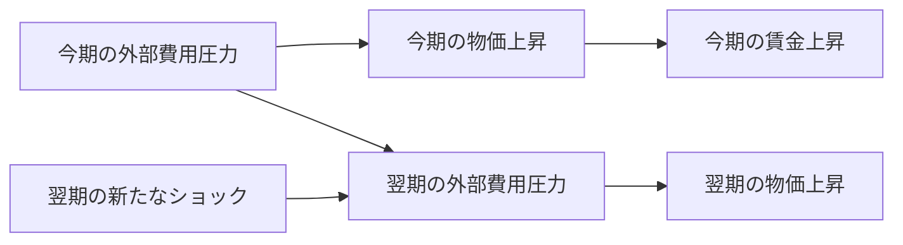

[前回の記事「原油高が起きても、なぜ賃金・物価スパイラルになるとは限らない？」](https://zenn.dev/econ_data_lab/articles/oil-shocks-inflation-regimes)では、1970年代から2020年代までの日本の経験を比較しました。原油高を迎えたときの賃金交渉、企業の価格設定、物価予想などが異なれば、その後のインフレの姿も異なりうる、という話です。

そこで、次の疑問が生まれます。

**賃金と物価がともに上昇し、さらに物価上昇が長引いたというデータがあれば、「賃上げが次の値上げを引き起こした」と言えるのでしょうか。**

**それだけでは言えません。**

賃金から物価への波及が実際にある経済と、賃金が物価に反応しているだけの経済とで、観測される賃金・物価データを完全に同じにできるからです。

前回のマクロ経済学的な説明をデータで裏づけるには、何を確かめればよいのでしょうか。この問いを、計量経済学の「識別」という考え方につなげます。

架空の2つの経済を作り、数式とPython・Rで比べながら、予測のための回帰係数と因果効果の違いを確かめます。

## 1. まず、賃金と物価の循環を式にする

時点 $t$ での変数を、通常時からの上昇率の上振れ（単位：パーセントポイント）として、次のように置きます。

| 記号 | 意味 |
| --- | --- |
| $\pi_t$ | 物価上昇率の通常時からの上振れ |
| $w_t$ | 名目賃金上昇率の通常時からの上振れ |
| $\varepsilon_t$ | その期に発生する新しい外部ショック |

いずれも実測のCPIや賃金指数そのものではありません。また、数式は理解のために極端に単純化した架空の経済です。

今回は、物価上昇率の上振れに対して賃金上昇率の上振れが当期中に一定の割合で反応すると仮定します。賃金が物価に完全に比例する、現実には極端な設定です。あえて単純化することで、「データが同じでも仕組みは違う」という問題を明瞭にします。

**経済A：賃金から物価へ波及する経済**

経済Aでは、賃金上昇が翌期の物価上昇を押し上げ、当期の物価上昇が賃金に反映されると仮定します。

$$
\begin{aligned}
\pi_t &= 0.75w_{t-1}+\varepsilon_t,\\
w_t &=0.8\pi_t.
\end{aligned}
$$

0.75は「前期の賃金上昇率が通常時より1ポイント高ければ、ほかの条件が同じとき、今期の物価上昇率を0.75ポイント押し上げる」という、この架空モデルでの係数です。0.8は物価上昇に対する賃金の反応です。

前期の賃金の式を代入すると、

$$
\pi_t=0.75(0.8\pi_{t-1})+\varepsilon_t
=0.6\pi_{t-1}+\varepsilon_t.
$$

したがって、ショックがその後ゼロでも、最初の物価上昇の一部は次期へ残ります。係数0.6をこの単純なモデルにおける循環の持続性として読めます。今回の設定では0から1の間なので、追加的な上昇率は徐々に減衰します。

例えば、時点0に2ポイントのショックが起き、その後は新たなショックがない場合、物価上昇率の追加分は $2, 1.2, 0.72, 0.432, \ldots$ と小さくなります。物価水準そのものが下がるという意味ではなく、通常時に比べた上昇率の上振れが弱まるという意味です。

## 2. まったく同じデータを生む、別の経済

**経済B：外部要因の持続が物価を動かす経済**

経済Bでは、賃金から物価へのフィードバックを考えません。代わりに、賃金以外の要因による価格上昇圧力が持続すると仮定します。その状態を $s_t$ と表します。

$$
\begin{aligned}
\pi_t &=s_t,\\
s_t &=0.6s_{t-1}+\varepsilon_t,\\
w_t &=0.8\pi_t.
\end{aligned}
$$

経済Bにも物価と賃金の連動はあります。ただし、矢印は物価から賃金への一方向であり、賃金から物価へのフィードバックはありません。

ここで重要なのは、$s_t$ が実測の原油価格や輸入物価ではなく、**観測上の同値性を示すために設けた架空の状態変数**だということです。経済Bでは $\pi_t=s_t$ と置いているため、$s_t$ の値を追加で見ても物価上昇率と同じ値しか得られません。この設定だけで、現実の物価上昇が原油高によって生じたと説明できるわけではありません。

経済Bでも、

$$
\pi_t=0.6\pi_{t-1}+\varepsilon_t
$$

が成立します。経済Aと同じ式です。たとえばショック前を $w_{-1}=s_{-1}=0$ とし、両経済に同じ数値の新規ショック $\varepsilon_t$ を与えると、物価上昇率はすべての期で一致します。さらに $w_t=0.8\pi_t$ も共通なので、賃金の系列まで一致します。

ここで「同じショック」とは、人工モデルの計算で同じ乱数列を入力するという意味です。現実の原油ショックと賃金ショックを同じ現象だとみなしているわけではありません。

| 期 | A・B共通：物価上昇率の追加分 | A・B共通：賃金上昇率の追加分 |
| --- | ---: | ---: |
| 0 | +2.0000pt | +1.6000pt |
| 1 | +1.2000pt | +0.9600pt |
| 2 | +0.7200pt | +0.5760pt |
| 3 | +0.4320pt | +0.3456pt |

*最初の期だけ2ポイントのショックを与えた手計算例。以降の新規ショックはゼロ。数値は日本の実績ではありません。*

### 同じ軌跡を2本ずつ重ねると？

*図1：架空の2モデルに同じ1回限りの2ポイントのショックを与えた結果。青い線がA、橙色の丸印がBで、2系列とも線と丸印が完全に重なる。縦軸は通常時の上昇率からの上振れ（pt）。*

同じ系列を生む理由は、単に2つの折れ線が似ているからではありません。両方の式を整理すると同じ漸化式になり、賃金の式も共通なので、観測できる2系列が厳密に一致するためです。

ここでは1度だけのショックを図示しましたが、同じ初期条件のもとであれば、**各期のショックの値がどのような並びでも、両モデルに同じ系列を入力する限り同じ賃金・物価系列が生まれます。**

それなのに、背後の構造は違います。

### 経済A：賃金から物価への波及がある

### 経済B：外部要因が持続している

図はそれぞれの式の因果方向を表す仮定上の模式図です。実際の日本でこの構造が確認されたという意味ではありません。

異なる因果構造が、同じ観測データを生むことを「観測上の同値性（observational equivalence）」と呼びます。ここでは偶然同じになったのではなく、同じになるようにモデルを構成しています。

これは、賃金と物価の上昇率の追加分が完全に比例するという特殊な反例です。それでも、この反例が示す結論は重要です。

**賃金と物価の連動を観察するだけでは、因果方向を一意に決められません。**

## 3. 回帰分析では、どちらも理論上の傾きはプラスになる

では、過去の賃金上昇率を使って、今期の物価上昇率を説明してみましょう。

$$
\pi_t=c+\gamma w_{t-1}+u_t
$$

経済Aでは、もともとの式から $\gamma=0.75$ です。賃金から物価への構造的な波及係数と一致します。

ところが経済Bでも、 $w_{t-1}=0.8\pi_{t-1}$ なので、

$$
\begin{aligned}
\pi_t
&=0.6\pi_{t-1}+\varepsilon_t\\
&=\frac{0.6}{0.8}w_{t-1}+\varepsilon_t\\
&=0.75w_{t-1}+\varepsilon_t.
\end{aligned}
$$

と書けます。

**経済Bでは、賃金から物価への因果的波及がゼロでも、回帰の理論上の傾きは0.75になるのです。**

経済Bの前期賃金は、持続的な外部圧力の状態を知らせる指標になっています。賃金自体が原因ではなくても、将来の物価を予測する役には立ちます。

| 比べたいもの | 経済A | 経済B |
| --- | --- | --- |
| 物価上昇が持続する仕組み | 賃金を経由した波及 | 潜在的な外部圧力の持続 |
| 前期賃金を説明変数とする回帰の理論上の傾き | 0.75 | 0.75 |
| 賃金だけを+1ptに介入した場合の翌期物価への効果 | +0.75pt | 0pt |

**予測に使う回帰係数と、賃金を介入で変えたときの効果は別の問いです。**

経済Aでは0.75が物価を決める式の賃金係数そのものです。一方、経済Bでは、回帰係数0.75は外部圧力の持続係数0.6を賃金の反応係数0.8で割った値にすぎません。数値が同じでも、何を表す係数なのかが違います。

### PythonとRで確認する

図1のような1回限りのショックでも、各期の値が変わるので回帰計算はできます。ただし、その結果だけでは、確率的なショックを受けるとOLSの推定値が理論値からどのくらいずれるかを確かめられません。

そこで、今度は時点1以降のショックを独立な平均ゼロの正規乱数で与え、5,000期分の架空データを作ります。時点0のショックだけは2ポイントに固定し、初期値とショック系列は両経済で共通にします。

再現用の全コードはGitHubに用意しました。

- [Pythonコード](https://github.com/Osino-Niso/econ-data-lab/blob/main/code/wage-price-observational-equivalence/python.py)
- [Rコード](https://github.com/Osino-Niso/econ-data-lab/blob/main/code/wage-price-observational-equivalence/r.R)

実験では次の3点を検証します。

1. 物価と賃金の全系列が、モデルAとBで数値誤差の範囲で一致する。
2. $\pi_t$ を $w_{t-1}$ に回帰したOLS推定値が両モデルで一致する。
3. 5,000期の人工データから推定したOLSの傾きを、理論値0.75と比較する。

Pythonで指定した乱数シードを用いると、OLSの傾きは両モデルとも約0.737となります。両モデルへ同じ数値の乱数列を入力したため、推定値も同じです。理論値0.75との差は有限標本のばらつきです。Rでは別の乱数列を使うため数値は同一とは限りませんが、比較すべき結論は変わりません。

なお、いずれも $|0.6|<1$ の安定した過程を用いており、独立な平均ゼロの新規ショックという仮定のもとで、標本を増やすとOLSの傾きは0.75に近づくと考えられます。

ここで大切なのは、「OLSが間違った計算をした」のではないことです。モデル上、新しいショック $\varepsilon_t$ が過去の情報から独立で平均ゼロなら、両モデルで回帰式の誤差を $u_t=\varepsilon_t$ と書けます。シミュレーションでは時点0のショックだけを2ポイントに固定していますが、OLSに用いる時点1以降のショックはこの仮定を満たします。したがって、回帰に用いる時点 $t\geq1$ について、

$$
E[u_t\mid w_{t-1}]=E[\varepsilon_t\mid w_{t-1}]=0
$$

が成立します。この仮定は、いまの回帰式から予測関係を推定できる根拠にはなります。しかし、**その回帰式を賃金への介入に対しても成り立つ構造方程式だと認定する根拠にはなりません。**

**条件付き平均ゼロが成立する回帰であっても、その係数が知りたい因果効果を表しているとは限りません。**

これは、以前の記事「[E[u|X]=0って結局どういう意味？](https://zenn.dev/econ_data_lab/articles/zero-conditional-mean)」の発展問題でもあります。OLSの回帰式の誤差に関する外生性と、経済構造に対する因果的な問いは区別しなければなりません。

## 4. では、何が分かれば2つを区別できる？

同じ系列を観察するだけでは、今回のAとBを見分けられません。

しかし、仮にほかの要因を変えずに、ある期の賃金上昇率だけを1ポイント高くする介入ができたらどうでしょうか。

経済Aでは翌期の物価上昇率が、介入しなかった場合より0.75ポイント高くなります。一方、経済Bでは外部費用圧力 $s_t$ の推移が変わらない限り、翌期の物価上昇率は変わりません。

ここで行うのは、時点0の賃金決定式だけを外から上書きし、賃金上昇率を反実仮想として+1ポイント上げるという操作です。それ以外の新規ショックと初期条件は変えません。時点1以降は通常の式に戻すため、Aでは賃金・物価の連鎖が続き、Bでは追加的な効果は生じません。

| 賃金上昇率への仮想的な介入 | 経済A | 経済B |
| --- | ---: | ---: |
| ある期の賃金上昇率だけを+1pt | 翌期物価上昇率に+0.75pt | 翌期物価上昇率に0pt |

*図2：時点0の賃金上昇率だけを+1ポイント変更した場合の、介入なしと比べた物価上昇率の差。経済Aでは翌期+0.75ポイント、さらに次の期+0.45ポイントと続くが、経済Bでは全期0。架空の構造を変えずに計算した反実仮想である。*

翌々期のAの応答は、賃金が物価に反応して $0.8\times0.75=0.6$ ポイント増え、その翌期の物価に $0.75\times0.6=0.45$ ポイント波及する、という計算です。これは賃金を1度だけ変えても、Aの循環がその後の影響を引き継ぐことを示します。

**同じ観測データを生む2つの構造でも、賃金への介入には異なる答えを出します。**

ただし、この介入は思考実験です。現実の因果効果を確かめるには、賃金に固有の外生的な変動や独立した費用データなどを使い、どの変動を原因として扱えるのかを仮定とともに検討する必要があります。

## 5. 現実の日本銀行の研究では、どう調べている？

前回の記事では、原油高が一次的な価格押し上げに終わるか、賃金を経由した二次的な波及を伴うかを考えました。では実際のデータを見て、**「賃金を経由した波及があった」とどう確かめられるでしょうか。** 今回の経済AとBが教えるのは、賃金と物価の連動だけでは決着しないということです。

ここまでの例は、因果関係を調べる際の困難を意図的に強調した教材です。現実には、賃金も物価もさまざまな要因から決まります。賃金交渉、企業の価格設定、輸入コスト、需要、期待、政策対応などが同時に関係しています。

[尾崎達哉ほか（2024）「賃金・物価の相互連関を巡る最近の状況について」（日銀レビュー）](https://www.boj.or.jp/research/wps_rev/rev_2024/rev24j02.htm)では、輸入物価の大きな変動が賃金・物価の相互連関の識別を難しくすると説明しています。そこで品目別のコスト構造や時系列モデルなど複数の方法を使い、**賃金上昇を販売価格に反映する動きが徐々に広がっている可能性**を示しました。

[安達孔・加藤直也（2025）「原材料高を起点とした賃金から物価への二次的波及：DSGEモデルによる実証分析」（日銀WP）](https://www.boj.or.jp/research/wps_rev/wps_2025/wp25j05.htm)では、日本と欧州を対象に一次的な価格転嫁と賃金経由の二次的波及を分析しました。著者らは、**2020年以降の物価上昇では原材料高の一次効果が主因である一方、二次的波及がインフレの持続性を高めた可能性**を指摘しています。

品目別のコスト構造は賃金以外の費用要因を考慮する手掛かりになり、DSGEモデルは賃金・物価の決まり方に追加の仮定を置いて波及経路を検討します。いずれも賃金・物価の連動だけで因果方向を決めるものではなく、追加の情報や識別のための仮定が必要です。研究結果も、二次的波及を無条件に証明したものではありません。

なお、**2024年の日銀レビュー、2025年のワーキングペーパーともに、結果・見解は各執筆者に属し、日本銀行の公式見解を必ずしも示すものではありません。**

[前回の記事](https://zenn.dev/econ_data_lab/articles/oil-shocks-inflation-regimes)で植田総裁の4局面を読んだとき、私たちは「同じ原油高でも結果が異なる」ことに注目しました。今回はその反対に、次のことを確認しました。

**同じ結果が観測されても、原因は異なりうる。**

マクロ経済学が示す「こういう仕組みがありうる」という説明を、実際のデータでどこまで検証できるのか。そこに計量経済学の出番があります。

## 6. 理解確認：自分で区別できる？

### Q1：同じデータなら因果関係も同じ？

次の2つの架空の経済を考えます。両者とも、同じ初期条件・同じ外部ショックのもとで、物価上昇率 $\pi_t$ と賃金上昇率 $w_t$ の系列がすべて一致するとします。

- A： $\pi_t=0.75w_{t-1}+\varepsilon_t,\quad w_t=0.8\pi_t$
- B： $\pi_t=s_t,\quad s_t=0.6s_{t-1}+\varepsilon_t,\quad w_t=0.8\pi_t$

問： 同じ賃金・物価データが得られたことを根拠に、「AとBで賃金から物価への因果効果は同じ」と言えますか。理由も説明してください。

:::details 解答と理由

**言えません。**

Aでは賃金から翌期物価への波及係数が0.75ですが、Bでは物価は外部圧力 $s_t$ のみで決まり、賃金から物価への因果的な波及はゼロです。それでも、両者は $\pi_t=0.6\pi_{t-1}+\varepsilon_t$ と $w_t=0.8\pi_t$ を満たすため、系列が一致します。観測結果が一致しても、経済構造が同じとは限りません。

:::

### Q2：条件付き平均ゼロは何を保証する？

架空の経済Bを次のように定義します。

$$
\pi_t=s_t,\quad s_t=0.6s_{t-1}+\varepsilon_t,\quad w_t=0.8\pi_t.
$$

新しいショック $\varepsilon_t$ は過去の情報から独立で平均ゼロとします。$\pi_t$ を前期賃金上昇率 $w_{t-1}$ にOLS回帰するとします。

問： (1) このモデルから $E[\pi_t\mid w_{t-1}]$ を求めてください。(2) $E[\varepsilon_t\mid w_{t-1}]=0$ が成立していても、その回帰係数を「賃金を1ポイント上げたときの物価への因果効果」と呼べない理由を説明してください。

:::details 解答と理由

**(1)** $w_{t-1}=0.8\pi_{t-1}$ と $\pi_t=0.6\pi_{t-1}+\varepsilon_t$ より、

$$
E[\pi_t\mid w_{t-1}]=0.75w_{t-1}
$$

です。

**(2)** 0.75は前期賃金を使って翌期の物価を予測する関係の係数です。賃金上昇率は、前期の物価を通じて外部圧力の状態を知らせています。しかしBの物価を決める式は $\pi_t=s_t$ であり、賃金を外から変えても $s_t$ が同じなら物価は変わりません。**回帰誤差の条件付き平均ゼロと、介入時の因果効果を区別すること**が重要です。

:::

### Q3：賃金だけを変えたら結果はどうなる？

次の2つの架空の経済を考えます。Aは $\pi_{t+1}=0.75w_t+\varepsilon_{t+1}$ に従い、Bは $\pi_{t+1}=s_{t+1}$、$s_{t+1}=0.6s_t+\varepsilon_{t+1}$ に従います。両経済とも通常は $w_t=0.8\pi_t$ ですが、ある期の名目賃金上昇率 $w_t$ だけを、もとの値より1ポイント高くする仮想的な介入を行います。外部ショックおよび $s_t$ は変えないとします。

問： 翌期の物価上昇率 $\pi_{t+1}$ は、介入しなかった場合と比べてA、Bでそれぞれ何ポイント変わりますか。その違いは何を意味しますか。

:::details 解答と理由

**Aでは翌期の物価上昇率が+0.75ポイント、Bでは0ポイントです。**

Aの物価決定式には前期賃金が0.75倍で入る一方、Bでは物価を決めるのは外部圧力 $s_t$ だからです。日常の観測データでは区別できなかった2つの経済も、賃金だけを変えたときに起きる反応を考えると、因果構造の違いが明確になります。

:::

## おわりに

**賃金と物価が同じように動いていることと、賃金が物価を押し上げていることは、同じではありません。**

しかも今回の例では、時系列データが完全に一致し、回帰係数も正しく推定でき、回帰の誤差項に対する条件付き平均ゼロも成立しています。それでも、構造的な因果効果は一致しませんでした。

賃金・物価スパイラルを現実に検証するには、「ともに上がったか」だけでなく、どの変動が、どの経路を通じて、どちらを動かしたのかを確かめる必要があります。マクロ経済学の説明を計量経済学の問いへつなげるとは、そういうことなのだと思います。

## 参考資料

- 植田和男（2026）[日本銀行金融研究所主催国際コンファランス開会挨拶](https://www.boj.or.jp/about/press/koen_2026/ko260527a.htm)。
- 尾崎達哉・神保真宏・八木智之・吉井彬人（2024）[「賃金・物価の相互連関を巡る最近の状況について」日銀レビュー](https://www.boj.or.jp/research/wps_rev/rev_2024/rev24j02.htm)。
- 安達孔・加藤直也（2025）[「原材料高を起点とした賃金から物価への二次的波及：DSGEモデルによる実証分析」日銀ワーキングペーパー](https://www.boj.or.jp/research/wps_rev/wps_2025/wp25j05.htm)。

*この記事のA・Bモデル、係数、人工データと介入比較は説明のために作ったものです。図1・図2も日本の実績ではありません。上記の日本銀行の分析結果を再現・推計したものではありません。*
